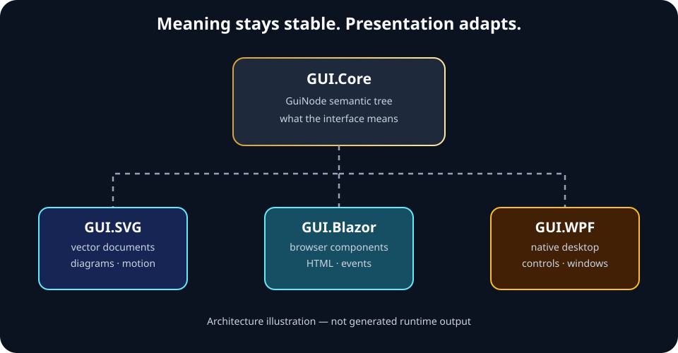

# TheSingularityWorkshop.GUI

[](https://github.com/TrentBest/TheSingularityWorkshop.GUI/actions)
[](https://opensource.org/licenses/MIT)
[](https://github.com/TrentBest/TheSingularityWorkshop.GUI/commits/master)

**A GUI should describe the experience—not become inseparable from the technology that displays it.**

An interface authored directly as WPF controls, browser markup, or another platform's widgets inherits that platform's assumptions at the point of creation. Reuse then becomes translation, duplication, or compromise.

TheSingularityWorkshop.GUI explores a different boundary: **author semantic intent once, then let an appropriate manifestation express it.**



## 01 — What: one semantic model, multiple manifestations

GUI.Core represents an interface as a recursive `GuiNode` tree. Nodes have a kind, identity, optional text or source, properties, and children. Fluent builders make that tree composable.

```csharp
using TheSingularityWorkshop.Workshop.Gui;

var settings = GuiBuilders.Column("settings")
    .Child(GuiBuilders.Text("title", "Settings"))
    .Child(GuiBuilders.Button("save", "Save"))
    .Child(GuiBuilders.Warning("status", "Changes are not saved yet."))
    .Build();
```

This builds semantic data. It does not create WPF controls, Blazor components, HTML, XAML, or a running interaction host.

## 02 — Why: protect meaning from platform mechanics

The separation is not an attempt to make every platform identical. It gives each concern a clear owner:

- **GUI.Core** owns the neutral semantic tree and builder vocabulary.
- **GUI.Blazor** manifests that model for browser-hosted interfaces.
- **GUI.WPF** manifests semantic trees and also offers a rich, deliberately WPF-specific native builder family.
- **GUI.SVG** explores standalone vector artifacts and living documentation.
- **FSM_COS** owns runtime composition; it does not need to own rendering.

A platform may offer capabilities another platform lacks. Those differences belong at the boundary—not hidden inside domain meaning. Typed properties, shared capability negotiation, portable interaction, and other larger contracts remain explicit future work; see the [implementation status](docs/IMPLEMENTATION_STATUS.md).

## 03 — How: follow the boundary

```text
domain experience / application
              |
              v
       GUI.Core semantic tree
              |
       +------+------+------+
       |             |      |
       v             v      v
    Blazor          WPF    SVG
    browser        desktop vector artifact
```

The tree is the shared *description*, not a promise that all manifestations already have feature parity. The adapters translate what is supported and must not quietly claim semantics they cannot implement.

**The package family**

| Project | Responsibility | Current reality |
|---|---|---|
| [GUI.Core](src/Core) | Semantic model, builders, Hub surface | Established core; see tests and status |
| [GUI.Blazor](src/Blazor) | Browser manifestation | Implemented, still partial |
| [GUI.WPF](src/WPF) | Windows manifestation and native builders | Substantial implementation; dedicated tests remain a gap |
| [GUI.SVG](src/SVG) | Standalone vector output | Early implementation; verification pending |

These packages are independently versioned. Check the [implementation status](docs/IMPLEMENTATION_STATUS.md) before relying on a capability or package version.

## 04 — See it in a minute

1. **Start with the experience:** [The Singularity Workshop](https://lemon-ground-09f542010.1.azurestaticapps.net/).
2. **Follow the integration:** [WebPage repository](https://github.com/TrentBest/WebPage) — the practical proving ground for consuming the GUI architecture.
3. **Understand the model:** [GUI Model](docs/GUI_MODEL.md).
4. **Inspect what exists today:** [Implementation Status](docs/IMPLEMENTATION_STATUS.md).
5. **Choose your next path:**
   - [Start Here](docs/START_HERE.md) — guided technical and theory tracks
   - [Architecture](docs/ARCHITECTURE.md) — ownership and dependency boundaries
   - [Platform Adapters](docs/PLATFORM_ADAPTERS.md) — how manifestations should behave
   - [WPF Guide](docs/WPF_GUIDE.md) — native desktop builders and semantic rendering
   - [SVG Guide](docs/SVG_GUIDE.md) — vector output and motion study
   - [Living Documentation](docs/LIVING_DOCUMENTATION.md) — visual documentation principles
   - [Testing](docs/TESTING.md) · [Roadmap](ROADMAP.md) · [Theory Guide](docs/THEORY_GUIDE.md)

The theory is intentionally more ambitious than the current runtime. Read the code and tests for executable behavior, the status document for current boundaries, and the roadmap for future contracts.

---

<p align="center">
  <a href="https://github.com/TrentBest/FSM_API">
    
  </a>
</p>

<p align="center">
  <em>The Singularity Workshop — Tools for the curious, the bold, and the systemically inclined.</em><br>
  <strong>Because state shouldn't be a mess.</strong>
</p>
