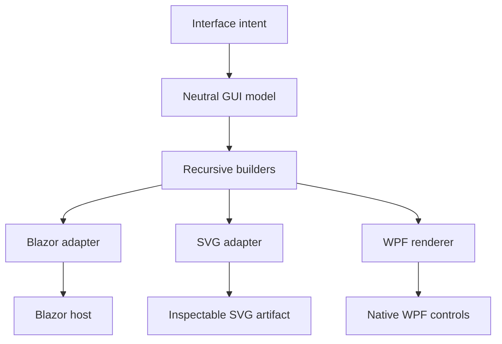
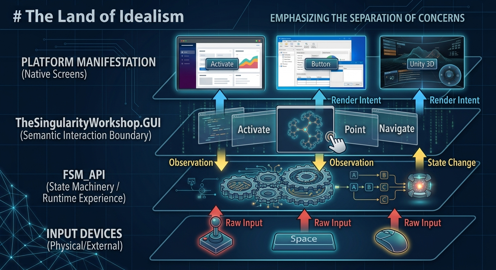
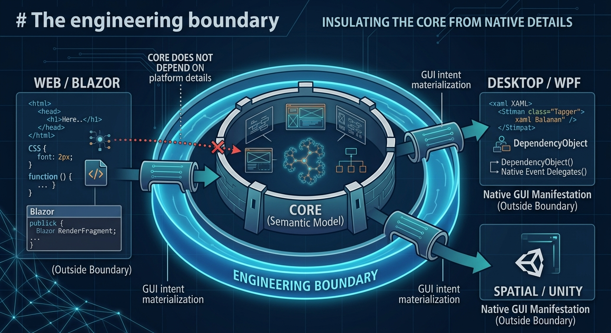
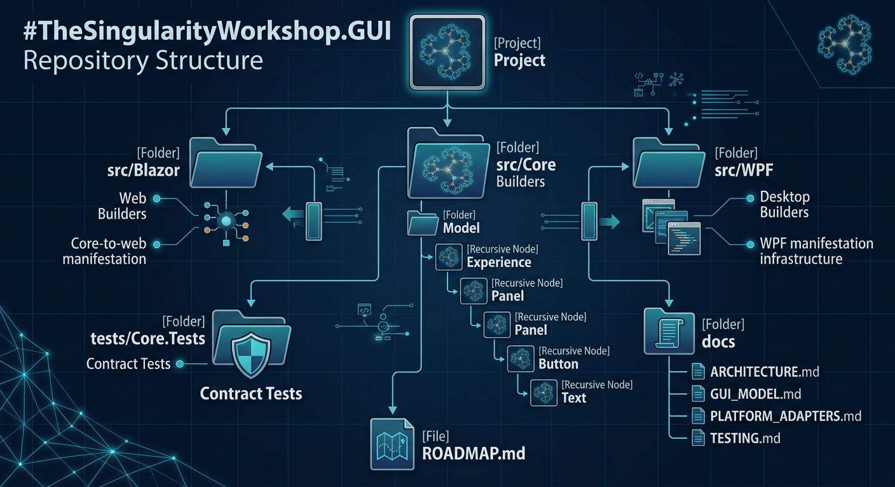

# TheSingularityWorkshop.GUI

> **A platform-neutral GUI engineering layer built around a recursive semantic model and platform adapters.**

GUI separates interface intent from the platform-specific work that presents it. Core owns the neutral model; each adapter owns its manifestation contract.

**New here?** [Come play: see what works, explore the idea, and find a first contribution](docs/COME_PLAY.md).



## 🟦 01 What

Core provides the neutral recursive model and builder contracts. Adapters translate that model into platform-specific output; consuming applications retain their own domain meaning and behavior.

## 🟣 02 Why

A neutral interface model lets one description of intent be manifested by different platform adapters. Without that boundary, application meaning becomes entangled with the widgets and APIs of whichever UI technology was chosen first.

## 🔺 03 How

Describe interface intent in the Core model, then pass it to an adapter. The current repository contains Blazor and WPF renderers plus an SVG manifestation adapter for supported scene nodes and coordinate-system scenes. Their contracts and coverage differ: the WPF renderer has focused Windows-native tests, while the shared conformance suite is intentionally narrow. SVG output is inspectable and may use declarative SVG animation; it is not a GUI-owned animation clock or a GPU pipeline.

## 🟢 04 See it in a minute

Start with the [Explore the GUI guide](docs/START_HERE.md), inspect the [generated SVG gallery](docs/assets/svg-adapter-gallery.svg), browse the [committed type inventory and source-derived UML](docs/uml/source-files/index.md), then build and run the tests for the adapter you intend to use.

## SVG demonstration samples

Browse the [Markdown-first SVG recipe gallery](samples/demonstrations/GALLERY.md), where each entry embeds its SVG preview, explains what it proves, identifies the packages actually consumed, and links to a deeper implementation walkthrough. The [scrollable card view](samples/demonstrations/index.html) is a convenience; the [demonstration index and evidence plan](samples/demonstrations/README.md) tracks the progressive proof ladder.

## 🟪 05 Documentation and theory

[Visual Gallery](docs/GALLERY.md) · [Start Here](docs/START_HERE.md) · [Architecture](docs/ARCHITECTURE.md) · [GUI Model](docs/GUI_MODEL.md) · [Platform Adapters](docs/PLATFORM_ADAPTERS.md) · [SVG Adapter](docs/SVG_ADAPTER.md) · [Source-derived UML](docs/SOURCE_DERIVED_UML.md) · [Generated Type Inventory](docs/uml/source-files/index.md) · [Living UML Architecture](docs/LIVING_UML_ARCHITECTURE.md) · [Per-Type Documentation and UML Standard](docs/CLASS_DOCUMENTATION_STANDARD.md) · [Branding Standard](docs/BRANDING.md) · [Testing](docs/TESTING.md) · [Roadmap](ROADMAP.md) · [Release Readiness](docs/RELEASE_READINESS.md) · [Theory Guide](docs/THEORY_GUIDE.md)

---

## Detailed guide



The visual above is a reference manifestation of the architectural idea: semantic interaction and runtime behavior remain distinct from platform-specific presentation.

The repository exists to separate GUI intent from GUI manifestation. It includes the neutral Core model, a Blazor renderer, an SVG manifestation adapter for its supported scene vocabulary, and reusable WPF builders with a tested initial Core-to-WPF renderer. Unity UI Toolkit remains a candidate future adapter, not a currently supported target.

## Repository structure

- `src/Core` — neutral recursive GUI model and platform-independent primitives.
- `src/Blazor` — Blazor renderer and Core-to-web manifestation.
- `src/WPF` — WPF renderer and WPF-specific identity bridge.
- `src/SVG` — SVG manifestation adapter for supported 2D scene nodes.
- `tests/Core.Tests` — platform-independent contract tests.
- `tests/Blazor.Tests` — Blazor render-tree contract tests.
- `tests/SVG.Tests` — SVG serialization and coordinate-mapping contract tests.
- `tests/WPF.Tests` — Windows-native WPF renderer tests.
- `tests/Adapter.Conformance.Tests` — initial shared semantic checks across adapters.
- `docs` — architecture, model, adapter, testing, theory, and release documentation.
- [`ROADMAP.md`](ROADMAP.md) — engineering work required to make the neutral model durable.
- [`docs/RELEASE_READINESS.md`](docs/RELEASE_READINESS.md) — explicit gates for the next package release.

## Evaluate the architecture

If you are skeptical that this abstraction is necessary, start with [START HERE — Explore the GUI](docs/START_HERE.md).

The documentation intentionally has two prongs:

1. **Technology** — what the repository implements, how the semantic model works, how adapters manifest it, how it is tested, and what remains unfinished.
2. **Theory** — why the boundaries exist, what engineering problems they address, and how the ideas can be used as textbook-ready material.

The code is the case study. The theory documents the argument. The engineering documentation describes the implementation.

### Technology

- [Architecture](docs/ARCHITECTURE.md)
- [GUI Model](docs/GUI_MODEL.md)
- [Platform Adapters](docs/PLATFORM_ADAPTERS.md)
- [Testing](docs/TESTING.md)
- [GUI Execution Model](docs/GUI_EXECUTION_MODEL.md)
- [GUI Spatial Domain](docs/GUI_SPATIAL_DOMAIN.md)
- [GUI Spatial Contracts](docs/GUI_SPATIAL_CONTRACTS.md)
- [GUI Visual Reference](docs/GUI_VISUAL_REFERENCE.md)
- [GUI Benchmarking](docs/GUI_BENCHMARKING.md)
- [Roadmap](ROADMAP.md)
- [Release Readiness](docs/RELEASE_READINESS.md)

### Theory

- [Theory Guide](docs/THEORY_GUIDE.md)
- [Textbook Map](docs/THEORY_TEXTBOOK_MAP.md)
- [Extrinsic Interface Layer](docs/THEORY/01_EXTRINSIC_INTERFACE_LAYER.md)
- [Breakwater Principle](docs/THEORY/02_BREAKWATER_PRINCIPLE.md)
- [Digital Shadow](docs/THEORY/03_DIGITAL_SHADOW.md)
- [Execution Boundary](docs/THEORY/04_EXECUTION_BOUNDARY.md)
- [Representational Compatibility](docs/THEORY/05_REPRESENTATIONAL_COMPATIBILITY.md)
- [Spatial Representation](docs/THEORY/06_SPATIAL_REPRESENTATION.md)

### Where the documentation appears in Visual Studio

The solution includes a dedicated `TheSingularityWorkshop.GUI.Documentation` project so Markdown files are real project items rather than relying on solution-folder discovery.

Expand:

```
TheSingularityWorkshop.GUI
└── TheSingularityWorkshop.GUI.Documentation
    ├── Solution Documentation
    ├── Documentation
    ├── Theory
    └── Reference Assets
```

For the fastest evaluation, open `Documentation / START_HERE.md`.

## The engineering boundary



The image is a visual companion to the breakwater idea: platform-specific details are allowed to be sophisticated, but they should cross the semantic boundary through an adapter rather than becoming Core dependencies.

The important abstraction is not a shared collection of buttons and panels. It is a semantic GUI model:

application intent → recursive GUI model → platform adapter → native manifestation

Core therefore must not depend on HTML, DOM, CSS, JavaScript, Blazor RenderFragment, WPF DependencyObject, XAML, Unity UI Toolkit types, or platform event delegates. Platform adapters own those details.

## Recursive builders

The model is intentionally recursive. A builder can contain children, and each child can itself contain children.

For example:

Experience → Panel → Panel → Button → Text

This permits small builders to compose larger interfaces without creating a single application-specific GUI builder.

## Neutrality is a contract

Neutral does not mean copying the lowest common denominator between platforms. A Core concept belongs in the model only when it has a defined, platform-independent meaning. Platform-specific details are translated by adapters.

See [Architecture](docs/ARCHITECTURE.md), [GUI Model](docs/GUI_MODEL.md), [Platform Adapters](docs/PLATFORM_ADAPTERS.md), and [Testing](docs/TESTING.md).

## Current integrations

The WebPage repository is the intended proving ground for the Blazor layer and the ten-minute evaluation path for this architecture.

The live Workshop is available at:

https://lemon-ground-09f542010.1.azurestaticapps.net/

The original migration issue [WebPage #52](https://github.com/TrentBest/WebPage/issues/52) was closed on 2026-09-29. The WebPage development project references `TheSingularityWorkshop.GUI.Blazor` v`0.1.0-alpha.8` in NuGet mode and can opt into repository-source mode. These are dependency-integration signals, not proof that the live production page is rendered through this adapter. Keep end-to-end integration marked unverified until the current WebPage development build and tests demonstrate reusable semantic GUI construction and Blazor manifestation through this path; the unchecked roadmap items remain the evidence checklist.

The WPF renderer is an initial, tested adapter path, not full parity with Blazor or SVG. See [Platform Adapters](docs/PLATFORM_ADAPTERS.md) for its tested surface and remaining gaps.

## Status

The repository is in active contract-design and implementation. Some adapter paths are implemented and tested, while broader semantic properties, capability negotiation, lifecycle, and cross-adapter parity remain open. Use the [roadmap](ROADMAP.md) and [release-readiness checklist](docs/RELEASE_READINESS.md) to distinguish demonstrated behavior from planned work.

## The Land of Idealism



The repository structure image is a conceptual map of how the semantic model, adapters, tests, and documentation fit together. It is not an exhaustive file listing.

The long-term design begins with a stronger premise than platform abstraction. The GUI is an **extrinsic interface layer**: an ephemeral observer and interaction boundary around a digital experience. It is not an intrinsic member of the experience's domain code.

An experience manifest identifies micro-bundles and configuration. It does not contain GUI implementation. The GUI observes the resulting runtime and manifests an appropriate representation.

```
experience manifest
    -> micro-bundles + configuration
    -> runtime experience
    -> GUI observation / interaction
    -> platform manifestation
```

The intended relationship with FSM_API is similarly separated:

- **FSM_API** provides behavior and state-transition machinery.
- **GUI** provides visualization and interaction representation.
- **Platform adapters** turn semantic GUI intent into platform-native manifestation.
- **Input devices** provide physical or external input to the interaction boundary.

## GUI is larger than widgets

GUI purpose is independent of GUI platform. The model must eventually support diagnostic, operational, informational, spatial, immersive, and expressive visualization. A GUI may represent a button, a floor plan, a state inspector, a 3D scene, an image, a mesh, animation, or deliberately unstructured visual output such as static/noise.

The goal is not to build a larger widget library. The goal is to build a semantic representation space expressive enough to describe digital visualization without making a particular device or rendering technology intrinsic to the domain.

This is also the foundation for VR: semantic interaction such as Activate, Select, Point, Navigate, or Rotate must not intrinsically mean mouse click, keyboard input, or any other particular physical device.

## Visual references

Concrete images are useful as **reference manifestations** of the semantic model.

The first reference is the Workshop map: a large spatial/operational interface combining navigation, a map/scene, destination indexing, textual information, and controls. It is intentionally treated as evidence of expressiveness rather than as a pixel-level Core contract.

The committed reference asset is:

`docs/assets/workshop-map-reference.jpg`

See [GUI Visual Reference](docs/GUI_VISUAL_REFERENCE.md) for the reference-artifact convention and the path from visual reference to semantic model to adapter manifestation.

See [Ideal GUI](docs/IDEAL_GUI.md), [GUI Taxonomy](docs/GUI_TAXONOMY.md), [Manifest Boundary](docs/MANIFEST_BOUNDARY.md), [GUI Expressiveness](docs/GUI_EXPRESSIVENESS.md), and [GUI Lifecycle](docs/GUI_LIFECYCLE.md) for the broader model.

---

<p align="center">
  <a href="https://github.com/TrentBest/WebPage" aria-label="Visit The Singularity Workshop">
    
  </a><br />
  <strong>The Singularity Workshop</strong><br />
  <em>Forging Software for the Singularity.</em><br />
  <a href="https://github.com/TrentBest">GitHub</a> · <a href="https://github.com/TrentBest/WebPage">Workshop</a>
</p>
