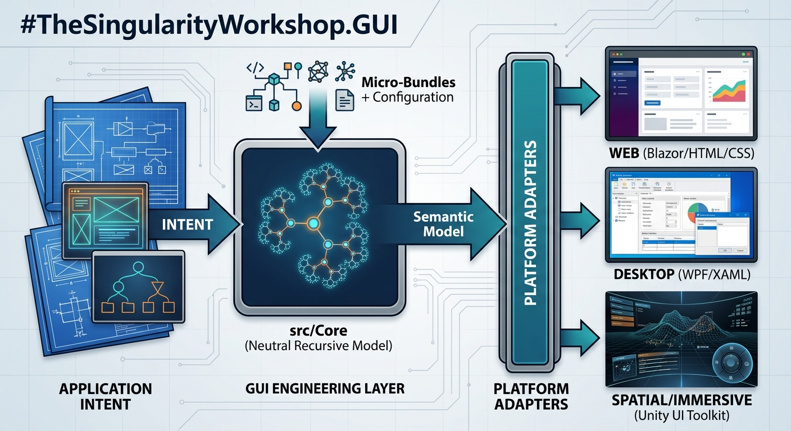

# GUI Visual Reference

The GUI project should preserve useful visual artifacts as **reference manifestations**, not as semantic contracts.

The current reference set covers four conceptual questions plus one living, generated manifestation. These artifacts have different evidentiary roles; a reference image illustrates an architectural question, while the SVG gallery is generated from runnable sample code and checked against a committed snapshot. Neither is, by itself, proof that every proposed semantic contract is implemented.

The conceptual references ask:

1. What is the ideal boundary?
2. How is that boundary protected from platform details?
3. How can one repository organize the semantic model, adapters, tests, and documentation around it?
4. What does a concrete spatial/operational manifestation look like?

## Reference set

### The Land of Idealism

This image illustrates the separation between physical/external input, FSM_API runtime behavior, the semantic GUI interaction boundary, and platform manifestations.

### The engineering boundary

This image emphasizes the breakwater around the semantic core. Web/Blazor, desktop/WPF, and spatial/Unity are shown as manifestations outside the protected semantic boundary.

### Workshop map

The Workshop map is the concrete visual companion for the spatial-domain work: it combines a scene, navigation, indexed destinations, text, and operational controls. It provides a useful starting point for asking how a semantic GUI can describe a spatial surface without becoming tied to one renderer.

It belongs with [GUI Spatial Domain](GUI_SPATIAL_DOMAIN.md) and [Spatial Representation](THEORY/06_SPATIAL_REPRESENTATION.md).

### Repository structure

This image is a conceptual repository map. It is intentionally not an exhaustive file listing.

## Living manifestation: GUI.SVG gallery

[Open the SVG gallery source](assets/svg-adapter-gallery.svg) · [Read the GUI.SVG adapter contract](SVG_ADAPTER.md)

Unlike the reference images above, this artifact is an actual SVG document produced for the GUI.SVG adapter gallery. Open it in a browser to observe declarative motion: the marker pulses and a scout travels along a path. The scene also demonstrates vector geometry, gradients, reusable symbols, patterns, clipping, filters, and semantic document metadata in one inspectable artifact.

This is a **living picture, not a screenshot of a hypothetical interface**. Its animation is native SVG behavior; it does not imply that GUI.SVG owns a clock, that Visualize is submitting GPU work, or that AnyApp's current WPF proof is GPU-rendered. Those are separate runtime and backend responsibilities.

The progression is intentional:

1. **Reference images** communicate the architectural question.
2. **The SVG gallery** makes a real, inspectable manifestation move.
3. **The adapter contract and tests** establish what is implemented and what behavior is verified.

A future gallery improvement should prefer examples generated from the same semantic inputs used by tests, so the living documentation can serve as an implementation witness rather than drift into decorative illustration.

## Asset convention

Generated filenames are renamed to semantic names when they enter the repository:

- ideal-gui-separation-of-concerns.jpg
- gui-engineering-boundary.jpg
- repository-structure-overview.jpg
- workshop-map-reference.jpg
- svg-adapter-gallery.svg — generated living SVG output; maintained as a reviewed snapshot of `samples/SvgGallery/Program.cs`, not a generated JPG or a hand-authored conceptual illustration.

The filename should describe the role of the artifact, not the image generator. The SVG snapshot should be regenerated and reviewed with its source sample whenever the sample intentionally changes; the SVG adapter documentation describes the verification workflow.

## Why these images belong in the documentation

The images are not merely artwork.

They are **reference manifestations** of architectural ideas.

The important engineering question is not:

> How do we reproduce these pixels?

It is:

> Can the semantic GUI model describe the observable structure represented by the image, and can multiple adapters manifest that structure without changing its meaning?

That makes visual references useful as future golden/reference artifacts while keeping Core platform-neutral.

## Intended progression

1. Start from the visual problem.
2. Identify semantic elements independently of HTML/CSS/WPF/Unity/etc.
3. Express those semantics through Core.
4. Manifest the same semantic artifact through an adapter.
5. Compare the resulting manifestation against the reference where appropriate.

The image therefore becomes evidence for expressiveness, not an implementation dependency.
