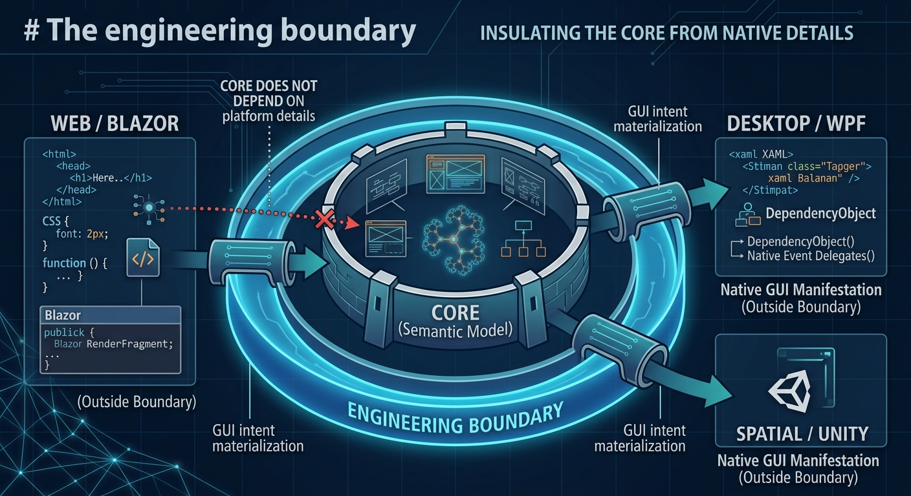

# Platform Adapter Guide

*Platform adapters are the controlled passage from semantic GUI intent to native manifestation.*

A platform adapter consumes the neutral GUI model and materializes it for a target UI technology. That definition has an important consequence: **a platform-specific builder library is not automatically an adapter for `GuiNode`.** The model-to-platform bridge must exist in code and have tests.

## Current implementation status

| Path | Current evidence | Boundary |
| --- | --- | --- |
| Core → Blazor | `BlazorGuiRenderer` consumes `GuiNode`; render-tree tests cover hierarchy, commands, typed text/select/toggle controls, and host-delegated `Viewport` nodes. | Typed controls dispatch values only through an explicit host dispatcher; without one they render read-only/disabled. `RenderWithHostedSurface` delegates the visual child to the host; scene state, Renderer policy, GPU execution, and lifecycle remain host/Visualize responsibilities. Broader semantic parity remains open. |
| Core → SVG | `SvgGuiRenderer` consumes `GuiNode`; tests cover scene serialization and static previews of typed text/select/toggle controls. | SVG controls are accessible visual snapshots, not interactive forms or a GUI event lifecycle. |
| Core → WPF | `WpfGuiRenderer` consumes `GuiNode`; Windows tests cover hierarchy/order, identity/text, supported layout/color properties, and typed text/select/toggle controls. | Value changes route to a supplied host dispatcher; controls are read-only/disabled without one. Broader property, accessibility, and lifecycle coverage remains open. |
| Core → Markdown | `MarkdownBadgeRenderer` consumes ordered `BadgeSet` values and a `MarkdownDocumentTarget`; tests cover the SURPS descriptor fixture, nested document paths, links, alt text, and missing-asset diagnostics. | This is a document-presentation adapter, not a widget renderer or publisher. It resolves repository assets relative to the target Markdown file and uses only caller-supplied path inventories for existence diagnostics. |
| Unity UI Toolkit | No adapter implementation in this repository. | Candidate future target only. |

Treat these as distinct evidence levels. A project build establishes that the project compiles under that workflow; it does not establish semantic parity with another adapter or prove an end-to-end application integration.

## Typed value-control manifestation

`TextInputDefinition`, `SelectDefinition`, and `ToggleDefinition` are shared Core contracts. Blazor and WPF translate them into native text, selection, and boolean controls. Each change reports the stable command ID plus the new value (text, option ID, or boolean string) to a host-supplied dispatcher. This is a transport boundary only: the consuming host owns command allow-listing, validation, authorization, and domain-state updates. No renderer executes arbitrary code or binds reflection-based handlers.

When no value dispatcher is supplied, Blazor marks text input read-only and disables selection/toggle; WPF applies the corresponding read-only/disabled state. WPF's native TextBox has no built-in placeholder-text property, so the current adapter exposes the placeholder through Tag/ToolTip metadata; a theme-specific visible watermark remains future work. WPF validation text is exposed through automation help text. SVG shows the current value/selection/state for documentation and review, but cannot dispatch changes. These behaviors are intentionally not presented as complete cross-adapter interactive parity.

## Semantic document presentation

`BadgeDefinition` and `BadgeSet` are Core contracts, not Markdown constructs. The Markdown adapter maps each explicit asset reference to a Markdown image with accessible alt text and optional description, and may wrap that image in an optional repository-relative or HTTPS destination link. The set's order is preserved.

`MarkdownDocumentTarget` is mandatory because the same badge composition can be inserted into `README.md`, `docs/books/dungeons-and-underground.md`, or a deeply nested chapter. Relative asset paths are computed from that target's directory. If the host supplies a repository path inventory, missing repository assets produce a `MISSING_ASSET` diagnostic and a readable text fallback; the adapter does not access the filesystem itself.

The first acceptance fixture mirrors SURPS's `dungeons-and-underground.book.json` descriptor: its LOD 1 badge and cover are separate semantic roles and remain separate assets. SURPS owns the descriptor schema and mapping policy; GUI owns the composable badge contract; GUI.Markdown owns serialization and path resolution. Publication and deployment remain with the consuming repository's workflow.

## Adapter responsibilities

An adapter should:

1. consume Core types;
2. map known semantic node kinds;
3. translate supported properties intentionally;
4. preserve child order;
5. report or handle unsupported capabilities explicitly;
6. own platform resources and event lifetimes;
7. avoid changing domain meaning.

## Do not use blind property passthrough

A renderer should not assume that every Core property is a native attribute.

For example, a future Core property named `layout.horizontalAlignment` should be translated by each adapter according to its own platform rules. It should not become an HTML attribute merely because HTML permits arbitrary attributes.

The current Blazor renderer contains a deliberately simple compatibility implementation. It forwards node properties as render attributes and maps a small set of known kinds to HTML tags. This is useful prototype behavior, not the final cross-platform contract.

That difference is observable today: a `data-note` property is forwarded by Blazor, while the SVG renderer ignores it unless it is part of the SVG node-specific property mapping or the explicit presentation/accessibility attribute allowlist. Common names such as `class` and `fill` are supported in both paths, but that does **not** mean the property dictionaries have shared semantics. The shared conformance test records this current adapter-specific behavior as evidence, not as a finalized parity requirement.

| Model field | Blazor prototype | SVG renderer |
| --- | --- | --- |
| `Id` | Emits semantic HTML `id`; property keys equal to `id` case-insensitively are ignored. | Emits semantic SVG `id`; generic property passthrough is not used. |
| `Source` | Emits `src` on the mapped HTML element, regardless of node kind. | Used as an `svg-image` `href` fallback; other kinds do not automatically receive it. |
| `Text` | Emits text content inside the HTML element. | Used according to SVG node kind; an unknown kind places it in a `title`, not visible widget text. |
| `Properties` | Forwards entries as render attributes, except the reserved identity key. | Maps only recognized node-specific properties plus the presentation/accessibility allowlist. Unknown properties may be omitted. |
| `Children` | Emits children in model order. | Emits children in model order, subject to the SVG vocabulary and fallback behavior. |

This table describes implementation, not a recommendation to preserve every behavior forever. The next contract step is to define which properties are semantic Core concepts, which are target-specific extensions, and how unsupported properties should be reported. Do not infer that arbitrary HTML attributes, SVG scene attributes, or interactive event wiring are portable Core capabilities.

Its recursive render-tree builder uses source-stable sequence numbers: each invocation of the renderer method starts at the same local sequence positions instead of carrying a global counter through the tree. Optional source/text fields and property/child loops must not shift later sequence positions as runtime data changes; the property loop therefore uses one stable sequence position for each emitted property. Blazor conformance tests pin the recursive element positions and verify that source, multiple properties, and text retain their expected positions. Sequence numbers guide framework diffing; they are not node IDs or a runtime count. This still does not prove complete interactive diff correctness for arbitrary tree mutations.

The SVG renderer has a separate explicit SVG scene vocabulary. It can serialize SVG-specific nodes and coordinate-system scenes, but a generic Core tree is not automatically equivalent to an interactive widget tree merely because it can be serialized as SVG.

For experience-owned visual scenes, `RenderWithHostedSurface` recognizes semantic `Viewport` nodes and asks the host for a `RenderFragment`. It supplies a stable, accessible region wrapper and preserves the ordinary GUI tree around the delegated surface. This is an integration seam, not a Visualize dependency or a graphics implementation; see [Visualize and Renderer: hosted viewport boundary](integrations/VISUALIZE_HOSTED_VIEWPORT.md) for the exact contract and remaining work.

## Capability differences

Platforms are not identical.

An adapter may support more capabilities than another adapter. The correct response is not to contaminate Core with platform-specific APIs.

Instead, capabilities should eventually be:

- declared;
- negotiated;
- degraded predictably; or
- rejected with a useful diagnostic.

## Testing adapters

Adapter tests should have two levels:

### Contract tests

Verify that the same Core tree produces the required semantic result. Shared conformance cases should check only explicit invariants—such as stable identity, child order, text preservation, and hierarchy—not equality of native element types.

### Platform tests

Verify native behavior that cannot be represented by Core alone, including framework lifecycle, event wiring, resource ownership, accessibility integration, and native layout.

Blazor and SVG have adapter-specific suites, and the shared conformance project runs the same small semantic tree through both adapters to compare identity, child ordering, and text preservation. That shared suite is intentionally narrow: it does not establish general widget parity or cover every node kind. It verifies that both renderers preserve `GuiNode.Id` when a properties dictionary also contains an `id` entry, reject duplicate node IDs within a rendered tree, and reject trees deeper than 256 edges from the root. Core construction itself remains permissive; identity uniqueness and this rendering depth guard are adapter-boundary rules. Blazor's generic property forwarding skips the reserved `id` key case-insensitively so casing variants cannot add a conflicting identity attribute.

The WPF test suite runs on `windows-latest`, because its controls and renderer require WPF. It covers a representative nested tree and child order, supported dimensions/spacing/colors/typography/alignment, null-root rejection, unknown-kind fallback, duplicate-ID rejection, and the 256-edge depth guard. WPF assigns `GuiNode.Id` to native `FrameworkElement.Name` only when the value is a legal WPF name. To preserve the model identity without imposing WPF constraints on Core or consuming `FrameworkElement.Tag`, the adapter also stores the exact ID in the WPF-specific attached property `WpfGuiIdentity.NodeIdProperty`, readable through `WpfGuiIdentity.GetNodeId(element)`. Thus IDs such as `widget:save/primary` remain available even though the native `Name` is empty. This is an adapter-specific bridge, not a new Core dependency or a promise that WPF name-based lookup can use arbitrary IDs. Broader property mappings, interaction/event behavior, accessibility, and resource lifecycle remain open. Do not treat the current suite as full cross-adapter conformance.

This keeps platform behavior testable without making the Core model platform-aware.
