# GUI.SVG Guide

> **Status:** early implementation, with a verified baseline. The latest package workflow for the current `master` head completed successfully, including the SVG tests and package/gallery checks. See [GitHub Actions](https://github.com/TrentBest/TheSingularityWorkshop.GUI/actions) for current runs; treat this guide as a snapshot, not a substitute for the tests.


GUI.SVG is a sibling manifestation beside GUI.Blazor and GUI.WPF. GUI.Core describes the interface; SVG turns a semantic tree into a standalone vector document. That makes SVG useful for portable artifacts, diagrams, generated documentation, previews, and visual experiments—without pretending an SVG file is an interactive application.

## First render

```csharp
using TheSingularityWorkshop.GUI.SVG;
using TheSingularityWorkshop.Workshop.Gui;

var view = GuiBuilders.Column("settings")
    .Child(GuiBuilders.Text("title", "Settings"))
    .Child(GuiBuilders.Button("save", "Save"))
    .Child(GuiBuilders.Warning("status", "Changes are not saved yet."))
    .Build();

var svg = new SvgGuiRenderer().Render(view, new SvgRenderOptions
{
    Title = "Settings interface",
    Description = "A title, a save button, and a status warning.",
    Width = 800,
    Height = 400,
    Background = "#101827"
});
```

The result is an SVG string. The semantic tree remains a Core object; rendering does not mutate it or create a GUI event loop.

## Current renderer coverage

The serializer has explicit basic representations for all 14 canonical kinds in `GuiKinds`:

| Core kind | Current SVG treatment |
|---|---|
| `Text` | Text label |
| `Button` | Button-like visual; not interactive |
| `Warning` | Warning panel |
| `Separator` | Horizontal rule |
| `Panel`, `Stack`, `Row`, `Column`, `Object` | Labeled container outline |
| `TextBox` | Input-like visual; not editable |
| `IntegerSlider`, `FloatSlider` | Slider-like visual; not interactive |
| `Toggle` | On/off visual based on the current property value |
| `Image` | Placeholder panel; source image is not yet embedded or loaded |
| Unknown kind | Neutral fallback representation |

These are visual representations, not a claim of semantic or behavioral parity with Blazor or WPF. In particular, a slider is not a slider control, a button does not dispatch events, and the image node does not yet render its source.

## What the renderer guarantees—and does not

Current implementation includes:

- standalone SVG markup returned as a string;
- configurable positive width and height;
- optional accessible document title and description;
- optional validated background color;
- XML text/attribute escaping;
- a nesting-depth guard;
- recursive placement for most containers;
- horizontal placement for direct children of `Row` and `Stack` nodes when a Stack's `orientation` property is `Horizontal`;
- row/container outline estimates based on child advances, with horizontal containers sized from their tallest child.

Still to be designed or proven:

- a shared layout contract for row, column, stack, sizing, spacing, and constraints;
- typed style and theme tokens;
- real image/media loading and safe resource policy;
- explicit semantic accessibility mappings for every node;
- event and state contracts owned by a host;
- animation/transition intent in the semantic model;
- cross-adapter conformance tests.

The current renderer uses a deliberately small layout model: most containers place children vertically; `Row` lays out direct children side by side; and a `Stack` does so when its `orientation` property is `Horizontal`. Horizontal children share a starting vertical coordinate, and the container outline is estimated from the tallest child. Dense rows divide available width among children, so this is not responsive sizing. Container heights are structural estimates—not font-metric measurement or a shared Core layout contract. These are explicit early boundaries, not browser/CSS layout semantics.

## Living motion example



[Open the animated energy-field SVG](examples/living-energy-vortex.svg). The study explores alternating gold/blue pulses, a slowly rotating orbital field, a breathing focal point, and a reduced-motion fallback.

This is hand-authored illustrative SVG—not output from `SvgGuiRenderer`, not a physical light simulation, and not yet driven by GUI node state. It demonstrates why SVG is worth developing beyond static screenshot generation.

## Next steps toward a serious manifestation

1. **Layout contract:** define shared Core intent for row/column/stack orientation, sizing, spacing, and constraints without accidentally inheriting browser/CSS semantics.
2. **Resources:** implement a deliberate image policy, including whether the output references a URI or embeds data.
3. **Style:** define safe, typed style tokens and consistent defaults instead of accepting arbitrary renderer-specific strings.
4. **Conformance:** share test cases across Blazor, WPF, and SVG where semantics overlap, while testing native capabilities separately.
5. **Living documentation:** connect visual examples to the source and tests that generate them; keep illustrative motion distinct from runtime output.

Related: [Start Here](START_HERE.md) · [GUI Model](GUI_MODEL.md) · [Architecture](ARCHITECTURE.md) · [Implementation Status](IMPLEMENTATION_STATUS.md) · [Testing](TESTING.md) · [Living Documentation](LIVING_DOCUMENTATION.md)
