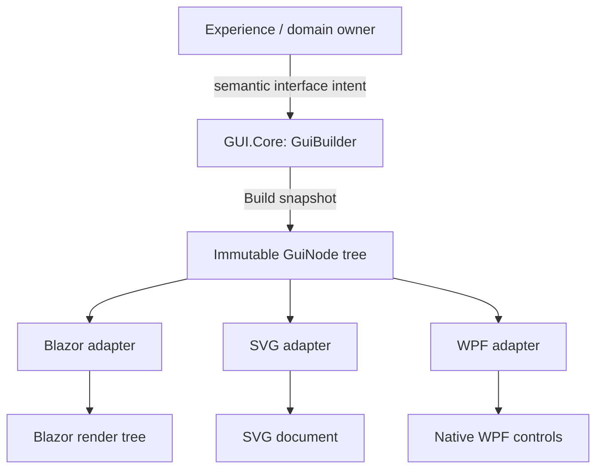

<!-- The Singularity Workshop animated moniker -->
<p align="center"><a href="https://github.com/TrentBest"></a></p>

# Semantic Presentation and Composition

## 1. The motivating problem: one intention, many arrangements

Imagine describing a workbench to another person. You do not begin by naming the brand of monitor, the operating system, or the material of every button. You first describe the arrangement and purpose: a place for the current task, a set of actions, a status display, and perhaps a nested area for related tools.

A graphical interface has a similar problem. An application needs to describe *what belongs in the interface and how those parts relate* before a particular platform decides how to display them.

Without a semantic boundary, the application can become entangled with the first toolkit used to build it. A button becomes a WPF Button, a Blazor element, or an SVG node too early. Replacing the presentation technology then becomes a migration of application meaning.

The GUI repository explores the alternative: describe interface intent in a neutral model, compose that model, and let an adapter manifest it.

The workbench analogy has a limit. A GUI tree is not a physical layout drawing and does not guarantee identical dimensions, behavior, or appearance on every platform. It records selected semantic structure; adapters still have their own capabilities and rules.

## 2. Concepts and vocabulary

The following terms describe different responsibilities. They should not be treated as synonyms.

| Term | Meaning |
|---|---|
| **Subject** | The experience, data, or system that an interface represents. Its domain identity belongs to its owning system. |
| **Semantic GUI node** | A platform-neutral description of one interface element: its kind, identity, optional text/source, properties, and children. |
| **GUI tree** | An ordered recursive composition of semantic GUI nodes. |
| **Builder** | A construction API used to compose a tree before producing its immutable node snapshot. |
| **Adapter** | A platform-specific component that translates the semantic tree into a supported manifestation. |
| **Manifestation** | The concrete output produced by an adapter, such as native WPF controls, a Blazor render tree, or SVG markup. |
| **Command identity** | A stable identifier naming an intended operation. It is not the operation itself and does not grant authority to execute it. |
| **Observation / view / viewport** | Concepts for selecting and presenting some portion or aspect of a subject. These are part of the spatial design vocabulary, not implemented by the current Core tree. |

A node's identity, its position in a tree, its text, and the operation named by a command property are separate facts. Moving a node in a composition should not silently redefine the subject it represents. Likewise, the string `onClickCommand` is a command reference, not a callback or permission token.

## 3. Theory: composition is semantic before it is visual

A semantic GUI tree answers questions such as:

- What interface element is this?
- What is its stable identifier?
- What text or resource reference is associated with it?
- Which properties are declared?
- Which children does it contain, and in what order?

It does not, by itself, answer every question a renderer or application might ask. It does not own domain state, decide whether an operation is authorized, define a graphics pipeline, or guarantee that every adapter supports every node kind or property.

The composition model can be summarized as:

```text
application / experience
        |
        | supplies meaning and intended interface
        v
semantic GUI composition
  - node kind and identity
  - text and source
  - string-valued properties
  - ordered child nodes
        |
        | immutable model
        v
platform adapter
  - validates supported behavior
  - maps semantic intent
  - applies platform-specific rules
        |
        v
native or serialized manifestation
```

The central invariant is separation of meaning from mechanism. Core describes the semantic tree; an adapter owns the details of its target platform. That does not require adapters to produce pixel-identical results. It requires each adapter to preserve the portions of meaning that its contract claims to preserve, and to make unsupported behavior visible rather than silently inventing equivalence.

### Composition is not observation

Composition describes how interface elements are organized. Observation describes which part, detail, or aspect of a subject is being viewed.

A panel may contain a view, but a panel is not itself a camera. A viewport is not a subject. A camera is not a WPF or graphics-engine object in the neutral theory; it is a proposed semantic description of controlled observation.

The intended spatial relationship is:

```text
subject
  |
  v
semantic observation (view / camera)
  |
  v
viewport
  |
  v
semantic presentation composition
  |
  v
platform adapter
```

This distinction matters for multiple views. One subject may be observed in several ways, and those observations may be composed into one interface. Changing a camera should not change subject identity; moving a panel should not change the observation's meaning.

**Current status:** the repository has a specified spatial vocabulary and coordinate primitives, but it does not yet implement semantic camera, view, viewport, projection, hit-testing, multi-view synchronization, or level-of-detail contracts. Those remain design work tracked in [GUI Spatial Contracts](../GUI_SPATIAL_CONTRACTS.md) and [issue #6](https://github.com/TrentBest/TheSingularityWorkshop.GUI/issues/6).

### The role of identity and order

A node identifier supports lookup and adapter identity mapping. The current Core model does not enforce document-wide uniqueness. Its lookup returns the first match in depth-first, left-to-right traversal. Some adapters reject duplicate identifiers because their output formats require unique IDs. Therefore, uniqueness is an adapter constraint today, not a universal invariant enforced by `GuiNode`.

Child order is part of the tree. An adapter may use a different native control structure, but it should not reorder children when its documented contract promises order preservation.

### Immutability is a snapshot boundary, not live binding

Building a `GuiNode` produces a snapshot of the builder's current state. Later changes to the builder do not mutate the already-built node. The node also snapshots its property dictionary and child sequence.

This gives consumers a stable value to inspect and pass to an adapter. It does not provide reactive data binding, subscriptions, automatic refresh, or a lifecycle manager. A host that needs a changing interface must decide when and how to construct or render a new snapshot.

## 4. Model and living visual

The following is a conceptual model of the current responsibility boundary, not a captured runtime screenshot:



The tree is the shared semantic input. The outputs are different manifestations. A shared input is not evidence of complete adapter parity; only explicitly tested properties and supported mappings may be claimed.

## 5. Implementation mapping

The following mapping was source-checked against `development` at revision [`064ea84a24bbf3fd045882de3a95ac893989a936`](https://github.com/TrentBest/TheSingularityWorkshop.GUI/commit/064ea84a24bbf3fd045882de3a95ac893989a936).

| Concept | Implementation | Observed contract |
|---|---|---|
| Semantic node | [`GuiNode`](../../src/Core/GuiNode.cs) | Stores kind, ID, optional text/source, read-only property snapshot, and ordered child snapshot. |
| Composition | [`GuiBuilder`](../../src/Core/GuiBuilder.cs) | Fluent recursive construction; `Build()` creates an immutable tree and rejects direct or indirect builder cycles. |
| Common factories | [`GuiBuilders`](../../src/Core/GuiBuilders.cs) | Provides semantic factories for Panel, Column, Text, Button, and Warning. |
| Command identity | [`GuiBuilder.WithOnClick`](../../src/Core/GuiBuilder.cs) | Stores a host-neutral `onClickCommand` identifier; it does not execute the command. |
| Coordinate primitive | [`CoordinateSystem`](../../src/Core/CoordinateSystem.cs) | Stores configurable minimum/maximum/origin values and validates supplied coordinate values for finiteness and range; it does not validate the configuration as a whole or implement a transform or camera system. |
| Blazor manifestation | [`BlazorGuiRenderer`](../../src/Blazor/BlazorGuiRenderer.cs) | Maps supported nodes into a Blazor render tree. |
| SVG manifestation | [`SvgGuiRenderer`](../../src/SVG/SvgGuiRenderer.cs) | Serializes supported semantic nodes into SVG markup. |
| WPF manifestation | [`WpfGuiRenderer`](../../src/WPF/WpfGuiRenderer.cs) | Maps supported nodes into native WPF elements. |

The model and adapters have different evidence surfaces. [Core builder tests](../../tests/Core.Tests/GuiBuilderTests.cs) cover recursive construction, snapshots, lookup, child order, command identity, and cycle rejection. [Shared adapter conformance tests](../../tests/Adapter.Conformance.Tests/SharedAdapterConformanceTests.cs) currently compare selected identity, child-order, and text behavior between Blazor and SVG. [WPF renderer tests](../../tests/WPF.Tests/WpfGuiRendererConformanceTests.cs) independently cover nested hierarchy, identity, text, row layout, enabled presentation state, and host-supplied command dispatch. These tests do not establish broad pixel parity or universal behavior across every node/property.

## 6. Worked example: describe an action panel

The following example builds a small semantic tree. It is source-checked against the current Core builder API; it is not a claim that all three adapters render every possible property identically.

```csharp
using TheSingularityWorkshop.Workshop.Gui;

var panel = GuiBuilders.Panel("workbench")
    .Text("Family workbench")
    .Child(
        GuiBuilders.Column("actions")
            .Child(
                GuiBuilders.Button("load-family", "Load family")
                    .WithOnClick("families.load"))
            .Child(
                GuiBuilders.Text("status", "Ready")))
    .Build();

var action = panel.Find("load-family");
var commandId = action.Properties["onClickCommand"];
```

The steps are:

1. `GuiBuilders.Panel` creates the root builder.
2. `Child` composes a column and then its button and status text.
3. `WithOnClick` records the command identity `families.load`.
4. `Build` creates an immutable `GuiNode` snapshot.
5. `Find` locates the first node with the requested identifier.
6. A host may pass the tree to an adapter and separately decide whether the command is authorized and how it is dispatched.

The last step is deliberately outside Core. The semantic tree can name an action, but the host owns the command map, authorization, execution, and error handling.

## 7. Evidence, limitations, and counterexamples

### What the current evidence supports

- Core source defines an immutable recursive node model and fluent builder.
- Core tests cover snapshot behavior, ordered composition, depth-safe lookup, and cycle rejection.
- The shared adapter fixture verifies selected semantic properties across Blazor and SVG.
- WPF has its own native tests for a related semantic surface and host-supplied command dispatch.
- The current coordinate primitive validates supplied values against its configured minimum/maximum range; it does not validate the configuration as a whole or perform a general world/local/view/viewport transformation chain.

### What it does not support

- It does not prove complete semantic parity across Blazor, SVG, and WPF.
- It does not prove pixel-level or layout-level equivalence.
- It does not implement a live observer, camera, viewport, projection, occlusion, hit testing, or level of detail.
- It does not provide a reactive view model, data-binding engine, application execution host, or domain authorization system.
- It does not establish that arbitrary node kinds or string properties are meaningful to every adapter.
- It does not make SVG output a live GUI or a GPU-rendered scene.

A framework-specific interface may be the better choice when an application depends heavily on platform-specific controls or behavior and does not need a neutral representation. The semantic model is useful when the separation enables reuse, inspection, multiple manifestations, or a stable interface contract. It is not an abstraction that must be imposed on every application.

### How the proposition can be challenged

A practical test is to describe one small interface tree once, render it through two adapters, and compare only declared invariants: identity, child order, text, and any explicitly shared properties. Then add a platform-specific feature and observe whether it can remain adapter-owned or whether the neutral model needs a carefully defined semantic extension. If the model must accumulate platform-specific callbacks or framework types to make the example work, the boundary is weakening.

The current source and tests provide focused evidence for the narrower composition claim. The theory remains broader than the implementation, and every proposed extension needs its own typed contract, tests, and consumer evidence.

## 8. Audit of related semantic and observer contracts

This chapter was created after reviewing the existing open design issues rather than treating the GUI tree as the entire GUI domain. The audit below records the boundary questions that must be resolved before a larger observer API is proposed.

| Existing issue | Domain question | Current evidence and status | Consequence for this chapter |
|---|---|---|---|
| [#6 — Semantic observer, camera, and LOD](https://github.com/TrentBest/TheSingularityWorkshop.GUI/issues/6) | How does a subject acquire one or more independent observations, views, viewports, and detail requests? | `docs/GUI_SPATIAL_CONTRACTS.md` specifies vocabulary and scenarios, but marks camera, projection, visibility, hit-testing, synchronization, and LOD as proposed. Core currently has coordinate primitives, not an observer/view API. | Do not describe camera, viewport, or LOD as implemented. A future contract needs stable subject/observer identity and explicit multi-view relationships before adapter behavior is designed. |
| [#7 — Datum ↔ human boundary](https://github.com/TrentBest/TheSingularityWorkshop.GUI/issues/7) | How can a human-facing representation refer to domain data without GUI taking ownership of that data? | The domain owner remains authoritative for datum and experience state. GUI composes a representation and can name an intended command; the current command identifier is not a mutation, authorization, or execution receipt. | Keep subject identity and state outside the GUI tree. A user edit must become a semantic request to the owning host/domain, not a mutation of GUI-owned shadow state. |
| [#58 — Semantic input bridge](https://github.com/TrentBest/TheSingularityWorkshop.GUI/issues/58) | Where do physical signals become reusable semantic intents? | The issue explicitly keeps FSM_UserIO and device-specific input out of GUI.Core pending a separate contract decision. Current WPF command dispatch is host-supplied; the neutral tree does not own physical input. | Keep physical input, device mapping, and ProtocolAi identity/execution concerns outside this chapter's Core model. The GUI boundary may expose intent targets, but must not become an input-device package. |
| [#52 — Interactive Experience presentation](https://github.com/TrentBest/TheSingularityWorkshop.GUI/issues/52) | What is the GUI contract for presenting a complete interactive Experience? | The issue is open. Experience rules/state remain with the Experience; GUI, Renderer, and Visualize are separate presentation responsibilities. | A semantic tree is one presentation artifact, not proof of a complete interactive Experience contract. Lifecycle, state refresh, input routing, and cross-presentation responsibilities need explicit evidence. |
| [#42 — Renderer-neutral charting](https://github.com/TrentBest/TheSingularityWorkshop.GUI/issues/42) | Are charts first-class semantic GUI content, and what does each adapter support? | The chart model and adapter capability matrix remain proposed; the issue calls for validation, accessible descriptions, nonvisual fallback, adapter evidence, and a real gallery example. | Do not imply that generic nodes or arbitrary string properties already constitute a chart contract. Chart semantics need a separately reviewed model and capability evidence. |

### Observer and level-of-detail ownership remains a cross-repository decision

The spatial issue correctly identifies a need to describe *what is being observed* independently of the platform camera or rendering implementation. However, the current GUI domain map assigns observer-facing representation and visibility decisions to Renderer, while GUI owns semantic interface composition and the human interaction boundary. Those statements are not yet a complete, jointly accepted contract.

A candidate separation to evaluate—not an implemented or accepted API—is:

- **Subject owner:** owns authoritative datum, identity, and domain state.
- **GUI:** composes the human-facing interface and carries stable references to the subject and declared interaction intent.
- **Renderer:** resolves observer-facing representation, visibility, and level-of-detail policy for the represented content.
- **Visualize / platform adapters:** produce the concrete visual manifestation using their supported capabilities.
- **Host:** routes user input and authorizes/executes requests against the subject owner.

Before introducing typed camera, view, viewport, or LOD members into Core, reconcile this candidate with [Renderer's ownership](https://github.com/TrentBest/TheSingularityWorkshop.Renderer) and the existing [spatial contract inventory](../GUI_SPATIAL_CONTRACTS.md). In particular, decide whether GUI carries only a semantic observation request, whether Renderer owns the resolved view/visibility state, and how a view remains stable when its subject or representation changes.

This audit is intentionally a design boundary, not a proposal to add a large rendering engine or a new package. The related issues remain open and should not be marked complete merely because this chapter documents their current status.

## 9. Practice and assessment

1. Predict the result of calling `Find("status")` when two nodes share that ID. Then inspect the Core lookup contract and explain why duplicate IDs can be ambiguous.
2. Build a tree, call `Build()`, mutate the original builder, and explain why the first node remains unchanged.
3. Add a command identity to a button. Identify which component must decide whether that command may run and why the identifier itself is not authorization.
4. Compare the shared Blazor/SVG fixture with the separate WPF tests. List exactly which semantic properties are evidenced and which are not.
5. Propose a typed view/viewport contract without using WPF, Blazor, SVG, or graphics-engine types. State what evidence would be required before calling it implemented.
6. Give an example where a direct platform-specific UI is a better fit than a renderer-neutral tree.

## 10. Further reading

- [GUI Model](../GUI_MODEL.md) — the current neutral model and its boundaries.
- [Architecture](../ARCHITECTURE.md) — package ownership and dependency direction.
- [Platform Adapters](../PLATFORM_ADAPTERS.md) — adapter responsibilities and known differences.
- [Spatial Representation](06_SPATIAL_REPRESENTATION.md) — observation, views, viewports, and spatial composition.
- [GUI Spatial Contracts](../GUI_SPATIAL_CONTRACTS.md) — specified and proposed spatial contracts.
- [Testing Strategy](../TESTING.md) — what the current test lanes actually execute.
- [Issue #6](https://github.com/TrentBest/TheSingularityWorkshop.GUI/issues/6) — semantic observer, camera, and LOD work.
- [Issue #63](https://github.com/TrentBest/TheSingularityWorkshop.GUI/issues/63) — GUI theory learning path.

## 11. Instructor and editor notes

This chapter can be taught before the spatial-observation chapter. Ask learners to separate composition from observation before introducing cameras or viewports. A useful lab is to construct the same small tree, inspect its immutable snapshot, and compare the output of two adapters. Have learners record the exact properties compared rather than declaring the renderers equivalent.

For an advanced exercise, ask students to propose a typed observer contract and then identify which concepts belong in GUI.Core, which belong in a renderer, and which belong to the subject's domain. Keep the exercise explicitly proposed until an implementation and tests exist.

---

**Evidence label:** The implementation mapping is source-checked against the `development` revision linked above. The five CI workflows completed successfully on repository commit `e905103078f725f5bd3689b574e6ef48bcb4132a`, including [documentation quality](https://github.com/TrentBest/TheSingularityWorkshop.GUI/actions/runs/41721321819). These workflows verify their respective repository gates, not the runtime behavior of every claim in this chapter. The diagrams in this chapter are authored conceptual models, not captured runtime output.

<!-- THE SINGULARITY WORKSHOP FOOTER -->
<p align="center"></p>
