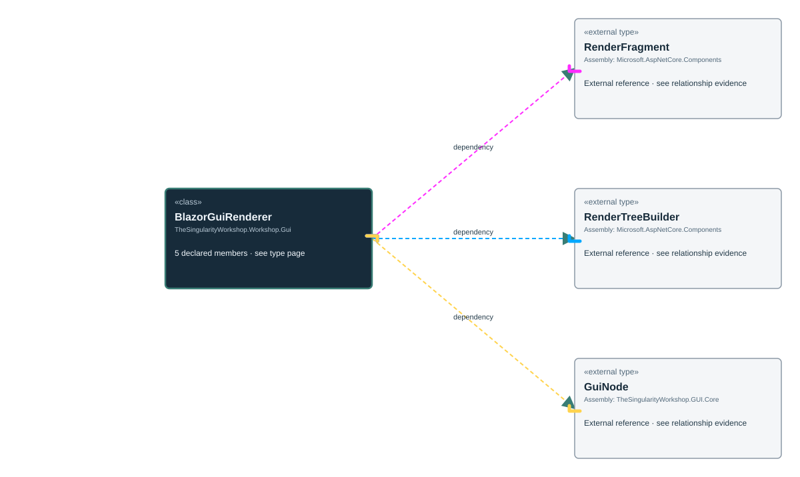

<!-- The Singularity Workshop moniker -->
<p align="center"><a href="https://github.com/TrentBest"></a></p>

# BlazorGuiRenderer

**Purpose.** `BlazorGuiRenderer` turns a Core `GuiNode` tree into a Blazor `RenderFragment`. It bridges the renderer-neutral semantic tree to Blazor's render-tree API; it is not a complete application host, state store, or navigation system.

## UML class card



See the [focused UML and use cases](../../uml/BlazorGuiRendererUML.md).

## Contract and behavior

- `Render(GuiNode node)` rejects a null root, validates the tree, and returns a fragment that renders the tree when Blazor executes it.
- Validation uses an explicit stack, rejects duplicate node IDs using ordinal comparison, and rejects trees deeper than 256 levels before rendering.
- The renderer writes each node's ID from `GuiNode.Id`. A property named `id` is ignored case-insensitively so a property cannot override node identity.
- A nonblank `Source` becomes `src`; properties are added as attributes; non-null text becomes content; children are rendered in order.
- Current tag mapping: `Panel` → `div`, `Button` → `button`, `Image` → `img`, `Text` → `span`, `Warning` → `aside`, and unknown kinds → `div`.
- Render-tree sequence numbers are fixed source positions rather than iteration indexes, so changing optional text, properties, or children does not shift later sequence positions.

## Example

The input is a Core `GuiNode` built by the supported Core model API; the fragment is consumed by a Blazor component:

```csharp
RenderFragment fragment = BlazorGuiRenderer.Render(node);
```

This creates the fragment. A Blazor component must actually render it for it to appear on a page.

## Failure boundaries

| Condition | Behavior |
|---|---|
| Null root | `ArgumentNullException` |
| Duplicate ID | `ArgumentException` |
| Depth greater than 256 | `InvalidOperationException` |
| Unrecognized kind | Rendered as a `div` |

This renderer is not an HTML sanitizer or browser security policy. The application remains responsible for deciding which properties, URL schemes, sources, and content may enter the model.

## Verification

See [Blazor renderer tests](../../../tests/Blazor.Tests/BlazorGuiRendererTests.cs), [Blazor conformance tests](../../../tests/Blazor.Tests/BlazorGuiRendererConformanceTests.cs), and the [package workflow](../../../.github/workflows/package.yml).

---

<!-- THE SINGULARITY WORKSHOP FOOTER -->
<p align="center"></p>
