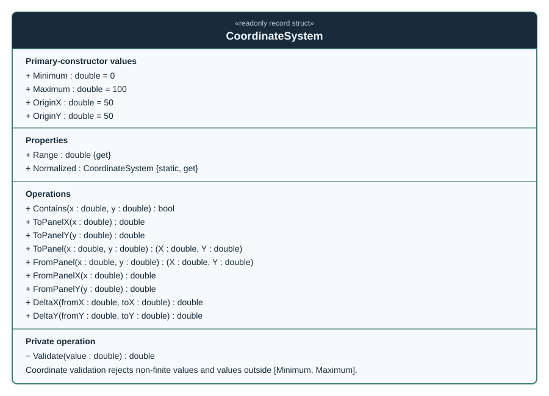

# CoordinateSystem

**Fully qualified name:** `TheSingularityWorkshop.Workshop.Gui.CoordinateSystem`  
**Kind:** readonly record struct  
**Assembly:** `TheSingularityWorkshop.GUI.Core`  
**Source:** [`CoordinateSystem.cs`](../../../src/Core/CoordinateSystem.cs)

## Responsibility

`CoordinateSystem` describes a normalized two-dimensional coordinate space using a shared inclusive numeric range and a declared origin. It provides validation and coordinate-pair helpers for renderer-neutral GUI descriptions. It is a value type and has no renderer dependency.

## UML class diagram

The diagram shows the primary-constructor values, computed properties, explicit operations, and private validation helper. The record struct's generated value semantics and positional members come from its primary declaration.

## Value contract

The primary-constructor defaults are `Minimum = 0`, `Maximum = 100`, `OriginX = 50`, and `OriginY = 50`. `Normalized` returns the conventional `(0, 100, 50, 50)` instance. `Range` is `Maximum - Minimum`.

The constructor does not validate the relationship between the configured bounds and origin. Consumers configuring non-default values should ensure the range is meaningful and the origin lies where intended.

## Operations and failure behavior

- `Contains(x, y)` returns true only when both coordinates are within the inclusive `Minimum` to `Maximum` range.
- `ToPanelX`, `ToPanelY`, `ToPanel`, `FromPanelX`, `FromPanelY`, and `FromPanel` validate coordinate values and return the supplied values; these methods do not rescale or invert axes.
- Coordinate validation throws `ArgumentOutOfRangeException` for NaN, infinities, or values outside the configured range.
- `DeltaX(fromX, toX)` and `DeltaY(fromY, toY)` return signed differences (`to - from`) without applying range validation.
- `FromPanel` is currently a validation/pass-through operation, not a conversion from pixels or device coordinates.

## Architectural boundary

`CoordinateSystem` defines numeric space semantics only. It does not render axes, transform pixels, own UI state, or depend on a UI framework. `CoordinateSystemGuiBuilder` projects a coordinate system into a semantic `GuiNode`; that builder's dedicated page is pending.

## Verification status

This page and its SVG were reviewed against [the source declaration](../../../src/Core/CoordinateSystem.cs). Automated inventory-to-source comparison and stale-SVG generation checks are not yet implemented, so the diagram is source-reviewed manual documentation rather than generated output.

## Related types

- `CoordinateSystemGuiBuilder` — semantic GUI projection; page pending.
- `CoordinateSystemUtilities` — normalization, clamping, and distance helpers; page pending.
- [Per-Type Documentation and UML Standard](../../CLASS_DOCUMENTATION_STANDARD.md)
