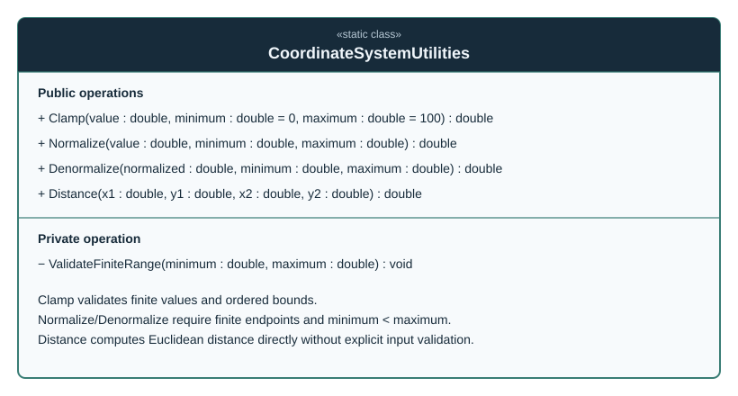

# CoordinateSystemUtilities

**Fully qualified name:** `TheSingularityWorkshop.Workshop.Gui.CoordinateSystemUtilities`  
**Kind:** static class  
**Assembly:** `TheSingularityWorkshop.GUI.Core`  
**Source:** [`CoordinateSystemUtilities.cs`](../../../src/Core/CoordinateSystemUtilities.cs)

## Responsibility

`CoordinateSystemUtilities` provides framework-neutral numeric helpers for clamping coordinates, mapping between an arbitrary range and the normalized 0–100 interval, and calculating Euclidean distance. It is a stateless utility; it does not own a coordinate system instance or perform rendering.

## UML class diagram

The diagram lists all four public static operations and the private range-validation helper. There is no inheritance or interface realization declared in the source.

## Operations and constraints

- `Clamp(value, minimum = 0, maximum = 100)` clamps to the inclusive supplied bounds. It throws `ArgumentException` if `minimum > maximum` and `ArgumentOutOfRangeException` if `value` is not finite. Equal bounds are allowed.
- `Normalize(value, minimum, maximum)` maps the input range to 0–100 using a linear formula. Both endpoints must be finite and `minimum < maximum`; the input value must be finite.
- `Denormalize(normalized, minimum, maximum)` maps a normalized 0–100 value to the supplied range. It validates the same endpoint constraints and requires the normalized value to be finite; it does not require that value to lie within 0–100.
- `Distance(x1, y1, x2, y2)` returns the Euclidean distance using the square root of the squared coordinate differences. The method does not explicitly validate inputs, so non-finite inputs can propagate to its result.

## Relationship to coordinate-space modeling

`CoordinateSystem` provides configured bounds and pass-through coordinate validation; this utility class provides independent mapping and geometric calculations. Neither type depends on a GUI renderer.

## Verification status

This page and its SVG were reviewed against [the source declaration](../../../src/Core/CoordinateSystemUtilities.cs). Parser-backed inventory drift detection and generated-SVG freshness checks remain pending; this is source-reviewed manual documentation, not generated output.

## Related types

- `CoordinateSystem` — configured coordinate-space value; page available in [the type index](CoordinateSystem.md).
- `CoordinateSystemGuiBuilder` — semantic GUI projection; page pending.
- [Per-Type Documentation and UML Standard](../../CLASS_DOCUMENTATION_STANDARD.md)
