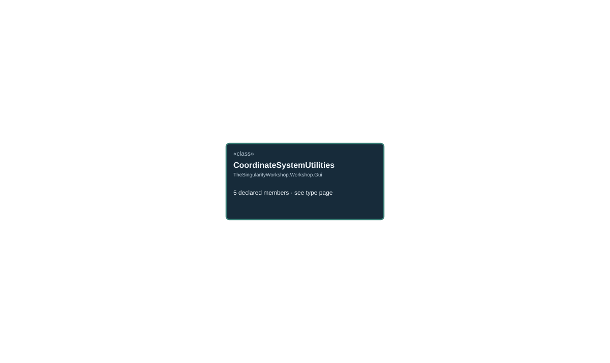

<!-- The Singularity Workshop moniker -->
<p align="center"><a href="https://github.com/TrentBest"></a></p>

# CoordinateSystemUtilities

**Author:** Trent Best  
**Fully qualified name:** `TheSingularityWorkshop.Workshop.Gui.CoordinateSystemUtilities`  
**Kind:** static class  
**Assembly:** `TheSingularityWorkshop.GUI.Core`  
**Source:** [`CoordinateSystemUtilities.cs`](../../../src/Core/CoordinateSystemUtilities.cs)  
**Tests:** [Core tests](../../../tests/Core.Tests)

## Purpose and boundary

This type supplies framework-neutral numeric helpers for mapping coordinate values between ranges, clamping values, and calculating Euclidean distance. It has no instance state and does not know about pixels, renderers, GUI nodes, or screen coordinate conventions.

## UML class diagram



The diagram represents source structure. The public API consists of four static operations; the finite-range validation helper is private implementation detail.

## Operations and failure behavior

- `Clamp(value, minimum, maximum)` requires `minimum <= maximum` and a finite value, then clamps inclusively. An inverted range throws `ArgumentException`; a non-finite value throws `ArgumentOutOfRangeException`.
- `Normalize(value, minimum, maximum)` maps the source range linearly to 0–100. Both endpoints must be finite and `minimum < maximum`; the value must be finite. The input value is not clamped to the source range.
- `Denormalize(normalized, minimum, maximum)` maps a 0–100-space value to the destination range. It applies the same finite, strictly increasing range requirement, and does not clamp the normalized input to 0–100.
- `Distance(x1, y1, x2, y2)` returns Euclidean distance using the square root of the sum of squared deltas. It does not perform finite-value or range validation.

## Use case

Normalize a domain value before placing it in a normalized GUI coordinate space, then reverse the mapping when a consumer needs the domain value back:

```csharp
double position = CoordinateSystemUtilities.Normalize(value, domainMinimum, domainMaximum);
double restored = CoordinateSystemUtilities.Denormalize(position, domainMinimum, domainMaximum);
```

For finite values and a valid nonzero source range, this is a linear mapping. Values outside the source range map outside 0–100 because normalization does not clamp.

## Related types

- [`CoordinateSystem`](CoordinateSystem.md) — range-aware coordinate value type.
- [`CoordinateSystemGuiBuilder`](CoordinateSystemGuiBuilder.md) — projects coordinates into a semantic GUI tree.
- [Class documentation standard](../../CLASS_DOCUMENTATION_STANDARD.md)

---

<!-- THE SINGULARITY WORKSHOP FOOTER -->
<p align="center"></p>
