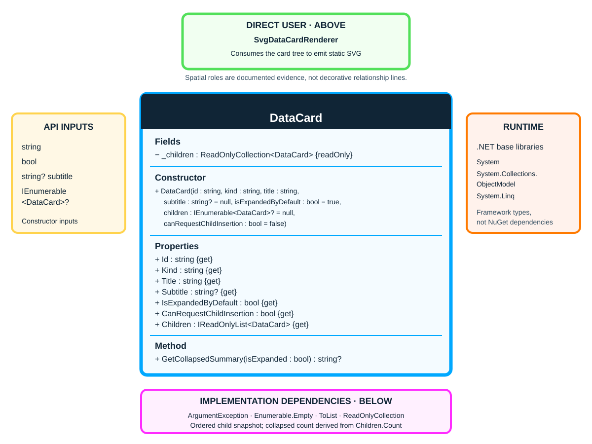

# DataCard

**Namespace:** `TheSingularityWorkshop.Workshop.Gui`  
**Kind:** sealed class  
**Source:** [`DataCard.cs`](../../../src/Core/DataCard.cs)  
**Focused tests:** [`DataCardTests.cs`](../../../tests/Core.Tests/DataCardTests.cs)

## Responsibility

`DataCard` is an immutable, renderer-neutral card node used to describe structured diagrams. It carries stable identity, semantic kind, header text, an optional subtitle, a default expansion preference, an insertion-capability hint, and an ordered child snapshot. Domain-specific meaning remains in the model that projects into cards.

## UML class diagram

The diagram shows the fields, constructor, properties, and collapsed-summary operation declared by the source. The class declares no base class or implemented interface. The child relationship is an ordered containment relation.

## Constructor and invariants

The constructor requires nonblank `id`, `kind`, and `title`; violations throw `ArgumentException`. It snapshots the supplied children into a read-only collection, so later mutation of the original enumerable does not change the card's child list.

## Public contract

- `Id`, `Kind`, and `Title` are required, immutable values.
- `Subtitle` is optional secondary header text.
- `IsExpandedByDefault` is an initial presentation preference; live expansion state belongs to the presentation layer.
- `CanRequestChildInsertion` is a capability hint, not authorization. The domain command handler must validate an insertion request.
- `Children` exposes the ordered, read-only child snapshot.
- `GetCollapsedSummary(isExpanded)` returns `null` when expanded or childless; otherwise it derives `Collapsed (N)` from the current number of direct children.

## Relationships and boundaries

- A card can contain zero or more child `DataCard` instances.
- [`SvgDataCardRenderer`](../SVG/SvgDataCardRenderer.md) consumes the card hierarchy to produce a static SVG manifestation.
- The type does not parse source code, execute edits, own live UI state, or depend on an SVG/WPF renderer.

## Verification

Use [`DataCardTests.cs`](../../../tests/Core.Tests/DataCardTests.cs) as the focused contract suite when changing constructor validation, child snapshots, or collapsed summaries. SVG manifestation behavior is covered separately by [`SvgDataCardRendererTests.cs`](../../../tests/SVG.Tests/SvgDataCardRendererTests.cs).

## Related documentation

- [Data Cards and UML](../../DATA_CARDS_AND_UML.md)
- [Per-Type Documentation and UML Standard](../../CLASS_DOCUMENTATION_STANDARD.md)
