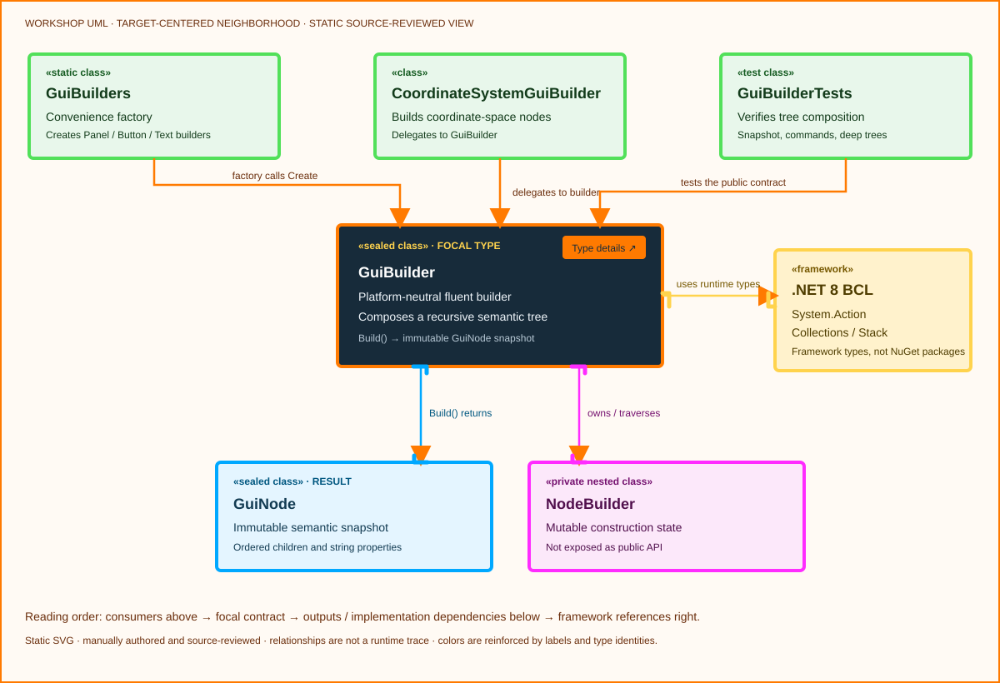

<!-- The Singularity Workshop moniker -->
<p align="center"><a href="https://github.com/TrentBest"></a></p>

# GuiBuilder

**Author:** Trent Best  
**Fully qualified name:** `TheSingularityWorkshop.Workshop.Gui.GuiBuilder`  
**Kind:** sealed class  
**Assembly/package:** `TheSingularityWorkshop.GUI.Core`  
**Target framework:** .NET 8  
**Source:** [`src/Core/GuiBuilder.cs`](../../../src/Core/GuiBuilder.cs)  
**Focused tests:** [`tests/Core.Tests/GuiBuilderTests.cs`](../../../tests/Core.Tests/GuiBuilderTests.cs)

## Purpose

`GuiBuilder` is the fluent, platform-neutral builder for a recursive semantic GUI tree. It collects node identity, kind, optional text/resource information, string-valued properties, and ordered child builders, then produces an immutable `GuiNode` snapshot.

It expresses **what a UI node means**, not how WPF, Blazor, SVG, or another platform renders it. Domain state, command authorization, rendering clocks, and platform-specific controls remain outside Core.

## Target-centered UML



The focal `GuiBuilder` card is centered. Direct consumers are above; the immutable result and private construction helper are below; .NET base-library references are to the right. Colored type-conduit stubs identify semantic type identities and label their endpoints. This is a manually authored, source-reviewed **static** SVG, not an interactive diagram or a runtime trace.

See the companion [GuiBuilder UML and use cases](../../uml/GuiBuilderUML.md).

### Compiler-derived type neighborhood


This additional diagram is generated from compiler-backed source analysis and pinned to the committed inventory. It complements—not replaces—the manually authored target-centered diagram and use-case explanation above. Its relationships describe source structure, not observed runtime behavior.

## Public contract

- `Create(kind, id)` creates a builder with a root kind and stable identifier. Blank values are rejected by the private `NodeBuilder` constructor.
- `Text(text)` records text content; `Image(source)` records a resource reference.
- `Property(name, value)` records a string-valued property. A blank property name throws `ArgumentException`; a null value throws `ArgumentNullException`.
- `WithOnClick(commandId)` records the stable command identity in the `onClickCommand` property. It does not execute the command, resolve a method by reflection, or grant permission to perform the operation.
- `Child(kind, id, configure)` creates and appends a child builder; the optional callback configures it before composition.
- `Child(GuiBuilder)` composes another builder's internal construction node; null is rejected.
- `Child(GuiNode)` copies an existing immutable node into the mutable construction model; null is rejected.
- `Build()` returns an immutable `GuiNode` snapshot. Its iterative traversal preserves child order and rejects cyclic builder composition with `InvalidOperationException` instead of relying on unbounded recursive calls.

## Important boundaries

- The builder is mutable during construction; a previously built `GuiNode` is a snapshot and does not change when the builder is subsequently modified.
- `NodeBuilder` is private implementation detail, not a public extension point.
- The builder does not render, schedule animation, own a UI event loop, dispatch commands, or authorize domain actions.
- Core's semantic command declaration is inert until a consuming host explicitly maps an allowed command ID to a host-owned operation.
- Core does not enforce tree-wide unique IDs; individual adapters may impose stricter validation, including the SVG renderer's duplicate-ID check.

## Usage

```csharp
var node = GuiBuilders.Button("create-scene", "Create Scene")
    .WithOnClick("storybuilder.scene.create")
    .Build();
```

The result contains a `Button` node with the stable identifier `create-scene`, text `Create Scene`, and property `onClickCommand = storybuilder.scene.create`. A host must still validate that command ID before performing any operation.

## Verification

The focused test suite covers recursive tree construction, stable command identity, blank command rejection, immutable snapshot behavior, node property snapshots, missing-node lookup, and deep-tree traversal. See [`GuiBuilderTests.cs`](../../../tests/Core.Tests/GuiBuilderTests.cs).

## Related types

- [`GuiNode`](GuiNode.md) — immutable semantic output.
- [`GuiBuilders` source](../../../src/Core/GuiBuilders.cs) — convenience factory methods; its dedicated type page remains open.
- [`CoordinateSystemGuiBuilder` source](../../../src/Core/CoordinateSystemGuiBuilder.cs) — domain-specific builder that delegates to `GuiBuilder`; its dedicated type page remains open.
- [Per-Type Documentation and UML Standard](../../CLASS_DOCUMENTATION_STANDARD.md)

---

<!-- THE SINGULARITY WORKSHOP FOOTER -->
<p align="center"></p>
