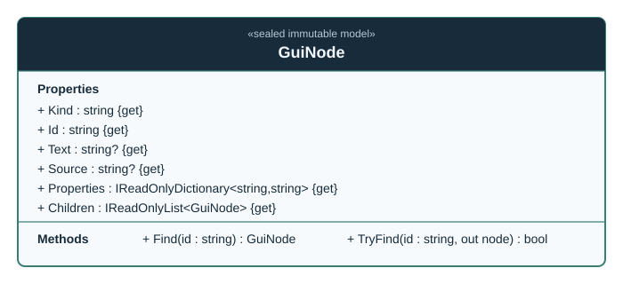

# GuiNode

**Author:** Trent Best  
**Fully qualified name:** `TheSingularityWorkshop.Workshop.Gui.GuiNode`  
**Kind:** sealed class  
**Assembly/package:** `TheSingularityWorkshop.GUI.Core`  
**Target framework:** .NET 8  
**Source:** [`src/Core/GuiNode.cs`](../../../src/Core/GuiNode.cs)

## Purpose and responsibility

`GuiNode` is the immutable, renderer-neutral node in the GUI semantic tree. It carries a stable node identifier and kind, optional text and resource/source reference, string-valued properties, and an ordered sequence of child nodes.

It defines **what a node means**, not how a platform draws it. It does not own live presentation state, render output, event loops, command authorization, or mutation after construction.

## UML class diagram



The diagram shows the sealed type, its private read-only child collection, constructor, read-only properties, and lookup operations. The child relationship is an ordered collection of `GuiNode` values. No base class or implemented interface is declared. This is a static, source-reviewed diagram—not a runtime trace.

See the companion [GuiNode UML and use cases](../../uml/GuiNodeUML.md).

## Construction and invariants

The constructor rejects a null, empty, or whitespace `kind` or `id` with `ArgumentException`. It copies the input property dictionary using ordinal key comparison and exposes it through a read-only wrapper. It also snapshots the supplied child sequence into a read-only ordered collection. Later changes to the caller's original dictionary or child collection do not alter those snapshots.

The snapshots are shallow: child nodes are themselves immutable, while string keys and values are immutable values.

## Public contract and failure behavior

- `Kind` and `Id` are required, immutable values.
- `Text` and `Source` are optional values.
- `Properties` exposes the read-only snapshot of string-valued properties.
- `Children` exposes the ordered read-only child snapshot.
- `Find(id)` returns the first match using depth-first, left-to-right traversal. If the identifier is absent, it throws `InvalidOperationException`.
- `TryFind(id, out node)` uses the same traversal and returns `false` with a null result when the identifier is absent.
- Both lookup methods reject null, empty, or whitespace identifiers.
- Traversal is iterative rather than recursively calling itself, avoiding call-stack growth proportional to tree depth. A fresh traversal stack is allocated for each lookup.

Identifiers are compared with the string equality semantics used by `current.Id == id`; the class does not enforce global uniqueness across a tree. If duplicate IDs exist, lookup returns the first match in traversal order.

## Relationships and boundaries

- A node may contain zero or more ordered child `GuiNode` instances.
- Renderer adapters consume the semantic tree and map supported kinds/properties to platform output. The Core node itself has no dependency on Blazor, SVG, WPF, or another renderer.
- `GuiBuilder` produces `GuiNode` snapshots from a mutable construction model; see [GuiBuilder](GuiBuilder.md).
- The type does not dispatch the command identity that may be carried in a property. A host must interpret and authorize such behavior.

## Usage

```csharp
var root = new GuiNode(
    kind: "Panel",
    id: "settings",
    children: new[]
    {
        new GuiNode("Text", "settings-title", text: "Settings"),
        new GuiNode("Button", "save-settings", text: "Save")
    });

var saveButton = root.Find("save-settings");
```

This builds a small immutable tree and finds the button by its ID. In an application, a renderer or host can consume the tree; this example does not claim any particular renderer behavior.

## Verification status

The focused test file for `GuiNode` is not yet mapped in this documentation inventory. The existing [`GuiBuilderTests.cs`](../../../tests/Core.Tests/GuiBuilderTests.cs) exercises builder-produced node behavior, but it should not be treated as proof of every direct-constructor contract listed here. Add or map direct tests for property/child snapshots, duplicate-ID traversal order, invalid lookup IDs, absent IDs, and deep trees before marking this type fully verified.

## Related documentation

- [GuiBuilder](GuiBuilder.md) — fluent construction of immutable node trees.
- [GuiNode UML and use cases](../../uml/GuiNodeUML.md)
- [Per-Type Documentation and UML Standard](../../CLASS_DOCUMENTATION_STANDARD.md)
