<!-- The Singularity Workshop animated moniker -->

# It's the Weekend. What Are You Building?

That's the whole invitation.

Make something. Make it visible. Give it a little life. Then show somebody what you've been building.

The picture above is an SVG: one small, portable file that can live in a browser, a README, or an article. Want to see how a **semantic GUI model becomes an SVG**—and how you can experiment with the same idea?

Start with [TheSingularityWorkshop.GUI](https://github.com/TrentBest/TheSingularityWorkshop.GUI), explore the [GUI.SVG guide](https://github.com/TrentBest/TheSingularityWorkshop.GUI/blob/development/docs/SVG_GUIDE.md), and take a look at the [generated, animated SVG gallery](https://raw.githubusercontent.com/TrentBest/TheSingularityWorkshop.GUI/development/docs/assets/svg-adapter-gallery.svg).

No big plan required. Pick a small idea and make it real.

**It's the weekend. What are you building?**
