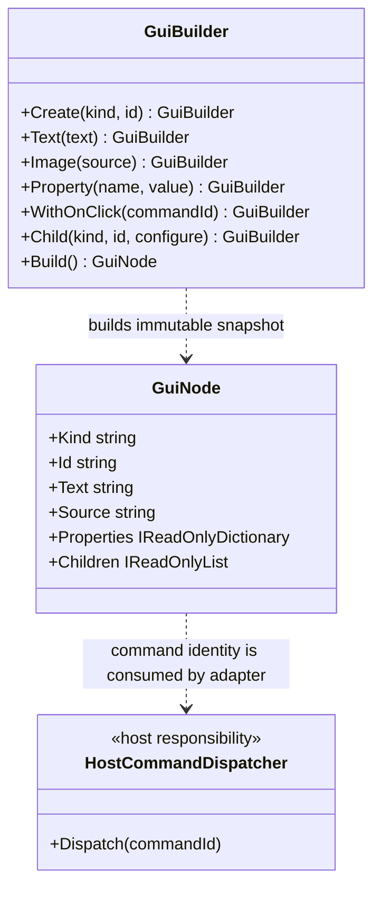

# GuiBuilder UML

**Author:** Trent Best

## Class diagram

## Use cases

- A builder author creates a button and assigns a stable command ID.
- The built node preserves that ID as semantic metadata.
- A platform adapter may route activation to a host-provided dispatcher.
- The host validates the ID against an explicit command map before invoking domain behavior.

The dispatcher shown here is a conceptual host responsibility, not a type declared by GUI.Core.
