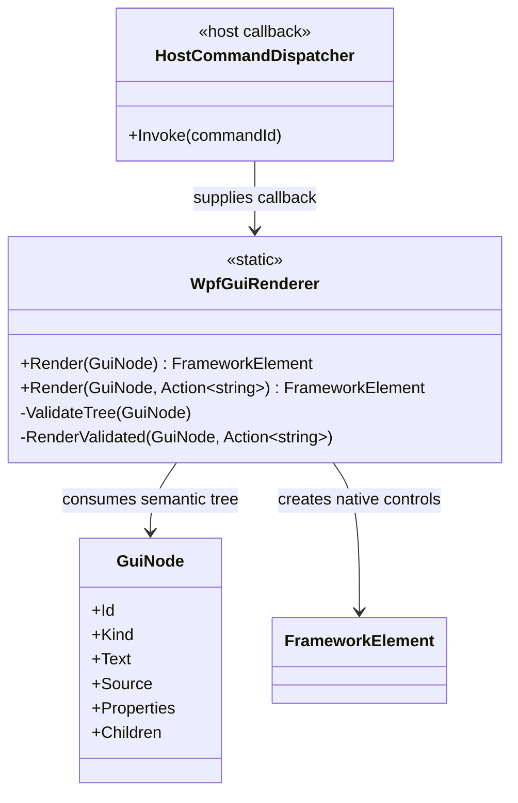

<!-- The Singularity Workshop moniker -->

# WpfGuiRenderer — UML class card

## Focused class diagram

The source-derived relationship graph is [available as SVG](source-files/WPF/TheSingularityWorkshop-GUI-WPF-WpfGuiRenderer-09d386773a.svg). The diagram above is the concise usage-oriented class card; the generated graph records compiler-derived relationships.

## Use cases

1. **Render a semantic screen:** build or receive a `GuiNode` root, call `Render(root)`, and place the returned element in a host-owned WPF visual tree.
2. **Route a button action:** call the dispatcher overload and map the received command ID through a host-maintained allow-list before invoking application behavior.
3. **Reject malformed structure:** duplicate IDs and trees deeper than 256 are rejected before recursive control creation; the caller should report the input error rather than silently retrying.
4. **Handle unsupported kinds:** unknown kinds become a basic bordered vertical container, allowing child content to remain visible while the host decides whether unsupported kinds should be surfaced diagnostically.

## Responsibility boundary

The semantic model describes the interface; this adapter creates WPF controls. The host owns the window, UI-thread lifecycle, command authorization, persistence, and any trust policy for manifest data. The renderer is not an HTML/SVG sanitizer or a domain security boundary.

---

<!-- THE SINGULARITY WORKSHOP FOOTER -->

