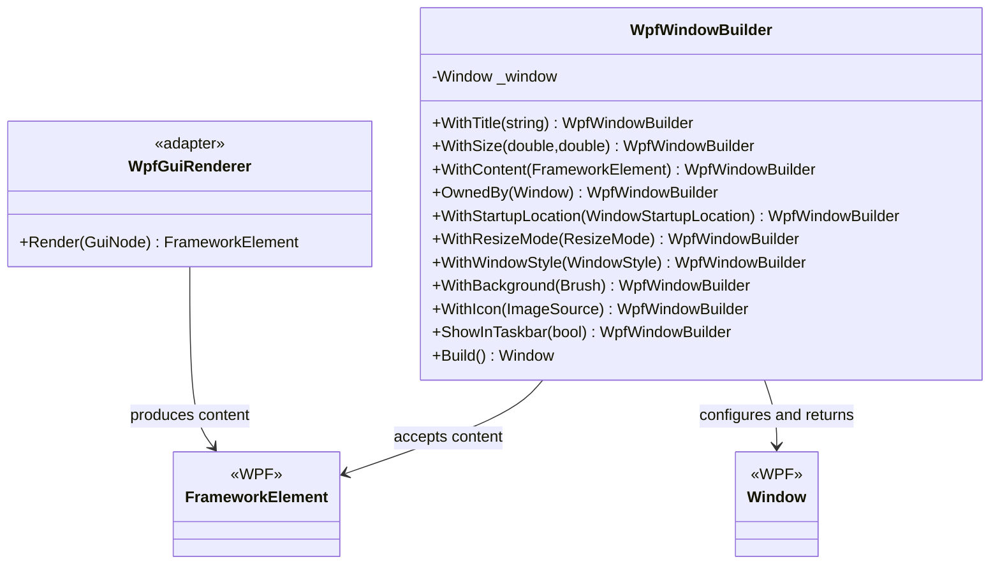

# WpfWindowBuilder — UML class card

**User moniker:** Trent Best

## Focused class diagram

The compiler-derived relationship graph is [available as SVG](source-files/WPF/TheSingularityWorkshop-GUI-WPF-WpfWindowBuilder-8f86ce64e7.svg).

## Use cases

1. **Host a rendered screen:** call `WpfGuiRenderer.Render(root)`, pass the returned element to `WithContent`, set a title and dimensions, then call `Build()`.
2. **Create an owned tool window:** configure `OwnedBy(owner)` and the desired startup/resize policy; the caller remains responsible for showing it and handling close/lifetime behavior.
3. **Validate dimensions early:** reject zero, negative, NaN, and infinite dimensions through `WithSize` exceptions rather than allowing an invalid window configuration to proceed.

## Responsibility boundary

This builder configures the native window only. It does not create an application, show the window, start the WPF dispatcher, or decide authorization or persistence policy. WPF thread affinity and visual-parent ownership remain host responsibilities.
