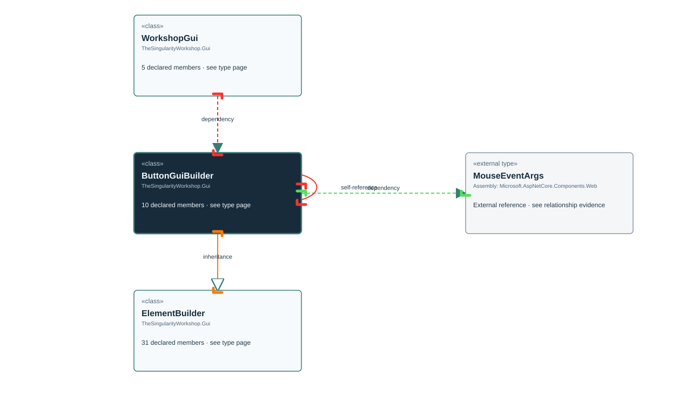

<!-- The Singularity Workshop moniker -->

# TheSingularityWorkshop.Gui.ButtonGuiBuilder

> Generated from compiler-backed source analysis. Do not edit by hand.

- Repository: `TrentBest/TheSingularityWorkshop.GUI`
- Revision: [`f5c9a2817cdcb9c9ab1ec235e7b67502bcd3b732`](https://github.com/TrentBest/TheSingularityWorkshop.GUI/tree/f5c9a2817cdcb9c9ab1ec235e7b67502bcd3b732)
- Project: `src/Blazor/TheSingularityWorkshop.GUI.Blazor.csproj`
- Type ID: `type:TheSingularityWorkshop.GUI.Blazor, Version=0.1.0.0, Culture=neutral, PublicKeyToken=null:global::TheSingularityWorkshop.Gui.ButtonGuiBuilder`
- Metadata name: `ButtonGuiBuilder`
- Kind: `class`
- Generic arity: 0

## UML diagram

## Source declarations

- [`src/Blazor/ButtonGuiBuilder.cs:4-25`](https://github.com/TrentBest/TheSingularityWorkshop.GUI/blob/f5c9a2817cdcb9c9ab1ec235e7b67502bcd3b732/src/Blazor/ButtonGuiBuilder.cs#L4-25)

## Members

| Kind | Signature | Source |
|---|---|---|
| `Method` | `TheSingularityWorkshop.Gui.ButtonGuiBuilder.AriaLabel(string)` | [`src/Blazor/ButtonGuiBuilder.cs:14-14`](https://github.com/TrentBest/TheSingularityWorkshop.GUI/blob/f5c9a2817cdcb9c9ab1ec235e7b67502bcd3b732/src/Blazor/ButtonGuiBuilder.cs#L14-14) |
| `Method` | `TheSingularityWorkshop.Gui.ButtonGuiBuilder.Attribute(string, object?)` | [`src/Blazor/ButtonGuiBuilder.cs:12-12`](https://github.com/TrentBest/TheSingularityWorkshop.GUI/blob/f5c9a2817cdcb9c9ab1ec235e7b67502bcd3b732/src/Blazor/ButtonGuiBuilder.cs#L12-12) |
| `Method` | `TheSingularityWorkshop.Gui.ButtonGuiBuilder.ButtonGuiBuilder(object)` | [`src/Blazor/ButtonGuiBuilder.cs:6-6`](https://github.com/TrentBest/TheSingularityWorkshop.GUI/blob/f5c9a2817cdcb9c9ab1ec235e7b67502bcd3b732/src/Blazor/ButtonGuiBuilder.cs#L6-6) |
| `Method` | `TheSingularityWorkshop.Gui.ButtonGuiBuilder.Label(string)` | [`src/Blazor/ButtonGuiBuilder.cs:8-8`](https://github.com/TrentBest/TheSingularityWorkshop.GUI/blob/f5c9a2817cdcb9c9ab1ec235e7b67502bcd3b732/src/Blazor/ButtonGuiBuilder.cs#L8-8) |
| `Method` | `TheSingularityWorkshop.Gui.ButtonGuiBuilder.OnClick(System.Action)` | [`src/Blazor/ButtonGuiBuilder.cs:20-20`](https://github.com/TrentBest/TheSingularityWorkshop.GUI/blob/f5c9a2817cdcb9c9ab1ec235e7b67502bcd3b732/src/Blazor/ButtonGuiBuilder.cs#L20-20) |
| `Method` | `TheSingularityWorkshop.Gui.ButtonGuiBuilder.OnClick(System.Action<Microsoft.AspNetCore.Components.Web.MouseEventArgs>)` | [`src/Blazor/ButtonGuiBuilder.cs:24-24`](https://github.com/TrentBest/TheSingularityWorkshop.GUI/blob/f5c9a2817cdcb9c9ab1ec235e7b67502bcd3b732/src/Blazor/ButtonGuiBuilder.cs#L24-24) |
| `Method` | `TheSingularityWorkshop.Gui.ButtonGuiBuilder.OnClick(System.Func<System.Threading.Tasks.Task>)` | [`src/Blazor/ButtonGuiBuilder.cs:22-22`](https://github.com/TrentBest/TheSingularityWorkshop.GUI/blob/f5c9a2817cdcb9c9ab1ec235e7b67502bcd3b732/src/Blazor/ButtonGuiBuilder.cs#L22-22) |
| `Method` | `TheSingularityWorkshop.Gui.ButtonGuiBuilder.PositionAt(double, double)` | [`src/Blazor/ButtonGuiBuilder.cs:10-10`](https://github.com/TrentBest/TheSingularityWorkshop.GUI/blob/f5c9a2817cdcb9c9ab1ec235e7b67502bcd3b732/src/Blazor/ButtonGuiBuilder.cs#L10-10) |
| `Method` | `TheSingularityWorkshop.Gui.ButtonGuiBuilder.Style(string, string)` | [`src/Blazor/ButtonGuiBuilder.cs:18-18`](https://github.com/TrentBest/TheSingularityWorkshop.GUI/blob/f5c9a2817cdcb9c9ab1ec235e7b67502bcd3b732/src/Blazor/ButtonGuiBuilder.cs#L18-18) |
| `Method` | `TheSingularityWorkshop.Gui.ButtonGuiBuilder.Title(string)` | [`src/Blazor/ButtonGuiBuilder.cs:16-16`](https://github.com/TrentBest/TheSingularityWorkshop.GUI/blob/f5c9a2817cdcb9c9ab1ec235e7b67502bcd3b732/src/Blazor/ButtonGuiBuilder.cs#L16-16) |

## Relationships

| Direction | Kind | Related type | Resolution | Evidence |
|---|---|---|---|---|
| outgoing | `Inheritance` | `TheSingularityWorkshop.Gui.ElementBuilder` | `Resolved` | [`src/Blazor/ButtonGuiBuilder.cs:4-25`](https://github.com/TrentBest/TheSingularityWorkshop.GUI/blob/f5c9a2817cdcb9c9ab1ec235e7b67502bcd3b732/src/Blazor/ButtonGuiBuilder.cs#L4-25) |
| outgoing | `Dependency` | `global::Microsoft.AspNetCore.Components.Web.MouseEventArgs` | `External` | [`src/Blazor/ButtonGuiBuilder.cs:24-24`](https://github.com/TrentBest/TheSingularityWorkshop.GUI/blob/f5c9a2817cdcb9c9ab1ec235e7b67502bcd3b732/src/Blazor/ButtonGuiBuilder.cs#L24-24) |
| outgoing | `Dependency` | `TheSingularityWorkshop.Gui.ButtonGuiBuilder` | `Resolved` | [`src/Blazor/ButtonGuiBuilder.cs:14-14`](https://github.com/TrentBest/TheSingularityWorkshop.GUI/blob/f5c9a2817cdcb9c9ab1ec235e7b67502bcd3b732/src/Blazor/ButtonGuiBuilder.cs#L14-14) |
| outgoing | `Dependency` | `TheSingularityWorkshop.Gui.ButtonGuiBuilder` | `Resolved` | [`src/Blazor/ButtonGuiBuilder.cs:12-12`](https://github.com/TrentBest/TheSingularityWorkshop.GUI/blob/f5c9a2817cdcb9c9ab1ec235e7b67502bcd3b732/src/Blazor/ButtonGuiBuilder.cs#L12-12) |
| outgoing | `Dependency` | `TheSingularityWorkshop.Gui.ButtonGuiBuilder` | `Resolved` | [`src/Blazor/ButtonGuiBuilder.cs:8-8`](https://github.com/TrentBest/TheSingularityWorkshop.GUI/blob/f5c9a2817cdcb9c9ab1ec235e7b67502bcd3b732/src/Blazor/ButtonGuiBuilder.cs#L8-8) |
| outgoing | `Dependency` | `TheSingularityWorkshop.Gui.ButtonGuiBuilder` | `Resolved` | [`src/Blazor/ButtonGuiBuilder.cs:20-20`](https://github.com/TrentBest/TheSingularityWorkshop.GUI/blob/f5c9a2817cdcb9c9ab1ec235e7b67502bcd3b732/src/Blazor/ButtonGuiBuilder.cs#L20-20) |
| outgoing | `Dependency` | `TheSingularityWorkshop.Gui.ButtonGuiBuilder` | `Resolved` | [`src/Blazor/ButtonGuiBuilder.cs:24-24`](https://github.com/TrentBest/TheSingularityWorkshop.GUI/blob/f5c9a2817cdcb9c9ab1ec235e7b67502bcd3b732/src/Blazor/ButtonGuiBuilder.cs#L24-24) |
| outgoing | `Dependency` | `TheSingularityWorkshop.Gui.ButtonGuiBuilder` | `Resolved` | [`src/Blazor/ButtonGuiBuilder.cs:22-22`](https://github.com/TrentBest/TheSingularityWorkshop.GUI/blob/f5c9a2817cdcb9c9ab1ec235e7b67502bcd3b732/src/Blazor/ButtonGuiBuilder.cs#L22-22) |
| outgoing | `Dependency` | `TheSingularityWorkshop.Gui.ButtonGuiBuilder` | `Resolved` | [`src/Blazor/ButtonGuiBuilder.cs:10-10`](https://github.com/TrentBest/TheSingularityWorkshop.GUI/blob/f5c9a2817cdcb9c9ab1ec235e7b67502bcd3b732/src/Blazor/ButtonGuiBuilder.cs#L10-10) |
| outgoing | `Dependency` | `TheSingularityWorkshop.Gui.ButtonGuiBuilder` | `Resolved` | [`src/Blazor/ButtonGuiBuilder.cs:18-18`](https://github.com/TrentBest/TheSingularityWorkshop.GUI/blob/f5c9a2817cdcb9c9ab1ec235e7b67502bcd3b732/src/Blazor/ButtonGuiBuilder.cs#L18-18) |
| outgoing | `Dependency` | `TheSingularityWorkshop.Gui.ButtonGuiBuilder` | `Resolved` | [`src/Blazor/ButtonGuiBuilder.cs:16-16`](https://github.com/TrentBest/TheSingularityWorkshop.GUI/blob/f5c9a2817cdcb9c9ab1ec235e7b67502bcd3b732/src/Blazor/ButtonGuiBuilder.cs#L16-16) |
| incoming | `Dependency` | `TheSingularityWorkshop.Gui.WorkshopGui` | `Resolved` | [`src/Blazor/WorkshopGuiBuilder.cs:17-17`](https://github.com/TrentBest/TheSingularityWorkshop.GUI/blob/f5c9a2817cdcb9c9ab1ec235e7b67502bcd3b732/src/Blazor/WorkshopGuiBuilder.cs#L17-17) |

[Back to the generated type index](index.md)

---

<!-- THE SINGULARITY WORKSHOP FOOTER -->

