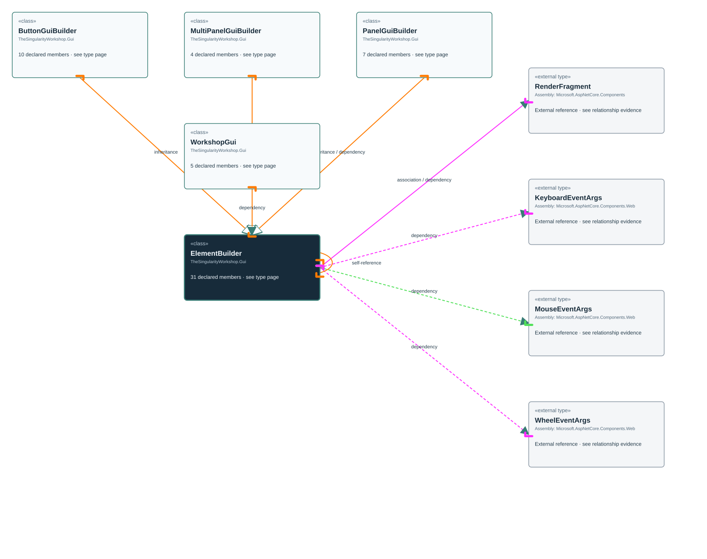

# TheSingularityWorkshop.Gui.ElementBuilder

> Generated from compiler-backed source analysis. Do not edit by hand.

- Repository: `TrentBest/TheSingularityWorkshop.GUI`
- Revision: [`3844b48b1a30f678cb8aa80c2a21aaaceed9348b`](https://github.com/TrentBest/TheSingularityWorkshop.GUI/tree/3844b48b1a30f678cb8aa80c2a21aaaceed9348b)
- Project: `src/Blazor/TheSingularityWorkshop.GUI.Blazor.csproj`
- Type ID: `type:TheSingularityWorkshop.GUI.Blazor, Version=0.1.0.0, Culture=neutral, PublicKeyToken=null:global::TheSingularityWorkshop.Gui.ElementBuilder`
- Metadata name: `ElementBuilder`
- Kind: `class`
- Generic arity: 0

## UML diagram

## Source declarations

- [`src/Blazor/WorkshopGuiBuilder.cs:23-83`](https://github.com/TrentBest/TheSingularityWorkshop.GUI/blob/3844b48b1a30f678cb8aa80c2a21aaaceed9348b/src/Blazor/WorkshopGuiBuilder.cs#L23-83)

## Members

| Kind | Signature | Source |
|---|---|---|
| `Method` | `TheSingularityWorkshop.Gui.ElementBuilder.AriaLabel(string)` | [`src/Blazor/WorkshopGuiBuilder.cs:38-38`](https://github.com/TrentBest/TheSingularityWorkshop.GUI/blob/3844b48b1a30f678cb8aa80c2a21aaaceed9348b/src/Blazor/WorkshopGuiBuilder.cs#L38-38) |
| `Method` | `TheSingularityWorkshop.Gui.ElementBuilder.Attribute(string, object?)` | [`src/Blazor/WorkshopGuiBuilder.cs:36-36`](https://github.com/TrentBest/TheSingularityWorkshop.GUI/blob/3844b48b1a30f678cb8aa80c2a21aaaceed9348b/src/Blazor/WorkshopGuiBuilder.cs#L36-36) |
| `Method` | `TheSingularityWorkshop.Gui.ElementBuilder.Build()` | [`src/Blazor/WorkshopGuiBuilder.cs:78-82`](https://github.com/TrentBest/TheSingularityWorkshop.GUI/blob/3844b48b1a30f678cb8aa80c2a21aaaceed9348b/src/Blazor/WorkshopGuiBuilder.cs#L78-82) |
| `Method` | `TheSingularityWorkshop.Gui.ElementBuilder.BuildChildren(params TheSingularityWorkshop.Gui.ElementBuilder[])` | [`src/Blazor/WorkshopGuiBuilder.cs:76-76`](https://github.com/TrentBest/TheSingularityWorkshop.GUI/blob/3844b48b1a30f678cb8aa80c2a21aaaceed9348b/src/Blazor/WorkshopGuiBuilder.cs#L76-76) |
| `Method` | `TheSingularityWorkshop.Gui.ElementBuilder.Child(Microsoft.AspNetCore.Components.RenderFragment)` | [`src/Blazor/WorkshopGuiBuilder.cs:54-54`](https://github.com/TrentBest/TheSingularityWorkshop.GUI/blob/3844b48b1a30f678cb8aa80c2a21aaaceed9348b/src/Blazor/WorkshopGuiBuilder.cs#L54-54) |
| `Method` | `TheSingularityWorkshop.Gui.ElementBuilder.Child(TheSingularityWorkshop.Gui.ElementBuilder)` | [`src/Blazor/WorkshopGuiBuilder.cs:52-52`](https://github.com/TrentBest/TheSingularityWorkshop.GUI/blob/3844b48b1a30f678cb8aa80c2a21aaaceed9348b/src/Blazor/WorkshopGuiBuilder.cs#L52-52) |
| `Method` | `TheSingularityWorkshop.Gui.ElementBuilder.Class(string)` | [`src/Blazor/WorkshopGuiBuilder.cs:44-44`](https://github.com/TrentBest/TheSingularityWorkshop.GUI/blob/3844b48b1a30f678cb8aa80c2a21aaaceed9348b/src/Blazor/WorkshopGuiBuilder.cs#L44-44) |
| `Method` | `TheSingularityWorkshop.Gui.ElementBuilder.Content(TheSingularityWorkshop.Gui.ElementBuilder)` | [`src/Blazor/WorkshopGuiBuilder.cs:56-56`](https://github.com/TrentBest/TheSingularityWorkshop.GUI/blob/3844b48b1a30f678cb8aa80c2a21aaaceed9348b/src/Blazor/WorkshopGuiBuilder.cs#L56-56) |
| `Method` | `TheSingularityWorkshop.Gui.ElementBuilder.ElementBuilder(Microsoft.AspNetCore.Components.RenderFragment)` | [`src/Blazor/WorkshopGuiBuilder.cs:32-32`](https://github.com/TrentBest/TheSingularityWorkshop.GUI/blob/3844b48b1a30f678cb8aa80c2a21aaaceed9348b/src/Blazor/WorkshopGuiBuilder.cs#L32-32) |
| `Method` | `TheSingularityWorkshop.Gui.ElementBuilder.ElementBuilder(object, string)` | [`src/Blazor/WorkshopGuiBuilder.cs:31-31`](https://github.com/TrentBest/TheSingularityWorkshop.GUI/blob/3844b48b1a30f678cb8aa80c2a21aaaceed9348b/src/Blazor/WorkshopGuiBuilder.cs#L31-31) |
| `Method` | `TheSingularityWorkshop.Gui.ElementBuilder.OnClick(System.Action)` | [`src/Blazor/WorkshopGuiBuilder.cs:58-58`](https://github.com/TrentBest/TheSingularityWorkshop.GUI/blob/3844b48b1a30f678cb8aa80c2a21aaaceed9348b/src/Blazor/WorkshopGuiBuilder.cs#L58-58) |
| `Method` | `TheSingularityWorkshop.Gui.ElementBuilder.OnClick(System.Action<Microsoft.AspNetCore.Components.Web.MouseEventArgs>)` | [`src/Blazor/WorkshopGuiBuilder.cs:62-62`](https://github.com/TrentBest/TheSingularityWorkshop.GUI/blob/3844b48b1a30f678cb8aa80c2a21aaaceed9348b/src/Blazor/WorkshopGuiBuilder.cs#L62-62) |
| `Method` | `TheSingularityWorkshop.Gui.ElementBuilder.OnClick(System.Func<System.Threading.Tasks.Task>)` | [`src/Blazor/WorkshopGuiBuilder.cs:60-60`](https://github.com/TrentBest/TheSingularityWorkshop.GUI/blob/3844b48b1a30f678cb8aa80c2a21aaaceed9348b/src/Blazor/WorkshopGuiBuilder.cs#L60-60) |
| `Method` | `TheSingularityWorkshop.Gui.ElementBuilder.OnKeyDown(System.Action<Microsoft.AspNetCore.Components.Web.KeyboardEventArgs>)` | [`src/Blazor/WorkshopGuiBuilder.cs:64-64`](https://github.com/TrentBest/TheSingularityWorkshop.GUI/blob/3844b48b1a30f678cb8aa80c2a21aaaceed9348b/src/Blazor/WorkshopGuiBuilder.cs#L64-64) |
| `Method` | `TheSingularityWorkshop.Gui.ElementBuilder.OnMouseEnter(System.Action)` | [`src/Blazor/WorkshopGuiBuilder.cs:66-66`](https://github.com/TrentBest/TheSingularityWorkshop.GUI/blob/3844b48b1a30f678cb8aa80c2a21aaaceed9348b/src/Blazor/WorkshopGuiBuilder.cs#L66-66) |
| `Method` | `TheSingularityWorkshop.Gui.ElementBuilder.OnMouseLeave(System.Action)` | [`src/Blazor/WorkshopGuiBuilder.cs:68-68`](https://github.com/TrentBest/TheSingularityWorkshop.GUI/blob/3844b48b1a30f678cb8aa80c2a21aaaceed9348b/src/Blazor/WorkshopGuiBuilder.cs#L68-68) |
| `Method` | `TheSingularityWorkshop.Gui.ElementBuilder.OnWheel(System.Action<Microsoft.AspNetCore.Components.Web.WheelEventArgs>)` | [`src/Blazor/WorkshopGuiBuilder.cs:70-70`](https://github.com/TrentBest/TheSingularityWorkshop.GUI/blob/3844b48b1a30f678cb8aa80c2a21aaaceed9348b/src/Blazor/WorkshopGuiBuilder.cs#L70-70) |
| `Method` | `TheSingularityWorkshop.Gui.ElementBuilder.Position(double, double)` | [`src/Blazor/WorkshopGuiBuilder.cs:48-48`](https://github.com/TrentBest/TheSingularityWorkshop.GUI/blob/3844b48b1a30f678cb8aa80c2a21aaaceed9348b/src/Blazor/WorkshopGuiBuilder.cs#L48-48) |
| `Method` | `TheSingularityWorkshop.Gui.ElementBuilder.PreventDefault(string)` | [`src/Blazor/WorkshopGuiBuilder.cs:74-74`](https://github.com/TrentBest/TheSingularityWorkshop.GUI/blob/3844b48b1a30f678cb8aa80c2a21aaaceed9348b/src/Blazor/WorkshopGuiBuilder.cs#L74-74) |
| `Method` | `TheSingularityWorkshop.Gui.ElementBuilder.StopPropagation(string)` | [`src/Blazor/WorkshopGuiBuilder.cs:72-72`](https://github.com/TrentBest/TheSingularityWorkshop.GUI/blob/3844b48b1a30f678cb8aa80c2a21aaaceed9348b/src/Blazor/WorkshopGuiBuilder.cs#L72-72) |
| `Method` | `TheSingularityWorkshop.Gui.ElementBuilder.Style(string, string)` | [`src/Blazor/WorkshopGuiBuilder.cs:46-46`](https://github.com/TrentBest/TheSingularityWorkshop.GUI/blob/3844b48b1a30f678cb8aa80c2a21aaaceed9348b/src/Blazor/WorkshopGuiBuilder.cs#L46-46) |
| `Method` | `TheSingularityWorkshop.Gui.ElementBuilder.TabIndex(int)` | [`src/Blazor/WorkshopGuiBuilder.cs:42-42`](https://github.com/TrentBest/TheSingularityWorkshop.GUI/blob/3844b48b1a30f678cb8aa80c2a21aaaceed9348b/src/Blazor/WorkshopGuiBuilder.cs#L42-42) |
| `Method` | `TheSingularityWorkshop.Gui.ElementBuilder.Text(string)` | [`src/Blazor/WorkshopGuiBuilder.cs:50-50`](https://github.com/TrentBest/TheSingularityWorkshop.GUI/blob/3844b48b1a30f678cb8aa80c2a21aaaceed9348b/src/Blazor/WorkshopGuiBuilder.cs#L50-50) |
| `Method` | `TheSingularityWorkshop.Gui.ElementBuilder.Title(string)` | [`src/Blazor/WorkshopGuiBuilder.cs:40-40`](https://github.com/TrentBest/TheSingularityWorkshop.GUI/blob/3844b48b1a30f678cb8aa80c2a21aaaceed9348b/src/Blazor/WorkshopGuiBuilder.cs#L40-40) |
| `Field` | `TheSingularityWorkshop.Gui.ElementBuilder._attributes` | [`src/Blazor/WorkshopGuiBuilder.cs:28-28`](https://github.com/TrentBest/TheSingularityWorkshop.GUI/blob/3844b48b1a30f678cb8aa80c2a21aaaceed9348b/src/Blazor/WorkshopGuiBuilder.cs#L28-28) |
| `Field` | `TheSingularityWorkshop.Gui.ElementBuilder._children` | [`src/Blazor/WorkshopGuiBuilder.cs:29-29`](https://github.com/TrentBest/TheSingularityWorkshop.GUI/blob/3844b48b1a30f678cb8aa80c2a21aaaceed9348b/src/Blazor/WorkshopGuiBuilder.cs#L29-29) |
| `Field` | `TheSingularityWorkshop.Gui.ElementBuilder._rawFragment` | [`src/Blazor/WorkshopGuiBuilder.cs:27-27`](https://github.com/TrentBest/TheSingularityWorkshop.GUI/blob/3844b48b1a30f678cb8aa80c2a21aaaceed9348b/src/Blazor/WorkshopGuiBuilder.cs#L27-27) |
| `Field` | `TheSingularityWorkshop.Gui.ElementBuilder._receiver` | [`src/Blazor/WorkshopGuiBuilder.cs:25-25`](https://github.com/TrentBest/TheSingularityWorkshop.GUI/blob/3844b48b1a30f678cb8aa80c2a21aaaceed9348b/src/Blazor/WorkshopGuiBuilder.cs#L25-25) |
| `Field` | `TheSingularityWorkshop.Gui.ElementBuilder._styles` | [`src/Blazor/WorkshopGuiBuilder.cs:30-30`](https://github.com/TrentBest/TheSingularityWorkshop.GUI/blob/3844b48b1a30f678cb8aa80c2a21aaaceed9348b/src/Blazor/WorkshopGuiBuilder.cs#L30-30) |
| `Field` | `TheSingularityWorkshop.Gui.ElementBuilder._tagName` | [`src/Blazor/WorkshopGuiBuilder.cs:26-26`](https://github.com/TrentBest/TheSingularityWorkshop.GUI/blob/3844b48b1a30f678cb8aa80c2a21aaaceed9348b/src/Blazor/WorkshopGuiBuilder.cs#L26-26) |
| `Method` | `TheSingularityWorkshop.Gui.ElementBuilder.implicit operator TheSingularityWorkshop.Gui.ElementBuilder(Microsoft.AspNetCore.Components.RenderFragment)` | [`src/Blazor/WorkshopGuiBuilder.cs:34-34`](https://github.com/TrentBest/TheSingularityWorkshop.GUI/blob/3844b48b1a30f678cb8aa80c2a21aaaceed9348b/src/Blazor/WorkshopGuiBuilder.cs#L34-34) |

## Relationships

| Direction | Kind | Related type | Resolution | Evidence |
|---|---|---|---|---|
| incoming | `Inheritance` | `TheSingularityWorkshop.Gui.ButtonGuiBuilder` | `Resolved` | [`src/Blazor/ButtonGuiBuilder.cs:4-25`](https://github.com/TrentBest/TheSingularityWorkshop.GUI/blob/3844b48b1a30f678cb8aa80c2a21aaaceed9348b/src/Blazor/ButtonGuiBuilder.cs#L4-25) |
| incoming | `Inheritance` | `TheSingularityWorkshop.Gui.MultiPanelGuiBuilder` | `Resolved` | [`src/Blazor/MultiPanelGuiBuilder.cs:3-12`](https://github.com/TrentBest/TheSingularityWorkshop.GUI/blob/3844b48b1a30f678cb8aa80c2a21aaaceed9348b/src/Blazor/MultiPanelGuiBuilder.cs#L3-12) |
| incoming | `Inheritance` | `TheSingularityWorkshop.Gui.PanelGuiBuilder` | `Resolved` | [`src/Blazor/PanelGuiBuilder.cs:3-18`](https://github.com/TrentBest/TheSingularityWorkshop.GUI/blob/3844b48b1a30f678cb8aa80c2a21aaaceed9348b/src/Blazor/PanelGuiBuilder.cs#L3-18) |
| outgoing | `Association` | `global::Microsoft.AspNetCore.Components.RenderFragment` | `External` | [`src/Blazor/WorkshopGuiBuilder.cs:29-29`](https://github.com/TrentBest/TheSingularityWorkshop.GUI/blob/3844b48b1a30f678cb8aa80c2a21aaaceed9348b/src/Blazor/WorkshopGuiBuilder.cs#L29-29) |
| outgoing | `Association` | `global::Microsoft.AspNetCore.Components.RenderFragment` | `External` | [`src/Blazor/WorkshopGuiBuilder.cs:27-27`](https://github.com/TrentBest/TheSingularityWorkshop.GUI/blob/3844b48b1a30f678cb8aa80c2a21aaaceed9348b/src/Blazor/WorkshopGuiBuilder.cs#L27-27) |
| outgoing | `Dependency` | `global::Microsoft.AspNetCore.Components.RenderFragment` | `External` | [`src/Blazor/WorkshopGuiBuilder.cs:54-54`](https://github.com/TrentBest/TheSingularityWorkshop.GUI/blob/3844b48b1a30f678cb8aa80c2a21aaaceed9348b/src/Blazor/WorkshopGuiBuilder.cs#L54-54) |
| outgoing | `Dependency` | `global::Microsoft.AspNetCore.Components.RenderFragment` | `External` | [`src/Blazor/WorkshopGuiBuilder.cs:34-34`](https://github.com/TrentBest/TheSingularityWorkshop.GUI/blob/3844b48b1a30f678cb8aa80c2a21aaaceed9348b/src/Blazor/WorkshopGuiBuilder.cs#L34-34) |
| outgoing | `Dependency` | `global::Microsoft.AspNetCore.Components.RenderFragment` | `External` | [`src/Blazor/WorkshopGuiBuilder.cs:32-32`](https://github.com/TrentBest/TheSingularityWorkshop.GUI/blob/3844b48b1a30f678cb8aa80c2a21aaaceed9348b/src/Blazor/WorkshopGuiBuilder.cs#L32-32) |
| outgoing | `Dependency` | `global::Microsoft.AspNetCore.Components.RenderFragment` | `External` | [`src/Blazor/WorkshopGuiBuilder.cs:78-82`](https://github.com/TrentBest/TheSingularityWorkshop.GUI/blob/3844b48b1a30f678cb8aa80c2a21aaaceed9348b/src/Blazor/WorkshopGuiBuilder.cs#L78-82) |
| outgoing | `Dependency` | `global::Microsoft.AspNetCore.Components.Web.KeyboardEventArgs` | `External` | [`src/Blazor/WorkshopGuiBuilder.cs:64-64`](https://github.com/TrentBest/TheSingularityWorkshop.GUI/blob/3844b48b1a30f678cb8aa80c2a21aaaceed9348b/src/Blazor/WorkshopGuiBuilder.cs#L64-64) |
| outgoing | `Dependency` | `global::Microsoft.AspNetCore.Components.Web.MouseEventArgs` | `External` | [`src/Blazor/WorkshopGuiBuilder.cs:62-62`](https://github.com/TrentBest/TheSingularityWorkshop.GUI/blob/3844b48b1a30f678cb8aa80c2a21aaaceed9348b/src/Blazor/WorkshopGuiBuilder.cs#L62-62) |
| outgoing | `Dependency` | `global::Microsoft.AspNetCore.Components.Web.WheelEventArgs` | `External` | [`src/Blazor/WorkshopGuiBuilder.cs:70-70`](https://github.com/TrentBest/TheSingularityWorkshop.GUI/blob/3844b48b1a30f678cb8aa80c2a21aaaceed9348b/src/Blazor/WorkshopGuiBuilder.cs#L70-70) |
| outgoing | `Dependency` | `TheSingularityWorkshop.Gui.ElementBuilder` | `Resolved` | [`src/Blazor/WorkshopGuiBuilder.cs:52-52`](https://github.com/TrentBest/TheSingularityWorkshop.GUI/blob/3844b48b1a30f678cb8aa80c2a21aaaceed9348b/src/Blazor/WorkshopGuiBuilder.cs#L52-52) |
| outgoing | `Dependency` | `TheSingularityWorkshop.Gui.ElementBuilder` | `Resolved` | [`src/Blazor/WorkshopGuiBuilder.cs:56-56`](https://github.com/TrentBest/TheSingularityWorkshop.GUI/blob/3844b48b1a30f678cb8aa80c2a21aaaceed9348b/src/Blazor/WorkshopGuiBuilder.cs#L56-56) |
| outgoing | `Dependency` | `TheSingularityWorkshop.Gui.ElementBuilder` | `Resolved` | [`src/Blazor/WorkshopGuiBuilder.cs:76-76`](https://github.com/TrentBest/TheSingularityWorkshop.GUI/blob/3844b48b1a30f678cb8aa80c2a21aaaceed9348b/src/Blazor/WorkshopGuiBuilder.cs#L76-76) |
| outgoing | `Dependency` | `TheSingularityWorkshop.Gui.ElementBuilder` | `Resolved` | [`src/Blazor/WorkshopGuiBuilder.cs:38-38`](https://github.com/TrentBest/TheSingularityWorkshop.GUI/blob/3844b48b1a30f678cb8aa80c2a21aaaceed9348b/src/Blazor/WorkshopGuiBuilder.cs#L38-38) |
| outgoing | `Dependency` | `TheSingularityWorkshop.Gui.ElementBuilder` | `Resolved` | [`src/Blazor/WorkshopGuiBuilder.cs:36-36`](https://github.com/TrentBest/TheSingularityWorkshop.GUI/blob/3844b48b1a30f678cb8aa80c2a21aaaceed9348b/src/Blazor/WorkshopGuiBuilder.cs#L36-36) |
| outgoing | `Dependency` | `TheSingularityWorkshop.Gui.ElementBuilder` | `Resolved` | [`src/Blazor/WorkshopGuiBuilder.cs:76-76`](https://github.com/TrentBest/TheSingularityWorkshop.GUI/blob/3844b48b1a30f678cb8aa80c2a21aaaceed9348b/src/Blazor/WorkshopGuiBuilder.cs#L76-76) |
| outgoing | `Dependency` | `TheSingularityWorkshop.Gui.ElementBuilder` | `Resolved` | [`src/Blazor/WorkshopGuiBuilder.cs:54-54`](https://github.com/TrentBest/TheSingularityWorkshop.GUI/blob/3844b48b1a30f678cb8aa80c2a21aaaceed9348b/src/Blazor/WorkshopGuiBuilder.cs#L54-54) |
| outgoing | `Dependency` | `TheSingularityWorkshop.Gui.ElementBuilder` | `Resolved` | [`src/Blazor/WorkshopGuiBuilder.cs:52-52`](https://github.com/TrentBest/TheSingularityWorkshop.GUI/blob/3844b48b1a30f678cb8aa80c2a21aaaceed9348b/src/Blazor/WorkshopGuiBuilder.cs#L52-52) |
| outgoing | `Dependency` | `TheSingularityWorkshop.Gui.ElementBuilder` | `Resolved` | [`src/Blazor/WorkshopGuiBuilder.cs:44-44`](https://github.com/TrentBest/TheSingularityWorkshop.GUI/blob/3844b48b1a30f678cb8aa80c2a21aaaceed9348b/src/Blazor/WorkshopGuiBuilder.cs#L44-44) |
| outgoing | `Dependency` | `TheSingularityWorkshop.Gui.ElementBuilder` | `Resolved` | [`src/Blazor/WorkshopGuiBuilder.cs:56-56`](https://github.com/TrentBest/TheSingularityWorkshop.GUI/blob/3844b48b1a30f678cb8aa80c2a21aaaceed9348b/src/Blazor/WorkshopGuiBuilder.cs#L56-56) |
| outgoing | `Dependency` | `TheSingularityWorkshop.Gui.ElementBuilder` | `Resolved` | [`src/Blazor/WorkshopGuiBuilder.cs:58-58`](https://github.com/TrentBest/TheSingularityWorkshop.GUI/blob/3844b48b1a30f678cb8aa80c2a21aaaceed9348b/src/Blazor/WorkshopGuiBuilder.cs#L58-58) |
| outgoing | `Dependency` | `TheSingularityWorkshop.Gui.ElementBuilder` | `Resolved` | [`src/Blazor/WorkshopGuiBuilder.cs:62-62`](https://github.com/TrentBest/TheSingularityWorkshop.GUI/blob/3844b48b1a30f678cb8aa80c2a21aaaceed9348b/src/Blazor/WorkshopGuiBuilder.cs#L62-62) |
| outgoing | `Dependency` | `TheSingularityWorkshop.Gui.ElementBuilder` | `Resolved` | [`src/Blazor/WorkshopGuiBuilder.cs:60-60`](https://github.com/TrentBest/TheSingularityWorkshop.GUI/blob/3844b48b1a30f678cb8aa80c2a21aaaceed9348b/src/Blazor/WorkshopGuiBuilder.cs#L60-60) |
| outgoing | `Dependency` | `TheSingularityWorkshop.Gui.ElementBuilder` | `Resolved` | [`src/Blazor/WorkshopGuiBuilder.cs:64-64`](https://github.com/TrentBest/TheSingularityWorkshop.GUI/blob/3844b48b1a30f678cb8aa80c2a21aaaceed9348b/src/Blazor/WorkshopGuiBuilder.cs#L64-64) |
| outgoing | `Dependency` | `TheSingularityWorkshop.Gui.ElementBuilder` | `Resolved` | [`src/Blazor/WorkshopGuiBuilder.cs:66-66`](https://github.com/TrentBest/TheSingularityWorkshop.GUI/blob/3844b48b1a30f678cb8aa80c2a21aaaceed9348b/src/Blazor/WorkshopGuiBuilder.cs#L66-66) |
| outgoing | `Dependency` | `TheSingularityWorkshop.Gui.ElementBuilder` | `Resolved` | [`src/Blazor/WorkshopGuiBuilder.cs:68-68`](https://github.com/TrentBest/TheSingularityWorkshop.GUI/blob/3844b48b1a30f678cb8aa80c2a21aaaceed9348b/src/Blazor/WorkshopGuiBuilder.cs#L68-68) |
| outgoing | `Dependency` | `TheSingularityWorkshop.Gui.ElementBuilder` | `Resolved` | [`src/Blazor/WorkshopGuiBuilder.cs:70-70`](https://github.com/TrentBest/TheSingularityWorkshop.GUI/blob/3844b48b1a30f678cb8aa80c2a21aaaceed9348b/src/Blazor/WorkshopGuiBuilder.cs#L70-70) |
| outgoing | `Dependency` | `TheSingularityWorkshop.Gui.ElementBuilder` | `Resolved` | [`src/Blazor/WorkshopGuiBuilder.cs:48-48`](https://github.com/TrentBest/TheSingularityWorkshop.GUI/blob/3844b48b1a30f678cb8aa80c2a21aaaceed9348b/src/Blazor/WorkshopGuiBuilder.cs#L48-48) |
| outgoing | `Dependency` | `TheSingularityWorkshop.Gui.ElementBuilder` | `Resolved` | [`src/Blazor/WorkshopGuiBuilder.cs:74-74`](https://github.com/TrentBest/TheSingularityWorkshop.GUI/blob/3844b48b1a30f678cb8aa80c2a21aaaceed9348b/src/Blazor/WorkshopGuiBuilder.cs#L74-74) |
| outgoing | `Dependency` | `TheSingularityWorkshop.Gui.ElementBuilder` | `Resolved` | [`src/Blazor/WorkshopGuiBuilder.cs:72-72`](https://github.com/TrentBest/TheSingularityWorkshop.GUI/blob/3844b48b1a30f678cb8aa80c2a21aaaceed9348b/src/Blazor/WorkshopGuiBuilder.cs#L72-72) |
| outgoing | `Dependency` | `TheSingularityWorkshop.Gui.ElementBuilder` | `Resolved` | [`src/Blazor/WorkshopGuiBuilder.cs:46-46`](https://github.com/TrentBest/TheSingularityWorkshop.GUI/blob/3844b48b1a30f678cb8aa80c2a21aaaceed9348b/src/Blazor/WorkshopGuiBuilder.cs#L46-46) |
| outgoing | `Dependency` | `TheSingularityWorkshop.Gui.ElementBuilder` | `Resolved` | [`src/Blazor/WorkshopGuiBuilder.cs:42-42`](https://github.com/TrentBest/TheSingularityWorkshop.GUI/blob/3844b48b1a30f678cb8aa80c2a21aaaceed9348b/src/Blazor/WorkshopGuiBuilder.cs#L42-42) |
| outgoing | `Dependency` | `TheSingularityWorkshop.Gui.ElementBuilder` | `Resolved` | [`src/Blazor/WorkshopGuiBuilder.cs:50-50`](https://github.com/TrentBest/TheSingularityWorkshop.GUI/blob/3844b48b1a30f678cb8aa80c2a21aaaceed9348b/src/Blazor/WorkshopGuiBuilder.cs#L50-50) |
| outgoing | `Dependency` | `TheSingularityWorkshop.Gui.ElementBuilder` | `Resolved` | [`src/Blazor/WorkshopGuiBuilder.cs:40-40`](https://github.com/TrentBest/TheSingularityWorkshop.GUI/blob/3844b48b1a30f678cb8aa80c2a21aaaceed9348b/src/Blazor/WorkshopGuiBuilder.cs#L40-40) |
| outgoing | `Dependency` | `TheSingularityWorkshop.Gui.ElementBuilder` | `Resolved` | [`src/Blazor/WorkshopGuiBuilder.cs:34-34`](https://github.com/TrentBest/TheSingularityWorkshop.GUI/blob/3844b48b1a30f678cb8aa80c2a21aaaceed9348b/src/Blazor/WorkshopGuiBuilder.cs#L34-34) |
| incoming | `Dependency` | `TheSingularityWorkshop.Gui.MultiPanelGuiBuilder` | `Resolved` | [`src/Blazor/MultiPanelGuiBuilder.cs:9-9`](https://github.com/TrentBest/TheSingularityWorkshop.GUI/blob/3844b48b1a30f678cb8aa80c2a21aaaceed9348b/src/Blazor/MultiPanelGuiBuilder.cs#L9-9) |
| incoming | `Dependency` | `TheSingularityWorkshop.Gui.PanelGuiBuilder` | `Resolved` | [`src/Blazor/PanelGuiBuilder.cs:11-11`](https://github.com/TrentBest/TheSingularityWorkshop.GUI/blob/3844b48b1a30f678cb8aa80c2a21aaaceed9348b/src/Blazor/PanelGuiBuilder.cs#L11-11) |
| incoming | `Dependency` | `TheSingularityWorkshop.Gui.WorkshopGui` | `Resolved` | [`src/Blazor/WorkshopGuiBuilder.cs:11-11`](https://github.com/TrentBest/TheSingularityWorkshop.GUI/blob/3844b48b1a30f678cb8aa80c2a21aaaceed9348b/src/Blazor/WorkshopGuiBuilder.cs#L11-11) |
| incoming | `Dependency` | `TheSingularityWorkshop.Gui.WorkshopGui` | `Resolved` | [`src/Blazor/WorkshopGuiBuilder.cs:19-19`](https://github.com/TrentBest/TheSingularityWorkshop.GUI/blob/3844b48b1a30f678cb8aa80c2a21aaaceed9348b/src/Blazor/WorkshopGuiBuilder.cs#L19-19) |

[Back to the generated type index](index.md)

