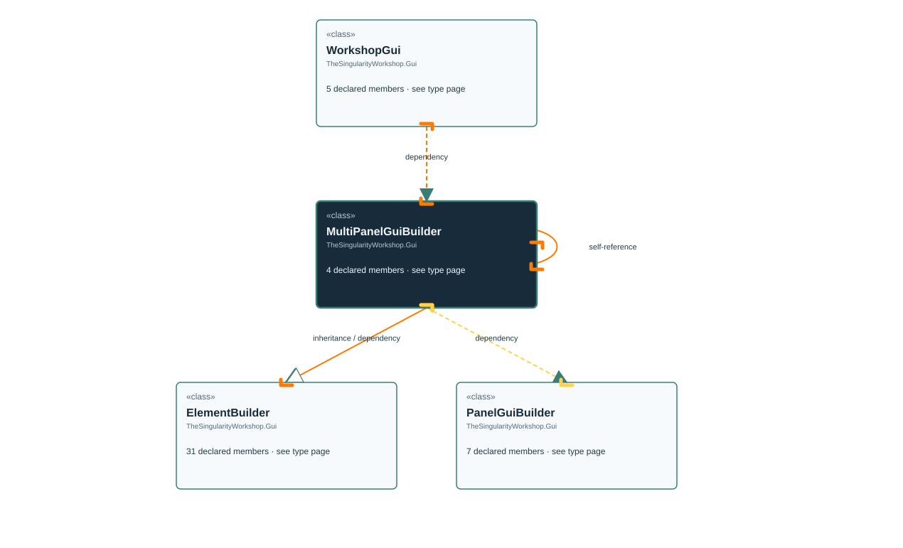

<!-- The Singularity Workshop moniker -->

# TheSingularityWorkshop.Gui.MultiPanelGuiBuilder

> Generated from compiler-backed source analysis. Do not edit by hand.

- Repository: `TrentBest/TheSingularityWorkshop.GUI`
- Revision: [`59362b4a57a60809f338977e3e978b9eb3ee5099`](https://github.com/TrentBest/TheSingularityWorkshop.GUI/tree/59362b4a57a60809f338977e3e978b9eb3ee5099)
- Project: `src/Blazor/TheSingularityWorkshop.GUI.Blazor.csproj`
- Type ID: `type:TheSingularityWorkshop.GUI.Blazor, Version=0.1.0.0, Culture=neutral, PublicKeyToken=null:global::TheSingularityWorkshop.Gui.MultiPanelGuiBuilder`
- Metadata name: `MultiPanelGuiBuilder`
- Kind: `class`
- Generic arity: 0

## UML diagram

## Source declarations

- [`src/Blazor/MultiPanelGuiBuilder.cs:3-12`](https://github.com/TrentBest/TheSingularityWorkshop.GUI/blob/59362b4a57a60809f338977e3e978b9eb3ee5099/src/Blazor/MultiPanelGuiBuilder.cs#L3-12)

## Members

| Kind | Signature | Source |
|---|---|---|
| `Method` | `TheSingularityWorkshop.Gui.MultiPanelGuiBuilder.Content(TheSingularityWorkshop.Gui.ElementBuilder)` | [`src/Blazor/MultiPanelGuiBuilder.cs:9-9`](https://github.com/TrentBest/TheSingularityWorkshop.GUI/blob/59362b4a57a60809f338977e3e978b9eb3ee5099/src/Blazor/MultiPanelGuiBuilder.cs#L9-9) |
| `Method` | `TheSingularityWorkshop.Gui.MultiPanelGuiBuilder.MultiPanelGuiBuilder(object)` | [`src/Blazor/MultiPanelGuiBuilder.cs:5-5`](https://github.com/TrentBest/TheSingularityWorkshop.GUI/blob/59362b4a57a60809f338977e3e978b9eb3ee5099/src/Blazor/MultiPanelGuiBuilder.cs#L5-5) |
| `Method` | `TheSingularityWorkshop.Gui.MultiPanelGuiBuilder.Panel(System.Action<TheSingularityWorkshop.Gui.PanelGuiBuilder>)` | [`src/Blazor/MultiPanelGuiBuilder.cs:7-7`](https://github.com/TrentBest/TheSingularityWorkshop.GUI/blob/59362b4a57a60809f338977e3e978b9eb3ee5099/src/Blazor/MultiPanelGuiBuilder.cs#L7-7) |
| `Method` | `TheSingularityWorkshop.Gui.MultiPanelGuiBuilder.Style(string, string)` | [`src/Blazor/MultiPanelGuiBuilder.cs:11-11`](https://github.com/TrentBest/TheSingularityWorkshop.GUI/blob/59362b4a57a60809f338977e3e978b9eb3ee5099/src/Blazor/MultiPanelGuiBuilder.cs#L11-11) |

## Relationships

| Direction | Kind | Related type | Resolution | Evidence |
|---|---|---|---|---|
| outgoing | `Inheritance` | `TheSingularityWorkshop.Gui.ElementBuilder` | `Resolved` | [`src/Blazor/MultiPanelGuiBuilder.cs:3-12`](https://github.com/TrentBest/TheSingularityWorkshop.GUI/blob/59362b4a57a60809f338977e3e978b9eb3ee5099/src/Blazor/MultiPanelGuiBuilder.cs#L3-12) |
| outgoing | `Dependency` | `TheSingularityWorkshop.Gui.ElementBuilder` | `Resolved` | [`src/Blazor/MultiPanelGuiBuilder.cs:9-9`](https://github.com/TrentBest/TheSingularityWorkshop.GUI/blob/59362b4a57a60809f338977e3e978b9eb3ee5099/src/Blazor/MultiPanelGuiBuilder.cs#L9-9) |
| outgoing | `Dependency` | `TheSingularityWorkshop.Gui.MultiPanelGuiBuilder` | `Resolved` | [`src/Blazor/MultiPanelGuiBuilder.cs:9-9`](https://github.com/TrentBest/TheSingularityWorkshop.GUI/blob/59362b4a57a60809f338977e3e978b9eb3ee5099/src/Blazor/MultiPanelGuiBuilder.cs#L9-9) |
| outgoing | `Dependency` | `TheSingularityWorkshop.Gui.MultiPanelGuiBuilder` | `Resolved` | [`src/Blazor/MultiPanelGuiBuilder.cs:7-7`](https://github.com/TrentBest/TheSingularityWorkshop.GUI/blob/59362b4a57a60809f338977e3e978b9eb3ee5099/src/Blazor/MultiPanelGuiBuilder.cs#L7-7) |
| outgoing | `Dependency` | `TheSingularityWorkshop.Gui.MultiPanelGuiBuilder` | `Resolved` | [`src/Blazor/MultiPanelGuiBuilder.cs:11-11`](https://github.com/TrentBest/TheSingularityWorkshop.GUI/blob/59362b4a57a60809f338977e3e978b9eb3ee5099/src/Blazor/MultiPanelGuiBuilder.cs#L11-11) |
| outgoing | `Dependency` | `TheSingularityWorkshop.Gui.PanelGuiBuilder` | `Resolved` | [`src/Blazor/MultiPanelGuiBuilder.cs:7-7`](https://github.com/TrentBest/TheSingularityWorkshop.GUI/blob/59362b4a57a60809f338977e3e978b9eb3ee5099/src/Blazor/MultiPanelGuiBuilder.cs#L7-7) |
| incoming | `Dependency` | `TheSingularityWorkshop.Gui.WorkshopGui` | `Resolved` | [`src/Blazor/WorkshopGuiBuilder.cs:15-15`](https://github.com/TrentBest/TheSingularityWorkshop.GUI/blob/59362b4a57a60809f338977e3e978b9eb3ee5099/src/Blazor/WorkshopGuiBuilder.cs#L15-15) |

[Back to the generated type index](index.md)

---

<!-- THE SINGULARITY WORKSHOP FOOTER -->

