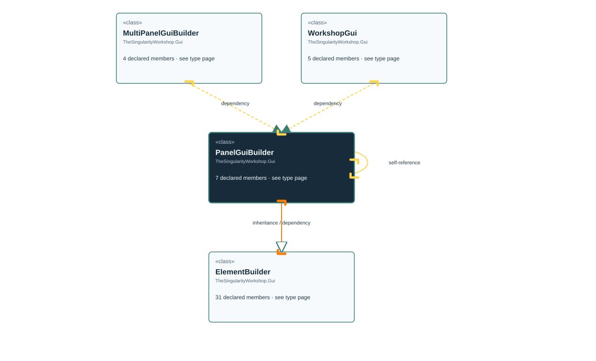

# TheSingularityWorkshop.Gui.PanelGuiBuilder

> Generated from compiler-backed source analysis. Do not edit by hand.

- Repository: `TrentBest/TheSingularityWorkshop.GUI`
- Revision: [`a25acf387b1e24b6dba0a927e763c0b55c8b9b3e`](https://github.com/TrentBest/TheSingularityWorkshop.GUI/tree/a25acf387b1e24b6dba0a927e763c0b55c8b9b3e)
- Project: `src/Blazor/TheSingularityWorkshop.GUI.Blazor.csproj`
- Type ID: `type:TheSingularityWorkshop.GUI.Blazor, Version=0.1.0.0, Culture=neutral, PublicKeyToken=null:global::TheSingularityWorkshop.Gui.PanelGuiBuilder`
- Metadata name: `PanelGuiBuilder`
- Kind: `class`
- Generic arity: 0

## UML diagram

## Source declarations

- [`src/Blazor/PanelGuiBuilder.cs:3-18`](https://github.com/TrentBest/TheSingularityWorkshop.GUI/blob/a25acf387b1e24b6dba0a927e763c0b55c8b9b3e/src/Blazor/PanelGuiBuilder.cs#L3-18)

## Members

| Kind | Signature | Source |
|---|---|---|
| `Method` | `TheSingularityWorkshop.Gui.PanelGuiBuilder.AriaLabel(string)` | [`src/Blazor/PanelGuiBuilder.cs:15-15`](https://github.com/TrentBest/TheSingularityWorkshop.GUI/blob/a25acf387b1e24b6dba0a927e763c0b55c8b9b3e/src/Blazor/PanelGuiBuilder.cs#L15-15) |
| `Method` | `TheSingularityWorkshop.Gui.PanelGuiBuilder.Attribute(string, object?)` | [`src/Blazor/PanelGuiBuilder.cs:13-13`](https://github.com/TrentBest/TheSingularityWorkshop.GUI/blob/a25acf387b1e24b6dba0a927e763c0b55c8b9b3e/src/Blazor/PanelGuiBuilder.cs#L13-13) |
| `Method` | `TheSingularityWorkshop.Gui.PanelGuiBuilder.Content(TheSingularityWorkshop.Gui.ElementBuilder)` | [`src/Blazor/PanelGuiBuilder.cs:11-11`](https://github.com/TrentBest/TheSingularityWorkshop.GUI/blob/a25acf387b1e24b6dba0a927e763c0b55c8b9b3e/src/Blazor/PanelGuiBuilder.cs#L11-11) |
| `Method` | `TheSingularityWorkshop.Gui.PanelGuiBuilder.Heading(string, int)` | [`src/Blazor/PanelGuiBuilder.cs:7-7`](https://github.com/TrentBest/TheSingularityWorkshop.GUI/blob/a25acf387b1e24b6dba0a927e763c0b55c8b9b3e/src/Blazor/PanelGuiBuilder.cs#L7-7) |
| `Method` | `TheSingularityWorkshop.Gui.PanelGuiBuilder.PanelGuiBuilder(object)` | [`src/Blazor/PanelGuiBuilder.cs:5-5`](https://github.com/TrentBest/TheSingularityWorkshop.GUI/blob/a25acf387b1e24b6dba0a927e763c0b55c8b9b3e/src/Blazor/PanelGuiBuilder.cs#L5-5) |
| `Method` | `TheSingularityWorkshop.Gui.PanelGuiBuilder.Paragraph(string)` | [`src/Blazor/PanelGuiBuilder.cs:9-9`](https://github.com/TrentBest/TheSingularityWorkshop.GUI/blob/a25acf387b1e24b6dba0a927e763c0b55c8b9b3e/src/Blazor/PanelGuiBuilder.cs#L9-9) |
| `Method` | `TheSingularityWorkshop.Gui.PanelGuiBuilder.Style(string, string)` | [`src/Blazor/PanelGuiBuilder.cs:17-17`](https://github.com/TrentBest/TheSingularityWorkshop.GUI/blob/a25acf387b1e24b6dba0a927e763c0b55c8b9b3e/src/Blazor/PanelGuiBuilder.cs#L17-17) |

## Relationships

| Direction | Kind | Related type | Resolution | Evidence |
|---|---|---|---|---|
| outgoing | `Inheritance` | `TheSingularityWorkshop.Gui.ElementBuilder` | `Resolved` | [`src/Blazor/PanelGuiBuilder.cs:3-18`](https://github.com/TrentBest/TheSingularityWorkshop.GUI/blob/a25acf387b1e24b6dba0a927e763c0b55c8b9b3e/src/Blazor/PanelGuiBuilder.cs#L3-18) |
| incoming | `Dependency` | `TheSingularityWorkshop.Gui.MultiPanelGuiBuilder` | `Resolved` | [`src/Blazor/MultiPanelGuiBuilder.cs:7-7`](https://github.com/TrentBest/TheSingularityWorkshop.GUI/blob/a25acf387b1e24b6dba0a927e763c0b55c8b9b3e/src/Blazor/MultiPanelGuiBuilder.cs#L7-7) |
| outgoing | `Dependency` | `TheSingularityWorkshop.Gui.ElementBuilder` | `Resolved` | [`src/Blazor/PanelGuiBuilder.cs:11-11`](https://github.com/TrentBest/TheSingularityWorkshop.GUI/blob/a25acf387b1e24b6dba0a927e763c0b55c8b9b3e/src/Blazor/PanelGuiBuilder.cs#L11-11) |
| outgoing | `Dependency` | `TheSingularityWorkshop.Gui.PanelGuiBuilder` | `Resolved` | [`src/Blazor/PanelGuiBuilder.cs:15-15`](https://github.com/TrentBest/TheSingularityWorkshop.GUI/blob/a25acf387b1e24b6dba0a927e763c0b55c8b9b3e/src/Blazor/PanelGuiBuilder.cs#L15-15) |
| outgoing | `Dependency` | `TheSingularityWorkshop.Gui.PanelGuiBuilder` | `Resolved` | [`src/Blazor/PanelGuiBuilder.cs:13-13`](https://github.com/TrentBest/TheSingularityWorkshop.GUI/blob/a25acf387b1e24b6dba0a927e763c0b55c8b9b3e/src/Blazor/PanelGuiBuilder.cs#L13-13) |
| outgoing | `Dependency` | `TheSingularityWorkshop.Gui.PanelGuiBuilder` | `Resolved` | [`src/Blazor/PanelGuiBuilder.cs:11-11`](https://github.com/TrentBest/TheSingularityWorkshop.GUI/blob/a25acf387b1e24b6dba0a927e763c0b55c8b9b3e/src/Blazor/PanelGuiBuilder.cs#L11-11) |
| outgoing | `Dependency` | `TheSingularityWorkshop.Gui.PanelGuiBuilder` | `Resolved` | [`src/Blazor/PanelGuiBuilder.cs:7-7`](https://github.com/TrentBest/TheSingularityWorkshop.GUI/blob/a25acf387b1e24b6dba0a927e763c0b55c8b9b3e/src/Blazor/PanelGuiBuilder.cs#L7-7) |
| outgoing | `Dependency` | `TheSingularityWorkshop.Gui.PanelGuiBuilder` | `Resolved` | [`src/Blazor/PanelGuiBuilder.cs:9-9`](https://github.com/TrentBest/TheSingularityWorkshop.GUI/blob/a25acf387b1e24b6dba0a927e763c0b55c8b9b3e/src/Blazor/PanelGuiBuilder.cs#L9-9) |
| outgoing | `Dependency` | `TheSingularityWorkshop.Gui.PanelGuiBuilder` | `Resolved` | [`src/Blazor/PanelGuiBuilder.cs:17-17`](https://github.com/TrentBest/TheSingularityWorkshop.GUI/blob/a25acf387b1e24b6dba0a927e763c0b55c8b9b3e/src/Blazor/PanelGuiBuilder.cs#L17-17) |
| incoming | `Dependency` | `TheSingularityWorkshop.Gui.WorkshopGui` | `Resolved` | [`src/Blazor/WorkshopGuiBuilder.cs:13-13`](https://github.com/TrentBest/TheSingularityWorkshop.GUI/blob/a25acf387b1e24b6dba0a927e763c0b55c8b9b3e/src/Blazor/WorkshopGuiBuilder.cs#L13-13) |

[Back to the generated type index](index.md)

