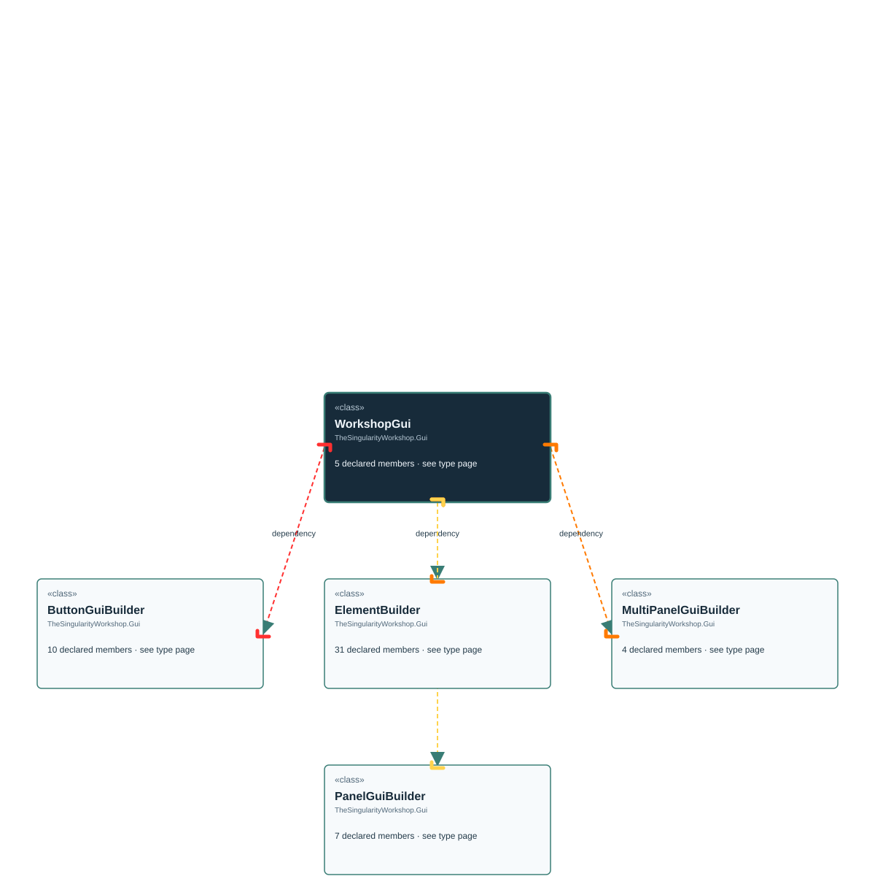

# TheSingularityWorkshop.Gui.WorkshopGui

> Generated from compiler-backed source analysis. Do not edit by hand.

- Repository: `TrentBest/TheSingularityWorkshop.GUI`
- Revision: [`0644fd4a6c6dc743fb9882f25358651ebbed954b`](https://github.com/TrentBest/TheSingularityWorkshop.GUI/tree/0644fd4a6c6dc743fb9882f25358651ebbed954b)
- Project: `src/Blazor/TheSingularityWorkshop.GUI.Blazor.csproj`
- Type ID: `type:TheSingularityWorkshop.GUI.Blazor, Version=0.1.0.0, Culture=neutral, PublicKeyToken=null:global::TheSingularityWorkshop.Gui.WorkshopGui`
- Metadata name: `WorkshopGui`
- Kind: `class`
- Generic arity: 0

## UML diagram

## Source declarations

- [`src/Blazor/WorkshopGuiBuilder.cs:8-20`](https://github.com/TrentBest/TheSingularityWorkshop.GUI/blob/0644fd4a6c6dc743fb9882f25358651ebbed954b/src/Blazor/WorkshopGuiBuilder.cs#L8-20)

## Members

| Kind | Signature | Source |
|---|---|---|
| `Method` | `TheSingularityWorkshop.Gui.WorkshopGui.Button(object)` | [`src/Blazor/WorkshopGuiBuilder.cs:17-17`](https://github.com/TrentBest/TheSingularityWorkshop.GUI/blob/0644fd4a6c6dc743fb9882f25358651ebbed954b/src/Blazor/WorkshopGuiBuilder.cs#L17-17) |
| `Method` | `TheSingularityWorkshop.Gui.WorkshopGui.Element(object, string)` | [`src/Blazor/WorkshopGuiBuilder.cs:11-11`](https://github.com/TrentBest/TheSingularityWorkshop.GUI/blob/0644fd4a6c6dc743fb9882f25358651ebbed954b/src/Blazor/WorkshopGuiBuilder.cs#L11-11) |
| `Method` | `TheSingularityWorkshop.Gui.WorkshopGui.Image(object)` | [`src/Blazor/WorkshopGuiBuilder.cs:19-19`](https://github.com/TrentBest/TheSingularityWorkshop.GUI/blob/0644fd4a6c6dc743fb9882f25358651ebbed954b/src/Blazor/WorkshopGuiBuilder.cs#L19-19) |
| `Method` | `TheSingularityWorkshop.Gui.WorkshopGui.MultiPanel(object)` | [`src/Blazor/WorkshopGuiBuilder.cs:15-15`](https://github.com/TrentBest/TheSingularityWorkshop.GUI/blob/0644fd4a6c6dc743fb9882f25358651ebbed954b/src/Blazor/WorkshopGuiBuilder.cs#L15-15) |
| `Method` | `TheSingularityWorkshop.Gui.WorkshopGui.Panel(object)` | [`src/Blazor/WorkshopGuiBuilder.cs:13-13`](https://github.com/TrentBest/TheSingularityWorkshop.GUI/blob/0644fd4a6c6dc743fb9882f25358651ebbed954b/src/Blazor/WorkshopGuiBuilder.cs#L13-13) |

## Relationships

| Direction | Kind | Related type | Resolution | Evidence |
|---|---|---|---|---|
| outgoing | `Dependency` | `TheSingularityWorkshop.Gui.ButtonGuiBuilder` | `Resolved` | [`src/Blazor/WorkshopGuiBuilder.cs:17-17`](https://github.com/TrentBest/TheSingularityWorkshop.GUI/blob/0644fd4a6c6dc743fb9882f25358651ebbed954b/src/Blazor/WorkshopGuiBuilder.cs#L17-17) |
| outgoing | `Dependency` | `TheSingularityWorkshop.Gui.ElementBuilder` | `Resolved` | [`src/Blazor/WorkshopGuiBuilder.cs:11-11`](https://github.com/TrentBest/TheSingularityWorkshop.GUI/blob/0644fd4a6c6dc743fb9882f25358651ebbed954b/src/Blazor/WorkshopGuiBuilder.cs#L11-11) |
| outgoing | `Dependency` | `TheSingularityWorkshop.Gui.ElementBuilder` | `Resolved` | [`src/Blazor/WorkshopGuiBuilder.cs:19-19`](https://github.com/TrentBest/TheSingularityWorkshop.GUI/blob/0644fd4a6c6dc743fb9882f25358651ebbed954b/src/Blazor/WorkshopGuiBuilder.cs#L19-19) |
| outgoing | `Dependency` | `TheSingularityWorkshop.Gui.MultiPanelGuiBuilder` | `Resolved` | [`src/Blazor/WorkshopGuiBuilder.cs:15-15`](https://github.com/TrentBest/TheSingularityWorkshop.GUI/blob/0644fd4a6c6dc743fb9882f25358651ebbed954b/src/Blazor/WorkshopGuiBuilder.cs#L15-15) |
| outgoing | `Dependency` | `TheSingularityWorkshop.Gui.PanelGuiBuilder` | `Resolved` | [`src/Blazor/WorkshopGuiBuilder.cs:13-13`](https://github.com/TrentBest/TheSingularityWorkshop.GUI/blob/0644fd4a6c6dc743fb9882f25358651ebbed954b/src/Blazor/WorkshopGuiBuilder.cs#L13-13) |

[Back to the generated type index](index.md)

