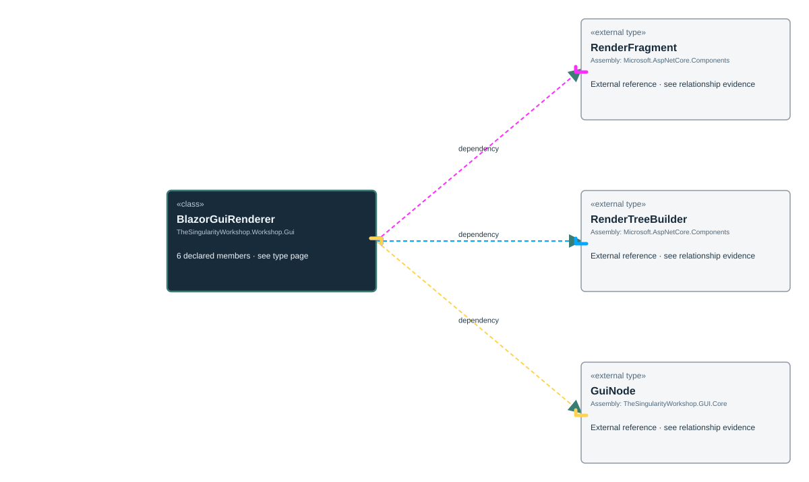

<!-- The Singularity Workshop moniker -->

# TheSingularityWorkshop.Workshop.Gui.BlazorGuiRenderer

> Generated from compiler-backed source analysis. Do not edit by hand.

- Repository: `TrentBest/TheSingularityWorkshop.GUI`
- Revision: [`739f7199b9b378db810d03c31e1ca6a205092a08`](https://github.com/TrentBest/TheSingularityWorkshop.GUI/tree/739f7199b9b378db810d03c31e1ca6a205092a08)
- Project: `src/Blazor/TheSingularityWorkshop.GUI.Blazor.csproj`
- Type ID: `type:TheSingularityWorkshop.GUI.Blazor, Version=0.1.0.0, Culture=neutral, PublicKeyToken=null:global::TheSingularityWorkshop.Workshop.Gui.BlazorGuiRenderer`
- Metadata name: `BlazorGuiRenderer`
- Kind: `class`
- Generic arity: 0

## UML diagram

## Source declarations

- [`src/Blazor/BlazorGuiRenderer.cs:11-109`](https://github.com/TrentBest/TheSingularityWorkshop.GUI/blob/739f7199b9b378db810d03c31e1ca6a205092a08/src/Blazor/BlazorGuiRenderer.cs#L11-109)

## Members

| Kind | Signature | Source |
|---|---|---|
| `Field` | `TheSingularityWorkshop.Workshop.Gui.BlazorGuiRenderer.MaximumTreeDepth` | [`src/Blazor/BlazorGuiRenderer.cs:13-13`](https://github.com/TrentBest/TheSingularityWorkshop.GUI/blob/739f7199b9b378db810d03c31e1ca6a205092a08/src/Blazor/BlazorGuiRenderer.cs#L13-13) |
| `Method` | `TheSingularityWorkshop.Workshop.Gui.BlazorGuiRenderer.Render(TheSingularityWorkshop.Workshop.Gui.GuiNode)` | [`src/Blazor/BlazorGuiRenderer.cs:16-21`](https://github.com/TrentBest/TheSingularityWorkshop.GUI/blob/739f7199b9b378db810d03c31e1ca6a205092a08/src/Blazor/BlazorGuiRenderer.cs#L16-21) |
| `Method` | `TheSingularityWorkshop.Workshop.Gui.BlazorGuiRenderer.Render(TheSingularityWorkshop.Workshop.Gui.GuiNode, System.Action<string>)` | [`src/Blazor/BlazorGuiRenderer.cs:27-33`](https://github.com/TrentBest/TheSingularityWorkshop.GUI/blob/739f7199b9b378db810d03c31e1ca6a205092a08/src/Blazor/BlazorGuiRenderer.cs#L27-33) |
| `Method` | `TheSingularityWorkshop.Workshop.Gui.BlazorGuiRenderer.RenderNode(Microsoft.AspNetCore.Components.Rendering.RenderTreeBuilder, TheSingularityWorkshop.Workshop.Gui.GuiNode, System.Action<string>?)` | [`src/Blazor/BlazorGuiRenderer.cs:58-98`](https://github.com/TrentBest/TheSingularityWorkshop.GUI/blob/739f7199b9b378db810d03c31e1ca6a205092a08/src/Blazor/BlazorGuiRenderer.cs#L58-98) |
| `Method` | `TheSingularityWorkshop.Workshop.Gui.BlazorGuiRenderer.ResolveTag(string)` | [`src/Blazor/BlazorGuiRenderer.cs:100-108`](https://github.com/TrentBest/TheSingularityWorkshop.GUI/blob/739f7199b9b378db810d03c31e1ca6a205092a08/src/Blazor/BlazorGuiRenderer.cs#L100-108) |
| `Method` | `TheSingularityWorkshop.Workshop.Gui.BlazorGuiRenderer.ValidateUniqueIds(TheSingularityWorkshop.Workshop.Gui.GuiNode)` | [`src/Blazor/BlazorGuiRenderer.cs:35-56`](https://github.com/TrentBest/TheSingularityWorkshop.GUI/blob/739f7199b9b378db810d03c31e1ca6a205092a08/src/Blazor/BlazorGuiRenderer.cs#L35-56) |

## Relationships

| Direction | Kind | Related type | Resolution | Evidence |
|---|---|---|---|---|
| outgoing | `Dependency` | `global::Microsoft.AspNetCore.Components.RenderFragment` | `External` | [`src/Blazor/BlazorGuiRenderer.cs:16-21`](https://github.com/TrentBest/TheSingularityWorkshop.GUI/blob/739f7199b9b378db810d03c31e1ca6a205092a08/src/Blazor/BlazorGuiRenderer.cs#L16-21) |
| outgoing | `Dependency` | `global::Microsoft.AspNetCore.Components.RenderFragment` | `External` | [`src/Blazor/BlazorGuiRenderer.cs:27-33`](https://github.com/TrentBest/TheSingularityWorkshop.GUI/blob/739f7199b9b378db810d03c31e1ca6a205092a08/src/Blazor/BlazorGuiRenderer.cs#L27-33) |
| outgoing | `Dependency` | `global::Microsoft.AspNetCore.Components.Rendering.RenderTreeBuilder` | `External` | [`src/Blazor/BlazorGuiRenderer.cs:58-98`](https://github.com/TrentBest/TheSingularityWorkshop.GUI/blob/739f7199b9b378db810d03c31e1ca6a205092a08/src/Blazor/BlazorGuiRenderer.cs#L58-98) |
| outgoing | `Dependency` | `global::TheSingularityWorkshop.Workshop.Gui.GuiNode` | `External` | [`src/Blazor/BlazorGuiRenderer.cs:16-21`](https://github.com/TrentBest/TheSingularityWorkshop.GUI/blob/739f7199b9b378db810d03c31e1ca6a205092a08/src/Blazor/BlazorGuiRenderer.cs#L16-21) |
| outgoing | `Dependency` | `global::TheSingularityWorkshop.Workshop.Gui.GuiNode` | `External` | [`src/Blazor/BlazorGuiRenderer.cs:27-33`](https://github.com/TrentBest/TheSingularityWorkshop.GUI/blob/739f7199b9b378db810d03c31e1ca6a205092a08/src/Blazor/BlazorGuiRenderer.cs#L27-33) |
| outgoing | `Dependency` | `global::TheSingularityWorkshop.Workshop.Gui.GuiNode` | `External` | [`src/Blazor/BlazorGuiRenderer.cs:58-98`](https://github.com/TrentBest/TheSingularityWorkshop.GUI/blob/739f7199b9b378db810d03c31e1ca6a205092a08/src/Blazor/BlazorGuiRenderer.cs#L58-98) |
| outgoing | `Dependency` | `global::TheSingularityWorkshop.Workshop.Gui.GuiNode` | `External` | [`src/Blazor/BlazorGuiRenderer.cs:35-56`](https://github.com/TrentBest/TheSingularityWorkshop.GUI/blob/739f7199b9b378db810d03c31e1ca6a205092a08/src/Blazor/BlazorGuiRenderer.cs#L35-56) |

[Back to the generated type index](index.md)

---

<!-- THE SINGULARITY WORKSHOP FOOTER -->

