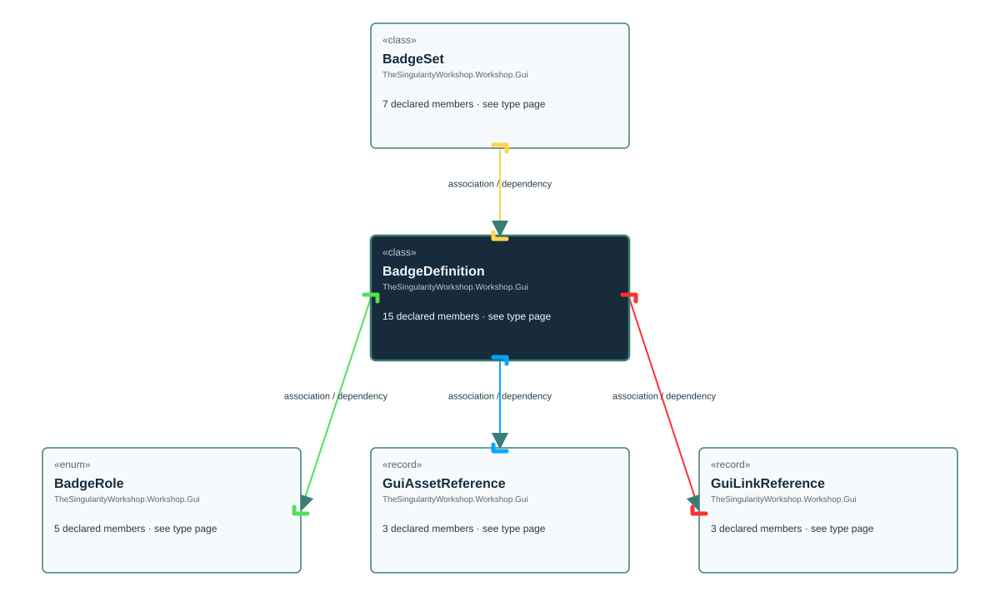

<!-- The Singularity Workshop moniker -->

# TheSingularityWorkshop.Workshop.Gui.BadgeDefinition

> Generated from compiler-backed source analysis. Do not edit by hand.

- Repository: `TrentBest/TheSingularityWorkshop.GUI`
- Revision: [`c1f4fdd938163ed0a26f4b2c5dd4d88194d5f8d9`](https://github.com/TrentBest/TheSingularityWorkshop.GUI/tree/c1f4fdd938163ed0a26f4b2c5dd4d88194d5f8d9)
- Project: `src/Core/TheSingularityWorkshop.GUI.Core.csproj`
- Type ID: `type:TheSingularityWorkshop.GUI.Core, Version=0.1.0.0, Culture=neutral, PublicKeyToken=null:global::TheSingularityWorkshop.Workshop.Gui.BadgeDefinition`
- Metadata name: `BadgeDefinition`
- Kind: `class`
- Generic arity: 0

## UML diagram

## Source declarations

- [`src/Core/BadgeDefinition.cs:89-129`](https://github.com/TrentBest/TheSingularityWorkshop.GUI/blob/c1f4fdd938163ed0a26f4b2c5dd4d88194d5f8d9/src/Core/BadgeDefinition.cs#L89-129)

## Members

| Kind | Signature | Source |
|---|---|---|
| `Property` | `TheSingularityWorkshop.Workshop.Gui.BadgeDefinition.AltText` | [`src/Core/BadgeDefinition.cs:122-122`](https://github.com/TrentBest/TheSingularityWorkshop.GUI/blob/c1f4fdd938163ed0a26f4b2c5dd4d88194d5f8d9/src/Core/BadgeDefinition.cs#L122-122) |
| `Method` | `TheSingularityWorkshop.Workshop.Gui.BadgeDefinition.AltText.get` | [`src/Core/BadgeDefinition.cs:122-122`](https://github.com/TrentBest/TheSingularityWorkshop.GUI/blob/c1f4fdd938163ed0a26f4b2c5dd4d88194d5f8d9/src/Core/BadgeDefinition.cs#L122-122) |
| `Property` | `TheSingularityWorkshop.Workshop.Gui.BadgeDefinition.Asset` | [`src/Core/BadgeDefinition.cs:124-124`](https://github.com/TrentBest/TheSingularityWorkshop.GUI/blob/c1f4fdd938163ed0a26f4b2c5dd4d88194d5f8d9/src/Core/BadgeDefinition.cs#L124-124) |
| `Method` | `TheSingularityWorkshop.Workshop.Gui.BadgeDefinition.Asset.get` | [`src/Core/BadgeDefinition.cs:124-124`](https://github.com/TrentBest/TheSingularityWorkshop.GUI/blob/c1f4fdd938163ed0a26f4b2c5dd4d88194d5f8d9/src/Core/BadgeDefinition.cs#L124-124) |
| `Method` | `TheSingularityWorkshop.Workshop.Gui.BadgeDefinition.BadgeDefinition(string, TheSingularityWorkshop.Workshop.Gui.BadgeRole, string, string, TheSingularityWorkshop.Workshop.Gui.GuiAssetReference, string?, TheSingularityWorkshop.Workshop.Gui.GuiLinkReference?)` | [`src/Core/BadgeDefinition.cs:92-113`](https://github.com/TrentBest/TheSingularityWorkshop.GUI/blob/c1f4fdd938163ed0a26f4b2c5dd4d88194d5f8d9/src/Core/BadgeDefinition.cs#L92-113) |
| `Property` | `TheSingularityWorkshop.Workshop.Gui.BadgeDefinition.Description` | [`src/Core/BadgeDefinition.cs:126-126`](https://github.com/TrentBest/TheSingularityWorkshop.GUI/blob/c1f4fdd938163ed0a26f4b2c5dd4d88194d5f8d9/src/Core/BadgeDefinition.cs#L126-126) |
| `Method` | `TheSingularityWorkshop.Workshop.Gui.BadgeDefinition.Description.get` | [`src/Core/BadgeDefinition.cs:126-126`](https://github.com/TrentBest/TheSingularityWorkshop.GUI/blob/c1f4fdd938163ed0a26f4b2c5dd4d88194d5f8d9/src/Core/BadgeDefinition.cs#L126-126) |
| `Property` | `TheSingularityWorkshop.Workshop.Gui.BadgeDefinition.Destination` | [`src/Core/BadgeDefinition.cs:128-128`](https://github.com/TrentBest/TheSingularityWorkshop.GUI/blob/c1f4fdd938163ed0a26f4b2c5dd4d88194d5f8d9/src/Core/BadgeDefinition.cs#L128-128) |
| `Method` | `TheSingularityWorkshop.Workshop.Gui.BadgeDefinition.Destination.get` | [`src/Core/BadgeDefinition.cs:128-128`](https://github.com/TrentBest/TheSingularityWorkshop.GUI/blob/c1f4fdd938163ed0a26f4b2c5dd4d88194d5f8d9/src/Core/BadgeDefinition.cs#L128-128) |
| `Property` | `TheSingularityWorkshop.Workshop.Gui.BadgeDefinition.Id` | [`src/Core/BadgeDefinition.cs:116-116`](https://github.com/TrentBest/TheSingularityWorkshop.GUI/blob/c1f4fdd938163ed0a26f4b2c5dd4d88194d5f8d9/src/Core/BadgeDefinition.cs#L116-116) |
| `Method` | `TheSingularityWorkshop.Workshop.Gui.BadgeDefinition.Id.get` | [`src/Core/BadgeDefinition.cs:116-116`](https://github.com/TrentBest/TheSingularityWorkshop.GUI/blob/c1f4fdd938163ed0a26f4b2c5dd4d88194d5f8d9/src/Core/BadgeDefinition.cs#L116-116) |
| `Property` | `TheSingularityWorkshop.Workshop.Gui.BadgeDefinition.Label` | [`src/Core/BadgeDefinition.cs:120-120`](https://github.com/TrentBest/TheSingularityWorkshop.GUI/blob/c1f4fdd938163ed0a26f4b2c5dd4d88194d5f8d9/src/Core/BadgeDefinition.cs#L120-120) |
| `Method` | `TheSingularityWorkshop.Workshop.Gui.BadgeDefinition.Label.get` | [`src/Core/BadgeDefinition.cs:120-120`](https://github.com/TrentBest/TheSingularityWorkshop.GUI/blob/c1f4fdd938163ed0a26f4b2c5dd4d88194d5f8d9/src/Core/BadgeDefinition.cs#L120-120) |
| `Property` | `TheSingularityWorkshop.Workshop.Gui.BadgeDefinition.Role` | [`src/Core/BadgeDefinition.cs:118-118`](https://github.com/TrentBest/TheSingularityWorkshop.GUI/blob/c1f4fdd938163ed0a26f4b2c5dd4d88194d5f8d9/src/Core/BadgeDefinition.cs#L118-118) |
| `Method` | `TheSingularityWorkshop.Workshop.Gui.BadgeDefinition.Role.get` | [`src/Core/BadgeDefinition.cs:118-118`](https://github.com/TrentBest/TheSingularityWorkshop.GUI/blob/c1f4fdd938163ed0a26f4b2c5dd4d88194d5f8d9/src/Core/BadgeDefinition.cs#L118-118) |

## Relationships

| Direction | Kind | Related type | Resolution | Evidence |
|---|---|---|---|---|
| outgoing | `Association` | `TheSingularityWorkshop.Workshop.Gui.BadgeRole` | `Resolved` | [`src/Core/BadgeDefinition.cs:118-118`](https://github.com/TrentBest/TheSingularityWorkshop.GUI/blob/c1f4fdd938163ed0a26f4b2c5dd4d88194d5f8d9/src/Core/BadgeDefinition.cs#L118-118) |
| outgoing | `Association` | `TheSingularityWorkshop.Workshop.Gui.GuiAssetReference` | `Resolved` | [`src/Core/BadgeDefinition.cs:124-124`](https://github.com/TrentBest/TheSingularityWorkshop.GUI/blob/c1f4fdd938163ed0a26f4b2c5dd4d88194d5f8d9/src/Core/BadgeDefinition.cs#L124-124) |
| outgoing | `Association` | `TheSingularityWorkshop.Workshop.Gui.GuiLinkReference` | `Resolved` | [`src/Core/BadgeDefinition.cs:128-128`](https://github.com/TrentBest/TheSingularityWorkshop.GUI/blob/c1f4fdd938163ed0a26f4b2c5dd4d88194d5f8d9/src/Core/BadgeDefinition.cs#L128-128) |
| incoming | `Association` | `TheSingularityWorkshop.Workshop.Gui.BadgeSet` | `Resolved` | [`src/Core/BadgeDefinition.cs:134-134`](https://github.com/TrentBest/TheSingularityWorkshop.GUI/blob/c1f4fdd938163ed0a26f4b2c5dd4d88194d5f8d9/src/Core/BadgeDefinition.cs#L134-134) |
| incoming | `Association` | `TheSingularityWorkshop.Workshop.Gui.BadgeSet` | `Resolved` | [`src/Core/BadgeDefinition.cs:153-153`](https://github.com/TrentBest/TheSingularityWorkshop.GUI/blob/c1f4fdd938163ed0a26f4b2c5dd4d88194d5f8d9/src/Core/BadgeDefinition.cs#L153-153) |
| outgoing | `Dependency` | `TheSingularityWorkshop.Workshop.Gui.BadgeRole` | `Resolved` | [`src/Core/BadgeDefinition.cs:92-113`](https://github.com/TrentBest/TheSingularityWorkshop.GUI/blob/c1f4fdd938163ed0a26f4b2c5dd4d88194d5f8d9/src/Core/BadgeDefinition.cs#L92-113) |
| outgoing | `Dependency` | `TheSingularityWorkshop.Workshop.Gui.GuiAssetReference` | `Resolved` | [`src/Core/BadgeDefinition.cs:92-113`](https://github.com/TrentBest/TheSingularityWorkshop.GUI/blob/c1f4fdd938163ed0a26f4b2c5dd4d88194d5f8d9/src/Core/BadgeDefinition.cs#L92-113) |
| outgoing | `Dependency` | `TheSingularityWorkshop.Workshop.Gui.GuiLinkReference` | `Resolved` | [`src/Core/BadgeDefinition.cs:92-113`](https://github.com/TrentBest/TheSingularityWorkshop.GUI/blob/c1f4fdd938163ed0a26f4b2c5dd4d88194d5f8d9/src/Core/BadgeDefinition.cs#L92-113) |
| incoming | `Dependency` | `TheSingularityWorkshop.Workshop.Gui.BadgeSet` | `Resolved` | [`src/Core/BadgeDefinition.cs:156-160`](https://github.com/TrentBest/TheSingularityWorkshop.GUI/blob/c1f4fdd938163ed0a26f4b2c5dd4d88194d5f8d9/src/Core/BadgeDefinition.cs#L156-160) |
| incoming | `Dependency` | `TheSingularityWorkshop.Workshop.Gui.BadgeSet` | `Resolved` | [`src/Core/BadgeDefinition.cs:137-147`](https://github.com/TrentBest/TheSingularityWorkshop.GUI/blob/c1f4fdd938163ed0a26f4b2c5dd4d88194d5f8d9/src/Core/BadgeDefinition.cs#L137-147) |

[Back to the generated type index](index.md)

---

<!-- THE SINGULARITY WORKSHOP FOOTER -->

