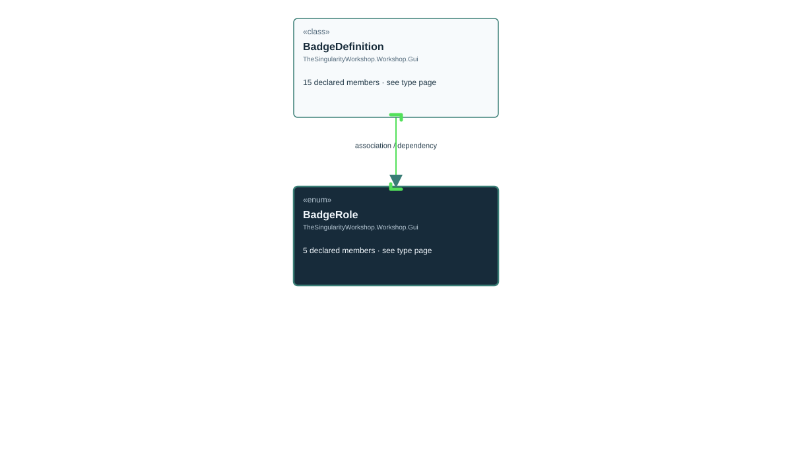

<!-- The Singularity Workshop moniker -->

# TheSingularityWorkshop.Workshop.Gui.BadgeRole

> Generated from compiler-backed source analysis. Do not edit by hand.

- Repository: `TrentBest/TheSingularityWorkshop.GUI`
- Revision: [`c1f4fdd938163ed0a26f4b2c5dd4d88194d5f8d9`](https://github.com/TrentBest/TheSingularityWorkshop.GUI/tree/c1f4fdd938163ed0a26f4b2c5dd4d88194d5f8d9)
- Project: `src/Core/TheSingularityWorkshop.GUI.Core.csproj`
- Type ID: `type:TheSingularityWorkshop.GUI.Core, Version=0.1.0.0, Culture=neutral, PublicKeyToken=null:global::TheSingularityWorkshop.Workshop.Gui.BadgeRole`
- Metadata name: `BadgeRole`
- Kind: `enum`
- Generic arity: 0

## UML diagram

## Source declarations

- [`src/Core/BadgeDefinition.cs:9-21`](https://github.com/TrentBest/TheSingularityWorkshop.GUI/blob/c1f4fdd938163ed0a26f4b2c5dd4d88194d5f8d9/src/Core/BadgeDefinition.cs#L9-21)

## Members

| Kind | Signature | Source |
|---|---|---|
| `Field` | `TheSingularityWorkshop.Workshop.Gui.BadgeRole.ArtifactIdentity` | [`src/Core/BadgeDefinition.cs:14-14`](https://github.com/TrentBest/TheSingularityWorkshop.GUI/blob/c1f4fdd938163ed0a26f4b2c5dd4d88194d5f8d9/src/Core/BadgeDefinition.cs#L14-14) |
| `Field` | `TheSingularityWorkshop.Workshop.Gui.BadgeRole.Classification` | [`src/Core/BadgeDefinition.cs:12-12`](https://github.com/TrentBest/TheSingularityWorkshop.GUI/blob/c1f4fdd938163ed0a26f4b2c5dd4d88194d5f8d9/src/Core/BadgeDefinition.cs#L12-12) |
| `Field` | `TheSingularityWorkshop.Workshop.Gui.BadgeRole.Other` | [`src/Core/BadgeDefinition.cs:20-20`](https://github.com/TrentBest/TheSingularityWorkshop.GUI/blob/c1f4fdd938163ed0a26f4b2c5dd4d88194d5f8d9/src/Core/BadgeDefinition.cs#L20-20) |
| `Field` | `TheSingularityWorkshop.Workshop.Gui.BadgeRole.Provenance` | [`src/Core/BadgeDefinition.cs:18-18`](https://github.com/TrentBest/TheSingularityWorkshop.GUI/blob/c1f4fdd938163ed0a26f4b2c5dd4d88194d5f8d9/src/Core/BadgeDefinition.cs#L18-18) |
| `Field` | `TheSingularityWorkshop.Workshop.Gui.BadgeRole.Status` | [`src/Core/BadgeDefinition.cs:16-16`](https://github.com/TrentBest/TheSingularityWorkshop.GUI/blob/c1f4fdd938163ed0a26f4b2c5dd4d88194d5f8d9/src/Core/BadgeDefinition.cs#L16-16) |

## Relationships

| Direction | Kind | Related type | Resolution | Evidence |
|---|---|---|---|---|
| incoming | `Association` | `TheSingularityWorkshop.Workshop.Gui.BadgeDefinition` | `Resolved` | [`src/Core/BadgeDefinition.cs:118-118`](https://github.com/TrentBest/TheSingularityWorkshop.GUI/blob/c1f4fdd938163ed0a26f4b2c5dd4d88194d5f8d9/src/Core/BadgeDefinition.cs#L118-118) |
| incoming | `Dependency` | `TheSingularityWorkshop.Workshop.Gui.BadgeDefinition` | `Resolved` | [`src/Core/BadgeDefinition.cs:92-113`](https://github.com/TrentBest/TheSingularityWorkshop.GUI/blob/c1f4fdd938163ed0a26f4b2c5dd4d88194d5f8d9/src/Core/BadgeDefinition.cs#L92-113) |

[Back to the generated type index](index.md)

---

<!-- THE SINGULARITY WORKSHOP FOOTER -->

