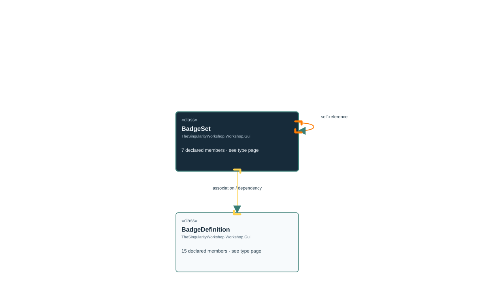

<!-- The Singularity Workshop moniker -->

# TheSingularityWorkshop.Workshop.Gui.BadgeSet

> Generated from compiler-backed source analysis. Do not edit by hand.

- Repository: `TrentBest/TheSingularityWorkshop.GUI`
- Revision: [`c314067d1411b65a797609459058e454c46bb143`](https://github.com/TrentBest/TheSingularityWorkshop.GUI/tree/c314067d1411b65a797609459058e454c46bb143)
- Project: `src/Core/TheSingularityWorkshop.GUI.Core.csproj`
- Type ID: `type:TheSingularityWorkshop.GUI.Core, Version=0.1.0.0, Culture=neutral, PublicKeyToken=null:global::TheSingularityWorkshop.Workshop.Gui.BadgeSet`
- Metadata name: `BadgeSet`
- Kind: `class`
- Generic arity: 0

## UML diagram

## Source declarations

- [`src/Core/BadgeDefinition.cs:132-161`](https://github.com/TrentBest/TheSingularityWorkshop.GUI/blob/c314067d1411b65a797609459058e454c46bb143/src/Core/BadgeDefinition.cs#L132-161)

## Members

| Kind | Signature | Source |
|---|---|---|
| `Method` | `TheSingularityWorkshop.Workshop.Gui.BadgeSet.BadgeSet(System.Collections.Generic.IEnumerable<TheSingularityWorkshop.Workshop.Gui.BadgeDefinition>)` | [`src/Core/BadgeDefinition.cs:137-147`](https://github.com/TrentBest/TheSingularityWorkshop.GUI/blob/c314067d1411b65a797609459058e454c46bb143/src/Core/BadgeDefinition.cs#L137-147) |
| `Property` | `TheSingularityWorkshop.Workshop.Gui.BadgeSet.Badges` | [`src/Core/BadgeDefinition.cs:153-153`](https://github.com/TrentBest/TheSingularityWorkshop.GUI/blob/c314067d1411b65a797609459058e454c46bb143/src/Core/BadgeDefinition.cs#L153-153) |
| `Method` | `TheSingularityWorkshop.Workshop.Gui.BadgeSet.Badges.get` | [`src/Core/BadgeDefinition.cs:153-153`](https://github.com/TrentBest/TheSingularityWorkshop.GUI/blob/c314067d1411b65a797609459058e454c46bb143/src/Core/BadgeDefinition.cs#L153-153) |
| `Property` | `TheSingularityWorkshop.Workshop.Gui.BadgeSet.Empty` | [`src/Core/BadgeDefinition.cs:150-150`](https://github.com/TrentBest/TheSingularityWorkshop.GUI/blob/c314067d1411b65a797609459058e454c46bb143/src/Core/BadgeDefinition.cs#L150-150) |
| `Method` | `TheSingularityWorkshop.Workshop.Gui.BadgeSet.Empty.get` | [`src/Core/BadgeDefinition.cs:150-150`](https://github.com/TrentBest/TheSingularityWorkshop.GUI/blob/c314067d1411b65a797609459058e454c46bb143/src/Core/BadgeDefinition.cs#L150-150) |
| `Method` | `TheSingularityWorkshop.Workshop.Gui.BadgeSet.WithBadge(TheSingularityWorkshop.Workshop.Gui.BadgeDefinition)` | [`src/Core/BadgeDefinition.cs:156-160`](https://github.com/TrentBest/TheSingularityWorkshop.GUI/blob/c314067d1411b65a797609459058e454c46bb143/src/Core/BadgeDefinition.cs#L156-160) |
| `Field` | `TheSingularityWorkshop.Workshop.Gui.BadgeSet._badges` | [`src/Core/BadgeDefinition.cs:134-134`](https://github.com/TrentBest/TheSingularityWorkshop.GUI/blob/c314067d1411b65a797609459058e454c46bb143/src/Core/BadgeDefinition.cs#L134-134) |

## Relationships

| Direction | Kind | Related type | Resolution | Evidence |
|---|---|---|---|---|
| outgoing | `Association` | `TheSingularityWorkshop.Workshop.Gui.BadgeDefinition` | `Resolved` | [`src/Core/BadgeDefinition.cs:134-134`](https://github.com/TrentBest/TheSingularityWorkshop.GUI/blob/c314067d1411b65a797609459058e454c46bb143/src/Core/BadgeDefinition.cs#L134-134) |
| outgoing | `Association` | `TheSingularityWorkshop.Workshop.Gui.BadgeDefinition` | `Resolved` | [`src/Core/BadgeDefinition.cs:153-153`](https://github.com/TrentBest/TheSingularityWorkshop.GUI/blob/c314067d1411b65a797609459058e454c46bb143/src/Core/BadgeDefinition.cs#L153-153) |
| outgoing | `Association` | `TheSingularityWorkshop.Workshop.Gui.BadgeSet` | `Resolved` | [`src/Core/BadgeDefinition.cs:150-150`](https://github.com/TrentBest/TheSingularityWorkshop.GUI/blob/c314067d1411b65a797609459058e454c46bb143/src/Core/BadgeDefinition.cs#L150-150) |
| outgoing | `Dependency` | `TheSingularityWorkshop.Workshop.Gui.BadgeDefinition` | `Resolved` | [`src/Core/BadgeDefinition.cs:156-160`](https://github.com/TrentBest/TheSingularityWorkshop.GUI/blob/c314067d1411b65a797609459058e454c46bb143/src/Core/BadgeDefinition.cs#L156-160) |
| outgoing | `Dependency` | `TheSingularityWorkshop.Workshop.Gui.BadgeDefinition` | `Resolved` | [`src/Core/BadgeDefinition.cs:137-147`](https://github.com/TrentBest/TheSingularityWorkshop.GUI/blob/c314067d1411b65a797609459058e454c46bb143/src/Core/BadgeDefinition.cs#L137-147) |
| outgoing | `Dependency` | `TheSingularityWorkshop.Workshop.Gui.BadgeSet` | `Resolved` | [`src/Core/BadgeDefinition.cs:156-160`](https://github.com/TrentBest/TheSingularityWorkshop.GUI/blob/c314067d1411b65a797609459058e454c46bb143/src/Core/BadgeDefinition.cs#L156-160) |

[Back to the generated type index](index.md)

---

<!-- THE SINGULARITY WORKSHOP FOOTER -->

