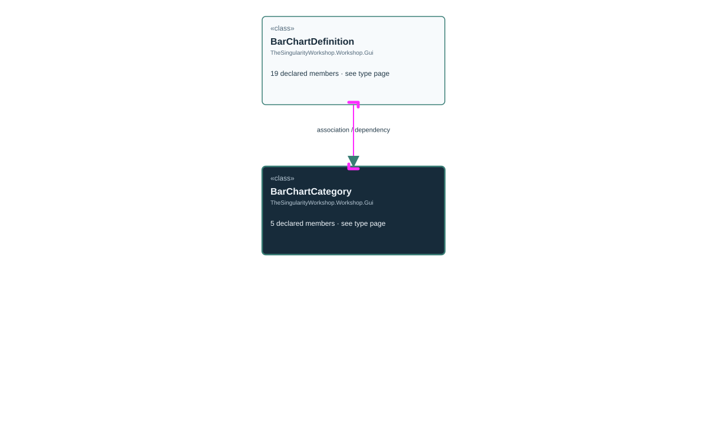

<!-- The Singularity Workshop moniker -->

# TheSingularityWorkshop.Workshop.Gui.BarChartCategory

> Generated from compiler-backed source analysis. Do not edit by hand.

- Repository: `TrentBest/TheSingularityWorkshop.GUI`
- Revision: [`ab72064a71716d2a2240016baaac9257896d425a`](https://github.com/TrentBest/TheSingularityWorkshop.GUI/tree/ab72064a71716d2a2240016baaac9257896d425a)
- Project: `src/Core/TheSingularityWorkshop.GUI.Core.csproj`
- Type ID: `type:TheSingularityWorkshop.GUI.Core, Version=0.1.0.0, Culture=neutral, PublicKeyToken=null:global::TheSingularityWorkshop.Workshop.Gui.BarChartCategory`
- Metadata name: `BarChartCategory`
- Kind: `class`
- Generic arity: 0

## UML diagram

## Source declarations

- [`src/Core/BarChartDefinition.cs:9-28`](https://github.com/TrentBest/TheSingularityWorkshop.GUI/blob/ab72064a71716d2a2240016baaac9257896d425a/src/Core/BarChartDefinition.cs#L9-28)

## Members

| Kind | Signature | Source |
|---|---|---|
| `Method` | `TheSingularityWorkshop.Workshop.Gui.BarChartCategory.BarChartCategory(string, string)` | [`src/Core/BarChartDefinition.cs:15-21`](https://github.com/TrentBest/TheSingularityWorkshop.GUI/blob/ab72064a71716d2a2240016baaac9257896d425a/src/Core/BarChartDefinition.cs#L15-21) |
| `Property` | `TheSingularityWorkshop.Workshop.Gui.BarChartCategory.Id` | [`src/Core/BarChartDefinition.cs:24-24`](https://github.com/TrentBest/TheSingularityWorkshop.GUI/blob/ab72064a71716d2a2240016baaac9257896d425a/src/Core/BarChartDefinition.cs#L24-24) |
| `Method` | `TheSingularityWorkshop.Workshop.Gui.BarChartCategory.Id.get` | [`src/Core/BarChartDefinition.cs:24-24`](https://github.com/TrentBest/TheSingularityWorkshop.GUI/blob/ab72064a71716d2a2240016baaac9257896d425a/src/Core/BarChartDefinition.cs#L24-24) |
| `Property` | `TheSingularityWorkshop.Workshop.Gui.BarChartCategory.Label` | [`src/Core/BarChartDefinition.cs:27-27`](https://github.com/TrentBest/TheSingularityWorkshop.GUI/blob/ab72064a71716d2a2240016baaac9257896d425a/src/Core/BarChartDefinition.cs#L27-27) |
| `Method` | `TheSingularityWorkshop.Workshop.Gui.BarChartCategory.Label.get` | [`src/Core/BarChartDefinition.cs:27-27`](https://github.com/TrentBest/TheSingularityWorkshop.GUI/blob/ab72064a71716d2a2240016baaac9257896d425a/src/Core/BarChartDefinition.cs#L27-27) |

## Relationships

| Direction | Kind | Related type | Resolution | Evidence |
|---|---|---|---|---|
| incoming | `Association` | `TheSingularityWorkshop.Workshop.Gui.BarChartDefinition` | `Resolved` | [`src/Core/BarChartDefinition.cs:89-89`](https://github.com/TrentBest/TheSingularityWorkshop.GUI/blob/ab72064a71716d2a2240016baaac9257896d425a/src/Core/BarChartDefinition.cs#L89-89) |
| incoming | `Association` | `TheSingularityWorkshop.Workshop.Gui.BarChartDefinition` | `Resolved` | [`src/Core/BarChartDefinition.cs:170-170`](https://github.com/TrentBest/TheSingularityWorkshop.GUI/blob/ab72064a71716d2a2240016baaac9257896d425a/src/Core/BarChartDefinition.cs#L170-170) |
| incoming | `Dependency` | `TheSingularityWorkshop.Workshop.Gui.BarChartDefinition` | `Resolved` | [`src/Core/BarChartDefinition.cs:106-149`](https://github.com/TrentBest/TheSingularityWorkshop.GUI/blob/ab72064a71716d2a2240016baaac9257896d425a/src/Core/BarChartDefinition.cs#L106-149) |

[Back to the generated type index](index.md)

---

<!-- THE SINGULARITY WORKSHOP FOOTER -->

