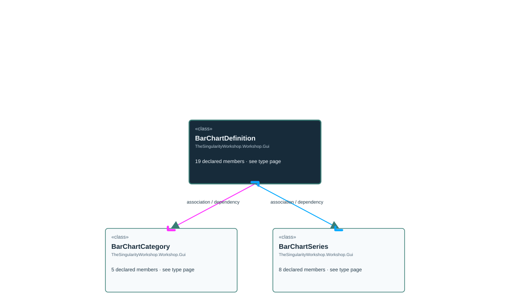

<!-- The Singularity Workshop moniker -->

# TheSingularityWorkshop.Workshop.Gui.BarChartDefinition

> Generated from compiler-backed source analysis. Do not edit by hand.

- Repository: `TrentBest/TheSingularityWorkshop.GUI`
- Revision: [`c314067d1411b65a797609459058e454c46bb143`](https://github.com/TrentBest/TheSingularityWorkshop.GUI/tree/c314067d1411b65a797609459058e454c46bb143)
- Project: `src/Core/TheSingularityWorkshop.GUI.Core.csproj`
- Type ID: `type:TheSingularityWorkshop.GUI.Core, Version=0.1.0.0, Culture=neutral, PublicKeyToken=null:global::TheSingularityWorkshop.Workshop.Gui.BarChartDefinition`
- Metadata name: `BarChartDefinition`
- Kind: `class`
- Generic arity: 0

## UML diagram

## Source declarations

- [`src/Core/BarChartDefinition.cs:65-123`](https://github.com/TrentBest/TheSingularityWorkshop.GUI/blob/c314067d1411b65a797609459058e454c46bb143/src/Core/BarChartDefinition.cs#L65-123)

## Members

| Kind | Signature | Source |
|---|---|---|
| `Property` | `TheSingularityWorkshop.Workshop.Gui.BarChartDefinition.AccessibleDescription` | [`src/Core/BarChartDefinition.cs:117-117`](https://github.com/TrentBest/TheSingularityWorkshop.GUI/blob/c314067d1411b65a797609459058e454c46bb143/src/Core/BarChartDefinition.cs#L117-117) |
| `Method` | `TheSingularityWorkshop.Workshop.Gui.BarChartDefinition.AccessibleDescription.get` | [`src/Core/BarChartDefinition.cs:117-117`](https://github.com/TrentBest/TheSingularityWorkshop.GUI/blob/c314067d1411b65a797609459058e454c46bb143/src/Core/BarChartDefinition.cs#L117-117) |
| `Method` | `TheSingularityWorkshop.Workshop.Gui.BarChartDefinition.BarChartDefinition(string, string, string, System.Collections.Generic.IEnumerable<TheSingularityWorkshop.Workshop.Gui.BarChartCategory>, System.Collections.Generic.IEnumerable<TheSingularityWorkshop.Workshop.Gui.BarChartSeries>, string?, string?, string?)` | [`src/Core/BarChartDefinition.cs:70-113`](https://github.com/TrentBest/TheSingularityWorkshop.GUI/blob/c314067d1411b65a797609459058e454c46bb143/src/Core/BarChartDefinition.cs#L70-113) |
| `Property` | `TheSingularityWorkshop.Workshop.Gui.BarChartDefinition.Categories` | [`src/Core/BarChartDefinition.cs:121-121`](https://github.com/TrentBest/TheSingularityWorkshop.GUI/blob/c314067d1411b65a797609459058e454c46bb143/src/Core/BarChartDefinition.cs#L121-121) |
| `Method` | `TheSingularityWorkshop.Workshop.Gui.BarChartDefinition.Categories.get` | [`src/Core/BarChartDefinition.cs:121-121`](https://github.com/TrentBest/TheSingularityWorkshop.GUI/blob/c314067d1411b65a797609459058e454c46bb143/src/Core/BarChartDefinition.cs#L121-121) |
| `Property` | `TheSingularityWorkshop.Workshop.Gui.BarChartDefinition.CategoryAxisLabel` | [`src/Core/BarChartDefinition.cs:118-118`](https://github.com/TrentBest/TheSingularityWorkshop.GUI/blob/c314067d1411b65a797609459058e454c46bb143/src/Core/BarChartDefinition.cs#L118-118) |
| `Method` | `TheSingularityWorkshop.Workshop.Gui.BarChartDefinition.CategoryAxisLabel.get` | [`src/Core/BarChartDefinition.cs:118-118`](https://github.com/TrentBest/TheSingularityWorkshop.GUI/blob/c314067d1411b65a797609459058e454c46bb143/src/Core/BarChartDefinition.cs#L118-118) |
| `Property` | `TheSingularityWorkshop.Workshop.Gui.BarChartDefinition.Id` | [`src/Core/BarChartDefinition.cs:115-115`](https://github.com/TrentBest/TheSingularityWorkshop.GUI/blob/c314067d1411b65a797609459058e454c46bb143/src/Core/BarChartDefinition.cs#L115-115) |
| `Method` | `TheSingularityWorkshop.Workshop.Gui.BarChartDefinition.Id.get` | [`src/Core/BarChartDefinition.cs:115-115`](https://github.com/TrentBest/TheSingularityWorkshop.GUI/blob/c314067d1411b65a797609459058e454c46bb143/src/Core/BarChartDefinition.cs#L115-115) |
| `Property` | `TheSingularityWorkshop.Workshop.Gui.BarChartDefinition.Series` | [`src/Core/BarChartDefinition.cs:122-122`](https://github.com/TrentBest/TheSingularityWorkshop.GUI/blob/c314067d1411b65a797609459058e454c46bb143/src/Core/BarChartDefinition.cs#L122-122) |
| `Method` | `TheSingularityWorkshop.Workshop.Gui.BarChartDefinition.Series.get` | [`src/Core/BarChartDefinition.cs:122-122`](https://github.com/TrentBest/TheSingularityWorkshop.GUI/blob/c314067d1411b65a797609459058e454c46bb143/src/Core/BarChartDefinition.cs#L122-122) |
| `Property` | `TheSingularityWorkshop.Workshop.Gui.BarChartDefinition.Title` | [`src/Core/BarChartDefinition.cs:116-116`](https://github.com/TrentBest/TheSingularityWorkshop.GUI/blob/c314067d1411b65a797609459058e454c46bb143/src/Core/BarChartDefinition.cs#L116-116) |
| `Method` | `TheSingularityWorkshop.Workshop.Gui.BarChartDefinition.Title.get` | [`src/Core/BarChartDefinition.cs:116-116`](https://github.com/TrentBest/TheSingularityWorkshop.GUI/blob/c314067d1411b65a797609459058e454c46bb143/src/Core/BarChartDefinition.cs#L116-116) |
| `Property` | `TheSingularityWorkshop.Workshop.Gui.BarChartDefinition.ValueAxisLabel` | [`src/Core/BarChartDefinition.cs:119-119`](https://github.com/TrentBest/TheSingularityWorkshop.GUI/blob/c314067d1411b65a797609459058e454c46bb143/src/Core/BarChartDefinition.cs#L119-119) |
| `Method` | `TheSingularityWorkshop.Workshop.Gui.BarChartDefinition.ValueAxisLabel.get` | [`src/Core/BarChartDefinition.cs:119-119`](https://github.com/TrentBest/TheSingularityWorkshop.GUI/blob/c314067d1411b65a797609459058e454c46bb143/src/Core/BarChartDefinition.cs#L119-119) |
| `Property` | `TheSingularityWorkshop.Workshop.Gui.BarChartDefinition.ValueUnit` | [`src/Core/BarChartDefinition.cs:120-120`](https://github.com/TrentBest/TheSingularityWorkshop.GUI/blob/c314067d1411b65a797609459058e454c46bb143/src/Core/BarChartDefinition.cs#L120-120) |
| `Method` | `TheSingularityWorkshop.Workshop.Gui.BarChartDefinition.ValueUnit.get` | [`src/Core/BarChartDefinition.cs:120-120`](https://github.com/TrentBest/TheSingularityWorkshop.GUI/blob/c314067d1411b65a797609459058e454c46bb143/src/Core/BarChartDefinition.cs#L120-120) |
| `Field` | `TheSingularityWorkshop.Workshop.Gui.BarChartDefinition._categories` | [`src/Core/BarChartDefinition.cs:67-67`](https://github.com/TrentBest/TheSingularityWorkshop.GUI/blob/c314067d1411b65a797609459058e454c46bb143/src/Core/BarChartDefinition.cs#L67-67) |
| `Field` | `TheSingularityWorkshop.Workshop.Gui.BarChartDefinition._series` | [`src/Core/BarChartDefinition.cs:68-68`](https://github.com/TrentBest/TheSingularityWorkshop.GUI/blob/c314067d1411b65a797609459058e454c46bb143/src/Core/BarChartDefinition.cs#L68-68) |

## Relationships

| Direction | Kind | Related type | Resolution | Evidence |
|---|---|---|---|---|
| outgoing | `Association` | `TheSingularityWorkshop.Workshop.Gui.BarChartCategory` | `Resolved` | [`src/Core/BarChartDefinition.cs:67-67`](https://github.com/TrentBest/TheSingularityWorkshop.GUI/blob/c314067d1411b65a797609459058e454c46bb143/src/Core/BarChartDefinition.cs#L67-67) |
| outgoing | `Association` | `TheSingularityWorkshop.Workshop.Gui.BarChartCategory` | `Resolved` | [`src/Core/BarChartDefinition.cs:121-121`](https://github.com/TrentBest/TheSingularityWorkshop.GUI/blob/c314067d1411b65a797609459058e454c46bb143/src/Core/BarChartDefinition.cs#L121-121) |
| outgoing | `Association` | `TheSingularityWorkshop.Workshop.Gui.BarChartSeries` | `Resolved` | [`src/Core/BarChartDefinition.cs:68-68`](https://github.com/TrentBest/TheSingularityWorkshop.GUI/blob/c314067d1411b65a797609459058e454c46bb143/src/Core/BarChartDefinition.cs#L68-68) |
| outgoing | `Association` | `TheSingularityWorkshop.Workshop.Gui.BarChartSeries` | `Resolved` | [`src/Core/BarChartDefinition.cs:122-122`](https://github.com/TrentBest/TheSingularityWorkshop.GUI/blob/c314067d1411b65a797609459058e454c46bb143/src/Core/BarChartDefinition.cs#L122-122) |
| outgoing | `Dependency` | `TheSingularityWorkshop.Workshop.Gui.BarChartCategory` | `Resolved` | [`src/Core/BarChartDefinition.cs:70-113`](https://github.com/TrentBest/TheSingularityWorkshop.GUI/blob/c314067d1411b65a797609459058e454c46bb143/src/Core/BarChartDefinition.cs#L70-113) |
| outgoing | `Dependency` | `TheSingularityWorkshop.Workshop.Gui.BarChartSeries` | `Resolved` | [`src/Core/BarChartDefinition.cs:70-113`](https://github.com/TrentBest/TheSingularityWorkshop.GUI/blob/c314067d1411b65a797609459058e454c46bb143/src/Core/BarChartDefinition.cs#L70-113) |

[Back to the generated type index](index.md)

---

<!-- THE SINGULARITY WORKSHOP FOOTER -->

