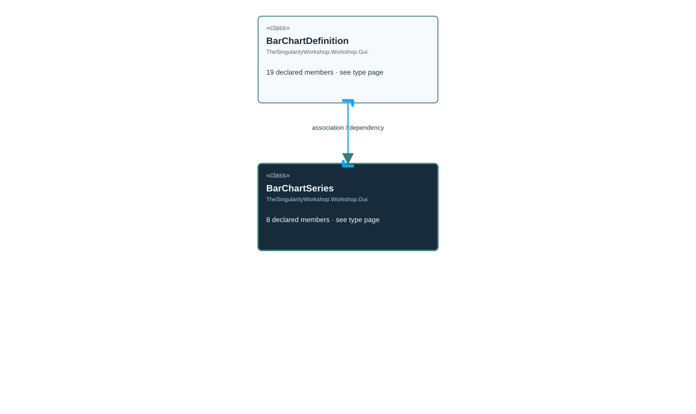

<!-- The Singularity Workshop moniker -->

# TheSingularityWorkshop.Workshop.Gui.BarChartSeries

> Generated from compiler-backed source analysis. Do not edit by hand.

- Repository: `TrentBest/TheSingularityWorkshop.GUI`
- Revision: [`c314067d1411b65a797609459058e454c46bb143`](https://github.com/TrentBest/TheSingularityWorkshop.GUI/tree/c314067d1411b65a797609459058e454c46bb143)
- Project: `src/Core/TheSingularityWorkshop.GUI.Core.csproj`
- Type ID: `type:TheSingularityWorkshop.GUI.Core, Version=0.1.0.0, Culture=neutral, PublicKeyToken=null:global::TheSingularityWorkshop.Workshop.Gui.BarChartSeries`
- Metadata name: `BarChartSeries`
- Kind: `class`
- Generic arity: 0

## UML diagram

## Source declarations

- [`src/Core/BarChartDefinition.cs:27-52`](https://github.com/TrentBest/TheSingularityWorkshop.GUI/blob/c314067d1411b65a797609459058e454c46bb143/src/Core/BarChartDefinition.cs#L27-52)

## Members

| Kind | Signature | Source |
|---|---|---|
| `Method` | `TheSingularityWorkshop.Workshop.Gui.BarChartSeries.BarChartSeries(string, string, System.Collections.Generic.IEnumerable<double?>)` | [`src/Core/BarChartDefinition.cs:31-47`](https://github.com/TrentBest/TheSingularityWorkshop.GUI/blob/c314067d1411b65a797609459058e454c46bb143/src/Core/BarChartDefinition.cs#L31-47) |
| `Property` | `TheSingularityWorkshop.Workshop.Gui.BarChartSeries.Id` | [`src/Core/BarChartDefinition.cs:49-49`](https://github.com/TrentBest/TheSingularityWorkshop.GUI/blob/c314067d1411b65a797609459058e454c46bb143/src/Core/BarChartDefinition.cs#L49-49) |
| `Method` | `TheSingularityWorkshop.Workshop.Gui.BarChartSeries.Id.get` | [`src/Core/BarChartDefinition.cs:49-49`](https://github.com/TrentBest/TheSingularityWorkshop.GUI/blob/c314067d1411b65a797609459058e454c46bb143/src/Core/BarChartDefinition.cs#L49-49) |
| `Property` | `TheSingularityWorkshop.Workshop.Gui.BarChartSeries.Label` | [`src/Core/BarChartDefinition.cs:50-50`](https://github.com/TrentBest/TheSingularityWorkshop.GUI/blob/c314067d1411b65a797609459058e454c46bb143/src/Core/BarChartDefinition.cs#L50-50) |
| `Method` | `TheSingularityWorkshop.Workshop.Gui.BarChartSeries.Label.get` | [`src/Core/BarChartDefinition.cs:50-50`](https://github.com/TrentBest/TheSingularityWorkshop.GUI/blob/c314067d1411b65a797609459058e454c46bb143/src/Core/BarChartDefinition.cs#L50-50) |
| `Property` | `TheSingularityWorkshop.Workshop.Gui.BarChartSeries.Values` | [`src/Core/BarChartDefinition.cs:51-51`](https://github.com/TrentBest/TheSingularityWorkshop.GUI/blob/c314067d1411b65a797609459058e454c46bb143/src/Core/BarChartDefinition.cs#L51-51) |
| `Method` | `TheSingularityWorkshop.Workshop.Gui.BarChartSeries.Values.get` | [`src/Core/BarChartDefinition.cs:51-51`](https://github.com/TrentBest/TheSingularityWorkshop.GUI/blob/c314067d1411b65a797609459058e454c46bb143/src/Core/BarChartDefinition.cs#L51-51) |
| `Field` | `TheSingularityWorkshop.Workshop.Gui.BarChartSeries._values` | [`src/Core/BarChartDefinition.cs:29-29`](https://github.com/TrentBest/TheSingularityWorkshop.GUI/blob/c314067d1411b65a797609459058e454c46bb143/src/Core/BarChartDefinition.cs#L29-29) |

## Relationships

| Direction | Kind | Related type | Resolution | Evidence |
|---|---|---|---|---|
| incoming | `Association` | `TheSingularityWorkshop.Workshop.Gui.BarChartDefinition` | `Resolved` | [`src/Core/BarChartDefinition.cs:68-68`](https://github.com/TrentBest/TheSingularityWorkshop.GUI/blob/c314067d1411b65a797609459058e454c46bb143/src/Core/BarChartDefinition.cs#L68-68) |
| incoming | `Association` | `TheSingularityWorkshop.Workshop.Gui.BarChartDefinition` | `Resolved` | [`src/Core/BarChartDefinition.cs:122-122`](https://github.com/TrentBest/TheSingularityWorkshop.GUI/blob/c314067d1411b65a797609459058e454c46bb143/src/Core/BarChartDefinition.cs#L122-122) |
| incoming | `Dependency` | `TheSingularityWorkshop.Workshop.Gui.BarChartDefinition` | `Resolved` | [`src/Core/BarChartDefinition.cs:70-113`](https://github.com/TrentBest/TheSingularityWorkshop.GUI/blob/c314067d1411b65a797609459058e454c46bb143/src/Core/BarChartDefinition.cs#L70-113) |

[Back to the generated type index](index.md)

---

<!-- THE SINGULARITY WORKSHOP FOOTER -->

