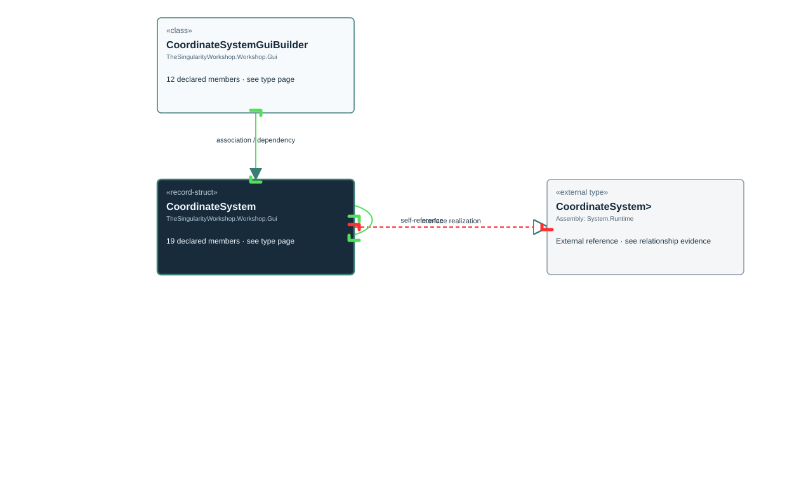

# TheSingularityWorkshop.Workshop.Gui.CoordinateSystem

> Generated from compiler-backed source analysis. Do not edit by hand.

- Repository: `TrentBest/TheSingularityWorkshop.GUI`
- Revision: [`8d11c5f449b73b519cfb1819c9c3942307f717c6`](https://github.com/TrentBest/TheSingularityWorkshop.GUI/tree/8d11c5f449b73b519cfb1819c9c3942307f717c6)
- Project: `src/Core/TheSingularityWorkshop.GUI.Core.csproj`
- Type ID: `type:TheSingularityWorkshop.GUI.Core, Version=0.1.0.0, Culture=neutral, PublicKeyToken=null:global::TheSingularityWorkshop.Workshop.Gui.CoordinateSystem`
- Metadata name: `CoordinateSystem`
- Kind: `record-struct`
- Generic arity: 0

## UML diagram

## Source declarations

- [`src/Core/CoordinateSystem.cs:12-51`](https://github.com/TrentBest/TheSingularityWorkshop.GUI/blob/8d11c5f449b73b519cfb1819c9c3942307f717c6/src/Core/CoordinateSystem.cs#L12-51)

## Members

| Kind | Signature | Source |
|---|---|---|
| `Method` | `TheSingularityWorkshop.Workshop.Gui.CoordinateSystem.Contains(double, double)` | [`src/Core/CoordinateSystem.cs:18-18`](https://github.com/TrentBest/TheSingularityWorkshop.GUI/blob/8d11c5f449b73b519cfb1819c9c3942307f717c6/src/Core/CoordinateSystem.cs#L18-18) |
| `Method` | `TheSingularityWorkshop.Workshop.Gui.CoordinateSystem.CoordinateSystem(double, double, double, double)` | [`src/Core/CoordinateSystem.cs:12-51`](https://github.com/TrentBest/TheSingularityWorkshop.GUI/blob/8d11c5f449b73b519cfb1819c9c3942307f717c6/src/Core/CoordinateSystem.cs#L12-51) |
| `Method` | `TheSingularityWorkshop.Workshop.Gui.CoordinateSystem.DeltaX(double, double)` | [`src/Core/CoordinateSystem.cs:39-39`](https://github.com/TrentBest/TheSingularityWorkshop.GUI/blob/8d11c5f449b73b519cfb1819c9c3942307f717c6/src/Core/CoordinateSystem.cs#L39-39) |
| `Method` | `TheSingularityWorkshop.Workshop.Gui.CoordinateSystem.DeltaY(double, double)` | [`src/Core/CoordinateSystem.cs:42-42`](https://github.com/TrentBest/TheSingularityWorkshop.GUI/blob/8d11c5f449b73b519cfb1819c9c3942307f717c6/src/Core/CoordinateSystem.cs#L42-42) |
| `Method` | `TheSingularityWorkshop.Workshop.Gui.CoordinateSystem.FromPanel(double, double)` | [`src/Core/CoordinateSystem.cs:30-30`](https://github.com/TrentBest/TheSingularityWorkshop.GUI/blob/8d11c5f449b73b519cfb1819c9c3942307f717c6/src/Core/CoordinateSystem.cs#L30-30) |
| `Method` | `TheSingularityWorkshop.Workshop.Gui.CoordinateSystem.FromPanelX(double)` | [`src/Core/CoordinateSystem.cs:33-33`](https://github.com/TrentBest/TheSingularityWorkshop.GUI/blob/8d11c5f449b73b519cfb1819c9c3942307f717c6/src/Core/CoordinateSystem.cs#L33-33) |
| `Method` | `TheSingularityWorkshop.Workshop.Gui.CoordinateSystem.FromPanelY(double)` | [`src/Core/CoordinateSystem.cs:36-36`](https://github.com/TrentBest/TheSingularityWorkshop.GUI/blob/8d11c5f449b73b519cfb1819c9c3942307f717c6/src/Core/CoordinateSystem.cs#L36-36) |
| `Property` | `TheSingularityWorkshop.Workshop.Gui.CoordinateSystem.Maximum` | [`src/Core/CoordinateSystem.cs:12-12`](https://github.com/TrentBest/TheSingularityWorkshop.GUI/blob/8d11c5f449b73b519cfb1819c9c3942307f717c6/src/Core/CoordinateSystem.cs#L12-12) |
| `Property` | `TheSingularityWorkshop.Workshop.Gui.CoordinateSystem.Minimum` | [`src/Core/CoordinateSystem.cs:12-12`](https://github.com/TrentBest/TheSingularityWorkshop.GUI/blob/8d11c5f449b73b519cfb1819c9c3942307f717c6/src/Core/CoordinateSystem.cs#L12-12) |
| `Property` | `TheSingularityWorkshop.Workshop.Gui.CoordinateSystem.Normalized` | [`src/Core/CoordinateSystem.cs:44-44`](https://github.com/TrentBest/TheSingularityWorkshop.GUI/blob/8d11c5f449b73b519cfb1819c9c3942307f717c6/src/Core/CoordinateSystem.cs#L44-44) |
| `Method` | `TheSingularityWorkshop.Workshop.Gui.CoordinateSystem.Normalized.get` | [`src/Core/CoordinateSystem.cs:44-44`](https://github.com/TrentBest/TheSingularityWorkshop.GUI/blob/8d11c5f449b73b519cfb1819c9c3942307f717c6/src/Core/CoordinateSystem.cs#L44-44) |
| `Property` | `TheSingularityWorkshop.Workshop.Gui.CoordinateSystem.OriginX` | [`src/Core/CoordinateSystem.cs:12-12`](https://github.com/TrentBest/TheSingularityWorkshop.GUI/blob/8d11c5f449b73b519cfb1819c9c3942307f717c6/src/Core/CoordinateSystem.cs#L12-12) |
| `Property` | `TheSingularityWorkshop.Workshop.Gui.CoordinateSystem.OriginY` | [`src/Core/CoordinateSystem.cs:12-12`](https://github.com/TrentBest/TheSingularityWorkshop.GUI/blob/8d11c5f449b73b519cfb1819c9c3942307f717c6/src/Core/CoordinateSystem.cs#L12-12) |
| `Property` | `TheSingularityWorkshop.Workshop.Gui.CoordinateSystem.Range` | [`src/Core/CoordinateSystem.cs:15-15`](https://github.com/TrentBest/TheSingularityWorkshop.GUI/blob/8d11c5f449b73b519cfb1819c9c3942307f717c6/src/Core/CoordinateSystem.cs#L15-15) |
| `Method` | `TheSingularityWorkshop.Workshop.Gui.CoordinateSystem.Range.get` | [`src/Core/CoordinateSystem.cs:15-15`](https://github.com/TrentBest/TheSingularityWorkshop.GUI/blob/8d11c5f449b73b519cfb1819c9c3942307f717c6/src/Core/CoordinateSystem.cs#L15-15) |
| `Method` | `TheSingularityWorkshop.Workshop.Gui.CoordinateSystem.ToPanel(double, double)` | [`src/Core/CoordinateSystem.cs:27-27`](https://github.com/TrentBest/TheSingularityWorkshop.GUI/blob/8d11c5f449b73b519cfb1819c9c3942307f717c6/src/Core/CoordinateSystem.cs#L27-27) |
| `Method` | `TheSingularityWorkshop.Workshop.Gui.CoordinateSystem.ToPanelX(double)` | [`src/Core/CoordinateSystem.cs:21-21`](https://github.com/TrentBest/TheSingularityWorkshop.GUI/blob/8d11c5f449b73b519cfb1819c9c3942307f717c6/src/Core/CoordinateSystem.cs#L21-21) |
| `Method` | `TheSingularityWorkshop.Workshop.Gui.CoordinateSystem.ToPanelY(double)` | [`src/Core/CoordinateSystem.cs:24-24`](https://github.com/TrentBest/TheSingularityWorkshop.GUI/blob/8d11c5f449b73b519cfb1819c9c3942307f717c6/src/Core/CoordinateSystem.cs#L24-24) |
| `Method` | `TheSingularityWorkshop.Workshop.Gui.CoordinateSystem.Validate(double)` | [`src/Core/CoordinateSystem.cs:45-50`](https://github.com/TrentBest/TheSingularityWorkshop.GUI/blob/8d11c5f449b73b519cfb1819c9c3942307f717c6/src/Core/CoordinateSystem.cs#L45-50) |

## Relationships

| Direction | Kind | Related type | Resolution | Evidence |
|---|---|---|---|---|
| outgoing | `InterfaceRealization` | `global::System.IEquatable<global::TheSingularityWorkshop.Workshop.Gui.CoordinateSystem>` | `External` | [`src/Core/CoordinateSystem.cs:12-51`](https://github.com/TrentBest/TheSingularityWorkshop.GUI/blob/8d11c5f449b73b519cfb1819c9c3942307f717c6/src/Core/CoordinateSystem.cs#L12-51) |
| outgoing | `Association` | `TheSingularityWorkshop.Workshop.Gui.CoordinateSystem` | `Resolved` | [`src/Core/CoordinateSystem.cs:44-44`](https://github.com/TrentBest/TheSingularityWorkshop.GUI/blob/8d11c5f449b73b519cfb1819c9c3942307f717c6/src/Core/CoordinateSystem.cs#L44-44) |
| incoming | `Association` | `TheSingularityWorkshop.Workshop.Gui.CoordinateSystemGuiBuilder` | `Resolved` | [`src/Core/CoordinateSystemGuiBuilder.cs:9-9`](https://github.com/TrentBest/TheSingularityWorkshop.GUI/blob/8d11c5f449b73b519cfb1819c9c3942307f717c6/src/Core/CoordinateSystemGuiBuilder.cs#L9-9) |
| incoming | `Dependency` | `TheSingularityWorkshop.Workshop.Gui.CoordinateSystemGuiBuilder` | `Resolved` | [`src/Core/CoordinateSystemGuiBuilder.cs:10-19`](https://github.com/TrentBest/TheSingularityWorkshop.GUI/blob/8d11c5f449b73b519cfb1819c9c3942307f717c6/src/Core/CoordinateSystemGuiBuilder.cs#L10-19) |
| incoming | `Dependency` | `TheSingularityWorkshop.Workshop.Gui.CoordinateSystemGuiBuilder` | `Resolved` | [`src/Core/CoordinateSystemGuiBuilder.cs:23-23`](https://github.com/TrentBest/TheSingularityWorkshop.GUI/blob/8d11c5f449b73b519cfb1819c9c3942307f717c6/src/Core/CoordinateSystemGuiBuilder.cs#L23-23) |

[Back to the generated type index](index.md)

