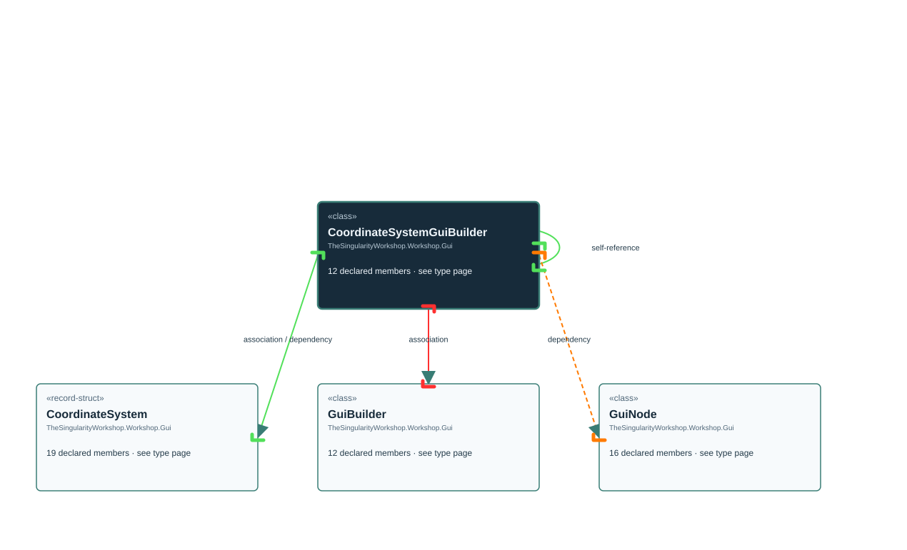

# TheSingularityWorkshop.Workshop.Gui.CoordinateSystemGuiBuilder

> Generated from compiler-backed source analysis. Do not edit by hand.

- Repository: `TrentBest/TheSingularityWorkshop.GUI`
- Revision: [`a25acf387b1e24b6dba0a927e763c0b55c8b9b3e`](https://github.com/TrentBest/TheSingularityWorkshop.GUI/tree/a25acf387b1e24b6dba0a927e763c0b55c8b9b3e)
- Project: `src/Core/TheSingularityWorkshop.GUI.Core.csproj`
- Type ID: `type:TheSingularityWorkshop.GUI.Core, Version=0.1.0.0, Culture=neutral, PublicKeyToken=null:global::TheSingularityWorkshop.Workshop.Gui.CoordinateSystemGuiBuilder`
- Metadata name: `CoordinateSystemGuiBuilder`
- Kind: `class`
- Generic arity: 0

## UML diagram

## Source declarations

- [`src/Core/CoordinateSystemGuiBuilder.cs:6-38`](https://github.com/TrentBest/TheSingularityWorkshop.GUI/blob/a25acf387b1e24b6dba0a927e763c0b55c8b9b3e/src/Core/CoordinateSystemGuiBuilder.cs#L6-38)

## Members

| Kind | Signature | Source |
|---|---|---|
| `Method` | `TheSingularityWorkshop.Workshop.Gui.CoordinateSystemGuiBuilder.Axes(bool)` | [`src/Core/CoordinateSystemGuiBuilder.cs:27-27`](https://github.com/TrentBest/TheSingularityWorkshop.GUI/blob/a25acf387b1e24b6dba0a927e763c0b55c8b9b3e/src/Core/CoordinateSystemGuiBuilder.cs#L27-27) |
| `Method` | `TheSingularityWorkshop.Workshop.Gui.CoordinateSystemGuiBuilder.Bounds(bool)` | [`src/Core/CoordinateSystemGuiBuilder.cs:33-33`](https://github.com/TrentBest/TheSingularityWorkshop.GUI/blob/a25acf387b1e24b6dba0a927e763c0b55c8b9b3e/src/Core/CoordinateSystemGuiBuilder.cs#L33-33) |
| `Method` | `TheSingularityWorkshop.Workshop.Gui.CoordinateSystemGuiBuilder.Build()` | [`src/Core/CoordinateSystemGuiBuilder.cs:37-37`](https://github.com/TrentBest/TheSingularityWorkshop.GUI/blob/a25acf387b1e24b6dba0a927e763c0b55c8b9b3e/src/Core/CoordinateSystemGuiBuilder.cs#L37-37) |
| `Method` | `TheSingularityWorkshop.Workshop.Gui.CoordinateSystemGuiBuilder.CoordinateSystemGuiBuilder(string, TheSingularityWorkshop.Workshop.Gui.CoordinateSystem)` | [`src/Core/CoordinateSystemGuiBuilder.cs:10-19`](https://github.com/TrentBest/TheSingularityWorkshop.GUI/blob/a25acf387b1e24b6dba0a927e763c0b55c8b9b3e/src/Core/CoordinateSystemGuiBuilder.cs#L10-19) |
| `Method` | `TheSingularityWorkshop.Workshop.Gui.CoordinateSystemGuiBuilder.Create(string)` | [`src/Core/CoordinateSystemGuiBuilder.cs:21-21`](https://github.com/TrentBest/TheSingularityWorkshop.GUI/blob/a25acf387b1e24b6dba0a927e763c0b55c8b9b3e/src/Core/CoordinateSystemGuiBuilder.cs#L21-21) |
| `Method` | `TheSingularityWorkshop.Workshop.Gui.CoordinateSystemGuiBuilder.Create(string, TheSingularityWorkshop.Workshop.Gui.CoordinateSystem)` | [`src/Core/CoordinateSystemGuiBuilder.cs:23-23`](https://github.com/TrentBest/TheSingularityWorkshop.GUI/blob/a25acf387b1e24b6dba0a927e763c0b55c8b9b3e/src/Core/CoordinateSystemGuiBuilder.cs#L23-23) |
| `Method` | `TheSingularityWorkshop.Workshop.Gui.CoordinateSystemGuiBuilder.Grid(bool)` | [`src/Core/CoordinateSystemGuiBuilder.cs:29-29`](https://github.com/TrentBest/TheSingularityWorkshop.GUI/blob/a25acf387b1e24b6dba0a927e763c0b55c8b9b3e/src/Core/CoordinateSystemGuiBuilder.cs#L29-29) |
| `Method` | `TheSingularityWorkshop.Workshop.Gui.CoordinateSystemGuiBuilder.Origin(bool)` | [`src/Core/CoordinateSystemGuiBuilder.cs:31-31`](https://github.com/TrentBest/TheSingularityWorkshop.GUI/blob/a25acf387b1e24b6dba0a927e763c0b55c8b9b3e/src/Core/CoordinateSystemGuiBuilder.cs#L31-31) |
| `Method` | `TheSingularityWorkshop.Workshop.Gui.CoordinateSystemGuiBuilder.Point(string, double, double)` | [`src/Core/CoordinateSystemGuiBuilder.cs:35-35`](https://github.com/TrentBest/TheSingularityWorkshop.GUI/blob/a25acf387b1e24b6dba0a927e763c0b55c8b9b3e/src/Core/CoordinateSystemGuiBuilder.cs#L35-35) |
| `Method` | `TheSingularityWorkshop.Workshop.Gui.CoordinateSystemGuiBuilder.Text(string)` | [`src/Core/CoordinateSystemGuiBuilder.cs:25-25`](https://github.com/TrentBest/TheSingularityWorkshop.GUI/blob/a25acf387b1e24b6dba0a927e763c0b55c8b9b3e/src/Core/CoordinateSystemGuiBuilder.cs#L25-25) |
| `Field` | `TheSingularityWorkshop.Workshop.Gui.CoordinateSystemGuiBuilder._builder` | [`src/Core/CoordinateSystemGuiBuilder.cs:8-8`](https://github.com/TrentBest/TheSingularityWorkshop.GUI/blob/a25acf387b1e24b6dba0a927e763c0b55c8b9b3e/src/Core/CoordinateSystemGuiBuilder.cs#L8-8) |
| `Field` | `TheSingularityWorkshop.Workshop.Gui.CoordinateSystemGuiBuilder._coordinates` | [`src/Core/CoordinateSystemGuiBuilder.cs:9-9`](https://github.com/TrentBest/TheSingularityWorkshop.GUI/blob/a25acf387b1e24b6dba0a927e763c0b55c8b9b3e/src/Core/CoordinateSystemGuiBuilder.cs#L9-9) |

## Relationships

| Direction | Kind | Related type | Resolution | Evidence |
|---|---|---|---|---|
| outgoing | `Association` | `TheSingularityWorkshop.Workshop.Gui.CoordinateSystem` | `Resolved` | [`src/Core/CoordinateSystemGuiBuilder.cs:9-9`](https://github.com/TrentBest/TheSingularityWorkshop.GUI/blob/a25acf387b1e24b6dba0a927e763c0b55c8b9b3e/src/Core/CoordinateSystemGuiBuilder.cs#L9-9) |
| outgoing | `Association` | `TheSingularityWorkshop.Workshop.Gui.GuiBuilder` | `Resolved` | [`src/Core/CoordinateSystemGuiBuilder.cs:8-8`](https://github.com/TrentBest/TheSingularityWorkshop.GUI/blob/a25acf387b1e24b6dba0a927e763c0b55c8b9b3e/src/Core/CoordinateSystemGuiBuilder.cs#L8-8) |
| outgoing | `Dependency` | `TheSingularityWorkshop.Workshop.Gui.CoordinateSystem` | `Resolved` | [`src/Core/CoordinateSystemGuiBuilder.cs:10-19`](https://github.com/TrentBest/TheSingularityWorkshop.GUI/blob/a25acf387b1e24b6dba0a927e763c0b55c8b9b3e/src/Core/CoordinateSystemGuiBuilder.cs#L10-19) |
| outgoing | `Dependency` | `TheSingularityWorkshop.Workshop.Gui.CoordinateSystem` | `Resolved` | [`src/Core/CoordinateSystemGuiBuilder.cs:23-23`](https://github.com/TrentBest/TheSingularityWorkshop.GUI/blob/a25acf387b1e24b6dba0a927e763c0b55c8b9b3e/src/Core/CoordinateSystemGuiBuilder.cs#L23-23) |
| outgoing | `Dependency` | `TheSingularityWorkshop.Workshop.Gui.CoordinateSystemGuiBuilder` | `Resolved` | [`src/Core/CoordinateSystemGuiBuilder.cs:27-27`](https://github.com/TrentBest/TheSingularityWorkshop.GUI/blob/a25acf387b1e24b6dba0a927e763c0b55c8b9b3e/src/Core/CoordinateSystemGuiBuilder.cs#L27-27) |
| outgoing | `Dependency` | `TheSingularityWorkshop.Workshop.Gui.CoordinateSystemGuiBuilder` | `Resolved` | [`src/Core/CoordinateSystemGuiBuilder.cs:33-33`](https://github.com/TrentBest/TheSingularityWorkshop.GUI/blob/a25acf387b1e24b6dba0a927e763c0b55c8b9b3e/src/Core/CoordinateSystemGuiBuilder.cs#L33-33) |
| outgoing | `Dependency` | `TheSingularityWorkshop.Workshop.Gui.CoordinateSystemGuiBuilder` | `Resolved` | [`src/Core/CoordinateSystemGuiBuilder.cs:21-21`](https://github.com/TrentBest/TheSingularityWorkshop.GUI/blob/a25acf387b1e24b6dba0a927e763c0b55c8b9b3e/src/Core/CoordinateSystemGuiBuilder.cs#L21-21) |
| outgoing | `Dependency` | `TheSingularityWorkshop.Workshop.Gui.CoordinateSystemGuiBuilder` | `Resolved` | [`src/Core/CoordinateSystemGuiBuilder.cs:23-23`](https://github.com/TrentBest/TheSingularityWorkshop.GUI/blob/a25acf387b1e24b6dba0a927e763c0b55c8b9b3e/src/Core/CoordinateSystemGuiBuilder.cs#L23-23) |
| outgoing | `Dependency` | `TheSingularityWorkshop.Workshop.Gui.CoordinateSystemGuiBuilder` | `Resolved` | [`src/Core/CoordinateSystemGuiBuilder.cs:29-29`](https://github.com/TrentBest/TheSingularityWorkshop.GUI/blob/a25acf387b1e24b6dba0a927e763c0b55c8b9b3e/src/Core/CoordinateSystemGuiBuilder.cs#L29-29) |
| outgoing | `Dependency` | `TheSingularityWorkshop.Workshop.Gui.CoordinateSystemGuiBuilder` | `Resolved` | [`src/Core/CoordinateSystemGuiBuilder.cs:31-31`](https://github.com/TrentBest/TheSingularityWorkshop.GUI/blob/a25acf387b1e24b6dba0a927e763c0b55c8b9b3e/src/Core/CoordinateSystemGuiBuilder.cs#L31-31) |
| outgoing | `Dependency` | `TheSingularityWorkshop.Workshop.Gui.CoordinateSystemGuiBuilder` | `Resolved` | [`src/Core/CoordinateSystemGuiBuilder.cs:35-35`](https://github.com/TrentBest/TheSingularityWorkshop.GUI/blob/a25acf387b1e24b6dba0a927e763c0b55c8b9b3e/src/Core/CoordinateSystemGuiBuilder.cs#L35-35) |
| outgoing | `Dependency` | `TheSingularityWorkshop.Workshop.Gui.CoordinateSystemGuiBuilder` | `Resolved` | [`src/Core/CoordinateSystemGuiBuilder.cs:25-25`](https://github.com/TrentBest/TheSingularityWorkshop.GUI/blob/a25acf387b1e24b6dba0a927e763c0b55c8b9b3e/src/Core/CoordinateSystemGuiBuilder.cs#L25-25) |
| outgoing | `Dependency` | `TheSingularityWorkshop.Workshop.Gui.GuiNode` | `Resolved` | [`src/Core/CoordinateSystemGuiBuilder.cs:37-37`](https://github.com/TrentBest/TheSingularityWorkshop.GUI/blob/a25acf387b1e24b6dba0a927e763c0b55c8b9b3e/src/Core/CoordinateSystemGuiBuilder.cs#L37-37) |

[Back to the generated type index](index.md)

