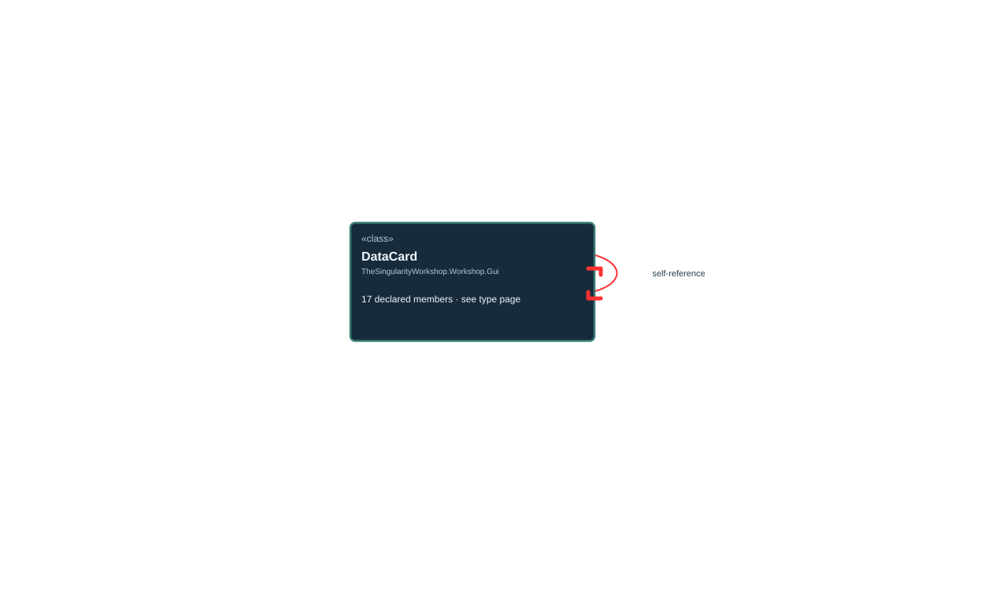

<!-- The Singularity Workshop moniker -->

# TheSingularityWorkshop.Workshop.Gui.DataCard

> Generated from compiler-backed source analysis. Do not edit by hand.

- Repository: `TrentBest/TheSingularityWorkshop.GUI`
- Revision: [`f48dd15256521c88fad88371742c89d5fd1d326f`](https://github.com/TrentBest/TheSingularityWorkshop.GUI/tree/f48dd15256521c88fad88371742c89d5fd1d326f)
- Project: `src/Core/TheSingularityWorkshop.GUI.Core.csproj`
- Type ID: `type:TheSingularityWorkshop.GUI.Core, Version=0.1.0.0, Culture=neutral, PublicKeyToken=null:global::TheSingularityWorkshop.Workshop.Gui.DataCard`
- Metadata name: `DataCard`
- Kind: `class`
- Generic arity: 0

## UML diagram

## Source declarations

- [`src/Core/DataCard.cs:12-82`](https://github.com/TrentBest/TheSingularityWorkshop.GUI/blob/f48dd15256521c88fad88371742c89d5fd1d326f/src/Core/DataCard.cs#L12-82)

## Members

| Kind | Signature | Source |
|---|---|---|
| `Property` | `TheSingularityWorkshop.Workshop.Gui.DataCard.CanRequestChildInsertion` | [`src/Core/DataCard.cs:67-67`](https://github.com/TrentBest/TheSingularityWorkshop.GUI/blob/f48dd15256521c88fad88371742c89d5fd1d326f/src/Core/DataCard.cs#L67-67) |
| `Method` | `TheSingularityWorkshop.Workshop.Gui.DataCard.CanRequestChildInsertion.get` | [`src/Core/DataCard.cs:67-67`](https://github.com/TrentBest/TheSingularityWorkshop.GUI/blob/f48dd15256521c88fad88371742c89d5fd1d326f/src/Core/DataCard.cs#L67-67) |
| `Property` | `TheSingularityWorkshop.Workshop.Gui.DataCard.Children` | [`src/Core/DataCard.cs:70-70`](https://github.com/TrentBest/TheSingularityWorkshop.GUI/blob/f48dd15256521c88fad88371742c89d5fd1d326f/src/Core/DataCard.cs#L70-70) |
| `Method` | `TheSingularityWorkshop.Workshop.Gui.DataCard.Children.get` | [`src/Core/DataCard.cs:70-70`](https://github.com/TrentBest/TheSingularityWorkshop.GUI/blob/f48dd15256521c88fad88371742c89d5fd1d326f/src/Core/DataCard.cs#L70-70) |
| `Method` | `TheSingularityWorkshop.Workshop.Gui.DataCard.DataCard(string, string, string, string?, bool, System.Collections.Generic.IEnumerable<TheSingularityWorkshop.Workshop.Gui.DataCard>?, bool)` | [`src/Core/DataCard.cs:24-48`](https://github.com/TrentBest/TheSingularityWorkshop.GUI/blob/f48dd15256521c88fad88371742c89d5fd1d326f/src/Core/DataCard.cs#L24-48) |
| `Method` | `TheSingularityWorkshop.Workshop.Gui.DataCard.GetCollapsedSummary(bool)` | [`src/Core/DataCard.cs:75-81`](https://github.com/TrentBest/TheSingularityWorkshop.GUI/blob/f48dd15256521c88fad88371742c89d5fd1d326f/src/Core/DataCard.cs#L75-81) |
| `Property` | `TheSingularityWorkshop.Workshop.Gui.DataCard.Id` | [`src/Core/DataCard.cs:51-51`](https://github.com/TrentBest/TheSingularityWorkshop.GUI/blob/f48dd15256521c88fad88371742c89d5fd1d326f/src/Core/DataCard.cs#L51-51) |
| `Method` | `TheSingularityWorkshop.Workshop.Gui.DataCard.Id.get` | [`src/Core/DataCard.cs:51-51`](https://github.com/TrentBest/TheSingularityWorkshop.GUI/blob/f48dd15256521c88fad88371742c89d5fd1d326f/src/Core/DataCard.cs#L51-51) |
| `Property` | `TheSingularityWorkshop.Workshop.Gui.DataCard.IsExpandedByDefault` | [`src/Core/DataCard.cs:63-63`](https://github.com/TrentBest/TheSingularityWorkshop.GUI/blob/f48dd15256521c88fad88371742c89d5fd1d326f/src/Core/DataCard.cs#L63-63) |
| `Method` | `TheSingularityWorkshop.Workshop.Gui.DataCard.IsExpandedByDefault.get` | [`src/Core/DataCard.cs:63-63`](https://github.com/TrentBest/TheSingularityWorkshop.GUI/blob/f48dd15256521c88fad88371742c89d5fd1d326f/src/Core/DataCard.cs#L63-63) |
| `Property` | `TheSingularityWorkshop.Workshop.Gui.DataCard.Kind` | [`src/Core/DataCard.cs:54-54`](https://github.com/TrentBest/TheSingularityWorkshop.GUI/blob/f48dd15256521c88fad88371742c89d5fd1d326f/src/Core/DataCard.cs#L54-54) |
| `Method` | `TheSingularityWorkshop.Workshop.Gui.DataCard.Kind.get` | [`src/Core/DataCard.cs:54-54`](https://github.com/TrentBest/TheSingularityWorkshop.GUI/blob/f48dd15256521c88fad88371742c89d5fd1d326f/src/Core/DataCard.cs#L54-54) |
| `Property` | `TheSingularityWorkshop.Workshop.Gui.DataCard.Subtitle` | [`src/Core/DataCard.cs:60-60`](https://github.com/TrentBest/TheSingularityWorkshop.GUI/blob/f48dd15256521c88fad88371742c89d5fd1d326f/src/Core/DataCard.cs#L60-60) |
| `Method` | `TheSingularityWorkshop.Workshop.Gui.DataCard.Subtitle.get` | [`src/Core/DataCard.cs:60-60`](https://github.com/TrentBest/TheSingularityWorkshop.GUI/blob/f48dd15256521c88fad88371742c89d5fd1d326f/src/Core/DataCard.cs#L60-60) |
| `Property` | `TheSingularityWorkshop.Workshop.Gui.DataCard.Title` | [`src/Core/DataCard.cs:57-57`](https://github.com/TrentBest/TheSingularityWorkshop.GUI/blob/f48dd15256521c88fad88371742c89d5fd1d326f/src/Core/DataCard.cs#L57-57) |
| `Method` | `TheSingularityWorkshop.Workshop.Gui.DataCard.Title.get` | [`src/Core/DataCard.cs:57-57`](https://github.com/TrentBest/TheSingularityWorkshop.GUI/blob/f48dd15256521c88fad88371742c89d5fd1d326f/src/Core/DataCard.cs#L57-57) |
| `Field` | `TheSingularityWorkshop.Workshop.Gui.DataCard._children` | [`src/Core/DataCard.cs:14-14`](https://github.com/TrentBest/TheSingularityWorkshop.GUI/blob/f48dd15256521c88fad88371742c89d5fd1d326f/src/Core/DataCard.cs#L14-14) |

## Relationships

| Direction | Kind | Related type | Resolution | Evidence |
|---|---|---|---|---|
| outgoing | `Association` | `TheSingularityWorkshop.Workshop.Gui.DataCard` | `Resolved` | [`src/Core/DataCard.cs:14-14`](https://github.com/TrentBest/TheSingularityWorkshop.GUI/blob/f48dd15256521c88fad88371742c89d5fd1d326f/src/Core/DataCard.cs#L14-14) |
| outgoing | `Association` | `TheSingularityWorkshop.Workshop.Gui.DataCard` | `Resolved` | [`src/Core/DataCard.cs:70-70`](https://github.com/TrentBest/TheSingularityWorkshop.GUI/blob/f48dd15256521c88fad88371742c89d5fd1d326f/src/Core/DataCard.cs#L70-70) |
| outgoing | `Dependency` | `TheSingularityWorkshop.Workshop.Gui.DataCard` | `Resolved` | [`src/Core/DataCard.cs:24-48`](https://github.com/TrentBest/TheSingularityWorkshop.GUI/blob/f48dd15256521c88fad88371742c89d5fd1d326f/src/Core/DataCard.cs#L24-48) |

[Back to the generated type index](index.md)

---

<!-- THE SINGULARITY WORKSHOP FOOTER -->

