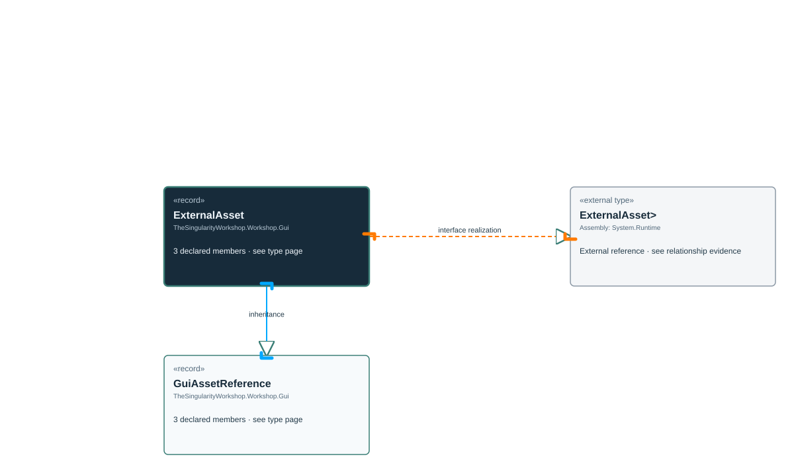

<!-- The Singularity Workshop moniker -->

# TheSingularityWorkshop.Workshop.Gui.GuiAssetReference.ExternalAsset

> Generated from compiler-backed source analysis. Do not edit by hand.

- Repository: `TrentBest/TheSingularityWorkshop.GUI`
- Revision: [`2c52512270bae4fa255ce922a2352852e35a6189`](https://github.com/TrentBest/TheSingularityWorkshop.GUI/tree/2c52512270bae4fa255ce922a2352852e35a6189)
- Project: `src/Core/TheSingularityWorkshop.GUI.Core.csproj`
- Type ID: `type:TheSingularityWorkshop.GUI.Core, Version=0.1.0.0, Culture=neutral, PublicKeyToken=null:global::TheSingularityWorkshop.Workshop.Gui.GuiAssetReference.ExternalAsset`
- Metadata name: `ExternalAsset`
- Kind: `record`
- Generic arity: 0

## UML diagram

## Source declarations

- [`src/Core/BadgeDefinition.cs:40-46`](https://github.com/TrentBest/TheSingularityWorkshop.GUI/blob/2c52512270bae4fa255ce922a2352852e35a6189/src/Core/BadgeDefinition.cs#L40-46)

## Members

| Kind | Signature | Source |
|---|---|---|
| `Method` | `TheSingularityWorkshop.Workshop.Gui.GuiAssetReference.ExternalAsset.ExternalAsset(System.Uri)` | [`src/Core/BadgeDefinition.cs:43-43`](https://github.com/TrentBest/TheSingularityWorkshop.GUI/blob/2c52512270bae4fa255ce922a2352852e35a6189/src/Core/BadgeDefinition.cs#L43-43) |
| `Property` | `TheSingularityWorkshop.Workshop.Gui.GuiAssetReference.ExternalAsset.Uri` | [`src/Core/BadgeDefinition.cs:45-45`](https://github.com/TrentBest/TheSingularityWorkshop.GUI/blob/2c52512270bae4fa255ce922a2352852e35a6189/src/Core/BadgeDefinition.cs#L45-45) |
| `Method` | `TheSingularityWorkshop.Workshop.Gui.GuiAssetReference.ExternalAsset.Uri.get` | [`src/Core/BadgeDefinition.cs:45-45`](https://github.com/TrentBest/TheSingularityWorkshop.GUI/blob/2c52512270bae4fa255ce922a2352852e35a6189/src/Core/BadgeDefinition.cs#L45-45) |

## Relationships

| Direction | Kind | Related type | Resolution | Evidence |
|---|---|---|---|---|
| outgoing | `Inheritance` | `TheSingularityWorkshop.Workshop.Gui.GuiAssetReference` | `Resolved` | [`src/Core/BadgeDefinition.cs:40-46`](https://github.com/TrentBest/TheSingularityWorkshop.GUI/blob/2c52512270bae4fa255ce922a2352852e35a6189/src/Core/BadgeDefinition.cs#L40-46) |
| outgoing | `InterfaceRealization` | `global::System.IEquatable<global::TheSingularityWorkshop.Workshop.Gui.GuiAssetReference.ExternalAsset>` | `External` | [`src/Core/BadgeDefinition.cs:40-46`](https://github.com/TrentBest/TheSingularityWorkshop.GUI/blob/2c52512270bae4fa255ce922a2352852e35a6189/src/Core/BadgeDefinition.cs#L40-46) |

[Back to the generated type index](index.md)

---

<!-- THE SINGULARITY WORKSHOP FOOTER -->

