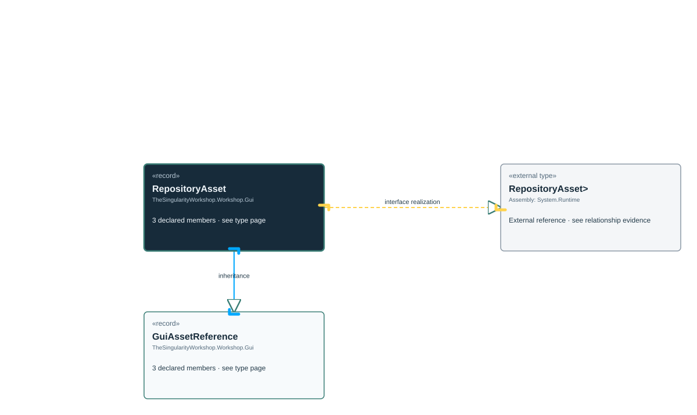

<!-- The Singularity Workshop moniker -->

# TheSingularityWorkshop.Workshop.Gui.GuiAssetReference.RepositoryAsset

> Generated from compiler-backed source analysis. Do not edit by hand.

- Repository: `TrentBest/TheSingularityWorkshop.GUI`
- Revision: [`792939b14c162608acaac5d2d1fda64a0c209304`](https://github.com/TrentBest/TheSingularityWorkshop.GUI/tree/792939b14c162608acaac5d2d1fda64a0c209304)
- Project: `src/Core/TheSingularityWorkshop.GUI.Core.csproj`
- Type ID: `type:TheSingularityWorkshop.GUI.Core, Version=0.1.0.0, Culture=neutral, PublicKeyToken=null:global::TheSingularityWorkshop.Workshop.Gui.GuiAssetReference.RepositoryAsset`
- Metadata name: `RepositoryAsset`
- Kind: `record`
- Generic arity: 0

## UML diagram

## Source declarations

- [`src/Core/BadgeDefinition.cs:30-36`](https://github.com/TrentBest/TheSingularityWorkshop.GUI/blob/792939b14c162608acaac5d2d1fda64a0c209304/src/Core/BadgeDefinition.cs#L30-36)

## Members

| Kind | Signature | Source |
|---|---|---|
| `Property` | `TheSingularityWorkshop.Workshop.Gui.GuiAssetReference.RepositoryAsset.Path` | [`src/Core/BadgeDefinition.cs:35-35`](https://github.com/TrentBest/TheSingularityWorkshop.GUI/blob/792939b14c162608acaac5d2d1fda64a0c209304/src/Core/BadgeDefinition.cs#L35-35) |
| `Method` | `TheSingularityWorkshop.Workshop.Gui.GuiAssetReference.RepositoryAsset.Path.get` | [`src/Core/BadgeDefinition.cs:35-35`](https://github.com/TrentBest/TheSingularityWorkshop.GUI/blob/792939b14c162608acaac5d2d1fda64a0c209304/src/Core/BadgeDefinition.cs#L35-35) |
| `Method` | `TheSingularityWorkshop.Workshop.Gui.GuiAssetReference.RepositoryAsset.RepositoryAsset(string)` | [`src/Core/BadgeDefinition.cs:33-33`](https://github.com/TrentBest/TheSingularityWorkshop.GUI/blob/792939b14c162608acaac5d2d1fda64a0c209304/src/Core/BadgeDefinition.cs#L33-33) |

## Relationships

| Direction | Kind | Related type | Resolution | Evidence |
|---|---|---|---|---|
| outgoing | `Inheritance` | `TheSingularityWorkshop.Workshop.Gui.GuiAssetReference` | `Resolved` | [`src/Core/BadgeDefinition.cs:30-36`](https://github.com/TrentBest/TheSingularityWorkshop.GUI/blob/792939b14c162608acaac5d2d1fda64a0c209304/src/Core/BadgeDefinition.cs#L30-36) |
| outgoing | `InterfaceRealization` | `global::System.IEquatable<global::TheSingularityWorkshop.Workshop.Gui.GuiAssetReference.RepositoryAsset>` | `External` | [`src/Core/BadgeDefinition.cs:30-36`](https://github.com/TrentBest/TheSingularityWorkshop.GUI/blob/792939b14c162608acaac5d2d1fda64a0c209304/src/Core/BadgeDefinition.cs#L30-36) |

[Back to the generated type index](index.md)

---

<!-- THE SINGULARITY WORKSHOP FOOTER -->

