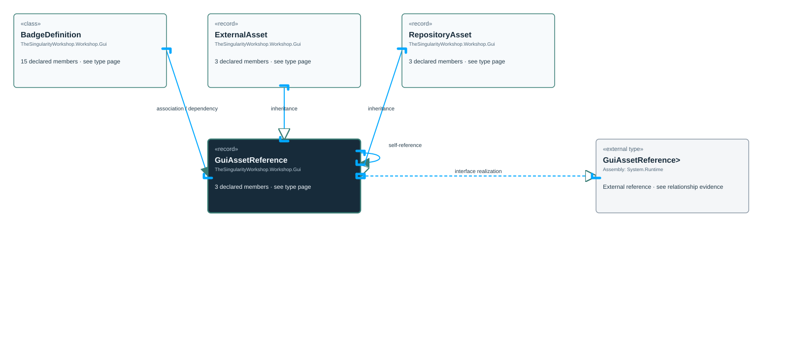

<!-- The Singularity Workshop moniker -->

# TheSingularityWorkshop.Workshop.Gui.GuiAssetReference

> Generated from compiler-backed source analysis. Do not edit by hand.

- Repository: `TrentBest/TheSingularityWorkshop.GUI`
- Revision: [`4fa33208ca046ee81f02d3dc3f244ffe960bcec8`](https://github.com/TrentBest/TheSingularityWorkshop.GUI/tree/4fa33208ca046ee81f02d3dc3f244ffe960bcec8)
- Project: `src/Core/TheSingularityWorkshop.GUI.Core.csproj`
- Type ID: `type:TheSingularityWorkshop.GUI.Core, Version=0.1.0.0, Culture=neutral, PublicKeyToken=null:global::TheSingularityWorkshop.Workshop.Gui.GuiAssetReference`
- Metadata name: `GuiAssetReference`
- Kind: `record`
- Generic arity: 0

## UML diagram

## Source declarations

- [`src/Core/BadgeDefinition.cs:24-52`](https://github.com/TrentBest/TheSingularityWorkshop.GUI/blob/4fa33208ca046ee81f02d3dc3f244ffe960bcec8/src/Core/BadgeDefinition.cs#L24-52)

## Members

| Kind | Signature | Source |
|---|---|---|
| `Method` | `TheSingularityWorkshop.Workshop.Gui.GuiAssetReference.External(System.Uri)` | [`src/Core/BadgeDefinition.cs:51-51`](https://github.com/TrentBest/TheSingularityWorkshop.GUI/blob/4fa33208ca046ee81f02d3dc3f244ffe960bcec8/src/Core/BadgeDefinition.cs#L51-51) |
| `Method` | `TheSingularityWorkshop.Workshop.Gui.GuiAssetReference.GuiAssetReference()` | [`src/Core/BadgeDefinition.cs:26-26`](https://github.com/TrentBest/TheSingularityWorkshop.GUI/blob/4fa33208ca046ee81f02d3dc3f244ffe960bcec8/src/Core/BadgeDefinition.cs#L26-26) |
| `Method` | `TheSingularityWorkshop.Workshop.Gui.GuiAssetReference.Repository(string)` | [`src/Core/BadgeDefinition.cs:49-49`](https://github.com/TrentBest/TheSingularityWorkshop.GUI/blob/4fa33208ca046ee81f02d3dc3f244ffe960bcec8/src/Core/BadgeDefinition.cs#L49-49) |

## Relationships

| Direction | Kind | Related type | Resolution | Evidence |
|---|---|---|---|---|
| incoming | `Inheritance` | `TheSingularityWorkshop.Workshop.Gui.GuiAssetReference.ExternalAsset` | `Resolved` | [`src/Core/BadgeDefinition.cs:40-46`](https://github.com/TrentBest/TheSingularityWorkshop.GUI/blob/4fa33208ca046ee81f02d3dc3f244ffe960bcec8/src/Core/BadgeDefinition.cs#L40-46) |
| incoming | `Inheritance` | `TheSingularityWorkshop.Workshop.Gui.GuiAssetReference.RepositoryAsset` | `Resolved` | [`src/Core/BadgeDefinition.cs:30-36`](https://github.com/TrentBest/TheSingularityWorkshop.GUI/blob/4fa33208ca046ee81f02d3dc3f244ffe960bcec8/src/Core/BadgeDefinition.cs#L30-36) |
| outgoing | `InterfaceRealization` | `global::System.IEquatable<global::TheSingularityWorkshop.Workshop.Gui.GuiAssetReference>` | `External` | [`src/Core/BadgeDefinition.cs:24-52`](https://github.com/TrentBest/TheSingularityWorkshop.GUI/blob/4fa33208ca046ee81f02d3dc3f244ffe960bcec8/src/Core/BadgeDefinition.cs#L24-52) |
| incoming | `Association` | `TheSingularityWorkshop.Workshop.Gui.BadgeDefinition` | `Resolved` | [`src/Core/BadgeDefinition.cs:124-124`](https://github.com/TrentBest/TheSingularityWorkshop.GUI/blob/4fa33208ca046ee81f02d3dc3f244ffe960bcec8/src/Core/BadgeDefinition.cs#L124-124) |
| incoming | `Dependency` | `TheSingularityWorkshop.Workshop.Gui.BadgeDefinition` | `Resolved` | [`src/Core/BadgeDefinition.cs:92-113`](https://github.com/TrentBest/TheSingularityWorkshop.GUI/blob/4fa33208ca046ee81f02d3dc3f244ffe960bcec8/src/Core/BadgeDefinition.cs#L92-113) |
| outgoing | `Dependency` | `TheSingularityWorkshop.Workshop.Gui.GuiAssetReference` | `Resolved` | [`src/Core/BadgeDefinition.cs:51-51`](https://github.com/TrentBest/TheSingularityWorkshop.GUI/blob/4fa33208ca046ee81f02d3dc3f244ffe960bcec8/src/Core/BadgeDefinition.cs#L51-51) |
| outgoing | `Dependency` | `TheSingularityWorkshop.Workshop.Gui.GuiAssetReference` | `Resolved` | [`src/Core/BadgeDefinition.cs:49-49`](https://github.com/TrentBest/TheSingularityWorkshop.GUI/blob/4fa33208ca046ee81f02d3dc3f244ffe960bcec8/src/Core/BadgeDefinition.cs#L49-49) |

[Back to the generated type index](index.md)

---

<!-- THE SINGULARITY WORKSHOP FOOTER -->

