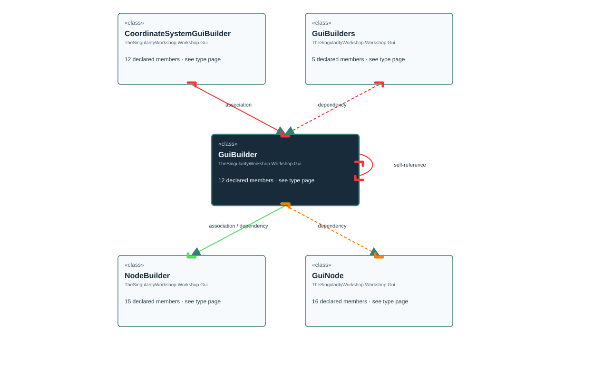

# TheSingularityWorkshop.Workshop.Gui.GuiBuilder

> Generated from compiler-backed source analysis. Do not edit by hand.

- Repository: `TrentBest/TheSingularityWorkshop.GUI`
- Revision: [`3844b48b1a30f678cb8aa80c2a21aaaceed9348b`](https://github.com/TrentBest/TheSingularityWorkshop.GUI/tree/3844b48b1a30f678cb8aa80c2a21aaaceed9348b)
- Project: `src/Core/TheSingularityWorkshop.GUI.Core.csproj`
- Type ID: `type:TheSingularityWorkshop.GUI.Core, Version=0.1.0.0, Culture=neutral, PublicKeyToken=null:global::TheSingularityWorkshop.Workshop.Gui.GuiBuilder`
- Metadata name: `GuiBuilder`
- Kind: `class`
- Generic arity: 0

## UML diagram

## Source declarations

- [`src/Core/GuiBuilder.cs:10-163`](https://github.com/TrentBest/TheSingularityWorkshop.GUI/blob/3844b48b1a30f678cb8aa80c2a21aaaceed9348b/src/Core/GuiBuilder.cs#L10-163)

## Members

| Kind | Signature | Source |
|---|---|---|
| `Method` | `TheSingularityWorkshop.Workshop.Gui.GuiBuilder.Build()` | [`src/Core/GuiBuilder.cs:73-109`](https://github.com/TrentBest/TheSingularityWorkshop.GUI/blob/3844b48b1a30f678cb8aa80c2a21aaaceed9348b/src/Core/GuiBuilder.cs#L73-109) |
| `Method` | `TheSingularityWorkshop.Workshop.Gui.GuiBuilder.Child(TheSingularityWorkshop.Workshop.Gui.GuiBuilder)` | [`src/Core/GuiBuilder.cs:54-59`](https://github.com/TrentBest/TheSingularityWorkshop.GUI/blob/3844b48b1a30f678cb8aa80c2a21aaaceed9348b/src/Core/GuiBuilder.cs#L54-59) |
| `Method` | `TheSingularityWorkshop.Workshop.Gui.GuiBuilder.Child(TheSingularityWorkshop.Workshop.Gui.GuiNode)` | [`src/Core/GuiBuilder.cs:62-67`](https://github.com/TrentBest/TheSingularityWorkshop.GUI/blob/3844b48b1a30f678cb8aa80c2a21aaaceed9348b/src/Core/GuiBuilder.cs#L62-67) |
| `Method` | `TheSingularityWorkshop.Workshop.Gui.GuiBuilder.Child(string, string, System.Action<TheSingularityWorkshop.Workshop.Gui.GuiBuilder>?)` | [`src/Core/GuiBuilder.cs:45-51`](https://github.com/TrentBest/TheSingularityWorkshop.GUI/blob/3844b48b1a30f678cb8aa80c2a21aaaceed9348b/src/Core/GuiBuilder.cs#L45-51) |
| `Method` | `TheSingularityWorkshop.Workshop.Gui.GuiBuilder.Create(string, string)` | [`src/Core/GuiBuilder.cs:16-16`](https://github.com/TrentBest/TheSingularityWorkshop.GUI/blob/3844b48b1a30f678cb8aa80c2a21aaaceed9348b/src/Core/GuiBuilder.cs#L16-16) |
| `Method` | `TheSingularityWorkshop.Workshop.Gui.GuiBuilder.FromNode(TheSingularityWorkshop.Workshop.Gui.GuiNode)` | [`src/Core/GuiBuilder.cs:111-144`](https://github.com/TrentBest/TheSingularityWorkshop.GUI/blob/3844b48b1a30f678cb8aa80c2a21aaaceed9348b/src/Core/GuiBuilder.cs#L111-144) |
| `Method` | `TheSingularityWorkshop.Workshop.Gui.GuiBuilder.GuiBuilder(TheSingularityWorkshop.Workshop.Gui.GuiBuilder.NodeBuilder)` | [`src/Core/GuiBuilder.cs:13-13`](https://github.com/TrentBest/TheSingularityWorkshop.GUI/blob/3844b48b1a30f678cb8aa80c2a21aaaceed9348b/src/Core/GuiBuilder.cs#L13-13) |
| `Method` | `TheSingularityWorkshop.Workshop.Gui.GuiBuilder.Image(string)` | [`src/Core/GuiBuilder.cs:22-22`](https://github.com/TrentBest/TheSingularityWorkshop.GUI/blob/3844b48b1a30f678cb8aa80c2a21aaaceed9348b/src/Core/GuiBuilder.cs#L22-22) |
| `Method` | `TheSingularityWorkshop.Workshop.Gui.GuiBuilder.Property(string, string)` | [`src/Core/GuiBuilder.cs:25-31`](https://github.com/TrentBest/TheSingularityWorkshop.GUI/blob/3844b48b1a30f678cb8aa80c2a21aaaceed9348b/src/Core/GuiBuilder.cs#L25-31) |
| `Method` | `TheSingularityWorkshop.Workshop.Gui.GuiBuilder.Text(string)` | [`src/Core/GuiBuilder.cs:19-19`](https://github.com/TrentBest/TheSingularityWorkshop.GUI/blob/3844b48b1a30f678cb8aa80c2a21aaaceed9348b/src/Core/GuiBuilder.cs#L19-19) |
| `Method` | `TheSingularityWorkshop.Workshop.Gui.GuiBuilder.WithOnClick(string)` | [`src/Core/GuiBuilder.cs:37-42`](https://github.com/TrentBest/TheSingularityWorkshop.GUI/blob/3844b48b1a30f678cb8aa80c2a21aaaceed9348b/src/Core/GuiBuilder.cs#L37-42) |
| `Field` | `TheSingularityWorkshop.Workshop.Gui.GuiBuilder._root` | [`src/Core/GuiBuilder.cs:12-12`](https://github.com/TrentBest/TheSingularityWorkshop.GUI/blob/3844b48b1a30f678cb8aa80c2a21aaaceed9348b/src/Core/GuiBuilder.cs#L12-12) |

## Relationships

| Direction | Kind | Related type | Resolution | Evidence |
|---|---|---|---|---|
| incoming | `Association` | `TheSingularityWorkshop.Workshop.Gui.CoordinateSystemGuiBuilder` | `Resolved` | [`src/Core/CoordinateSystemGuiBuilder.cs:8-8`](https://github.com/TrentBest/TheSingularityWorkshop.GUI/blob/3844b48b1a30f678cb8aa80c2a21aaaceed9348b/src/Core/CoordinateSystemGuiBuilder.cs#L8-8) |
| outgoing | `Association` | `TheSingularityWorkshop.Workshop.Gui.GuiBuilder.NodeBuilder` | `Resolved` | [`src/Core/GuiBuilder.cs:12-12`](https://github.com/TrentBest/TheSingularityWorkshop.GUI/blob/3844b48b1a30f678cb8aa80c2a21aaaceed9348b/src/Core/GuiBuilder.cs#L12-12) |
| outgoing | `Dependency` | `TheSingularityWorkshop.Workshop.Gui.GuiBuilder` | `Resolved` | [`src/Core/GuiBuilder.cs:54-59`](https://github.com/TrentBest/TheSingularityWorkshop.GUI/blob/3844b48b1a30f678cb8aa80c2a21aaaceed9348b/src/Core/GuiBuilder.cs#L54-59) |
| outgoing | `Dependency` | `TheSingularityWorkshop.Workshop.Gui.GuiBuilder` | `Resolved` | [`src/Core/GuiBuilder.cs:45-51`](https://github.com/TrentBest/TheSingularityWorkshop.GUI/blob/3844b48b1a30f678cb8aa80c2a21aaaceed9348b/src/Core/GuiBuilder.cs#L45-51) |
| outgoing | `Dependency` | `TheSingularityWorkshop.Workshop.Gui.GuiBuilder` | `Resolved` | [`src/Core/GuiBuilder.cs:54-59`](https://github.com/TrentBest/TheSingularityWorkshop.GUI/blob/3844b48b1a30f678cb8aa80c2a21aaaceed9348b/src/Core/GuiBuilder.cs#L54-59) |
| outgoing | `Dependency` | `TheSingularityWorkshop.Workshop.Gui.GuiBuilder` | `Resolved` | [`src/Core/GuiBuilder.cs:62-67`](https://github.com/TrentBest/TheSingularityWorkshop.GUI/blob/3844b48b1a30f678cb8aa80c2a21aaaceed9348b/src/Core/GuiBuilder.cs#L62-67) |
| outgoing | `Dependency` | `TheSingularityWorkshop.Workshop.Gui.GuiBuilder` | `Resolved` | [`src/Core/GuiBuilder.cs:45-51`](https://github.com/TrentBest/TheSingularityWorkshop.GUI/blob/3844b48b1a30f678cb8aa80c2a21aaaceed9348b/src/Core/GuiBuilder.cs#L45-51) |
| outgoing | `Dependency` | `TheSingularityWorkshop.Workshop.Gui.GuiBuilder` | `Resolved` | [`src/Core/GuiBuilder.cs:16-16`](https://github.com/TrentBest/TheSingularityWorkshop.GUI/blob/3844b48b1a30f678cb8aa80c2a21aaaceed9348b/src/Core/GuiBuilder.cs#L16-16) |
| outgoing | `Dependency` | `TheSingularityWorkshop.Workshop.Gui.GuiBuilder` | `Resolved` | [`src/Core/GuiBuilder.cs:22-22`](https://github.com/TrentBest/TheSingularityWorkshop.GUI/blob/3844b48b1a30f678cb8aa80c2a21aaaceed9348b/src/Core/GuiBuilder.cs#L22-22) |
| outgoing | `Dependency` | `TheSingularityWorkshop.Workshop.Gui.GuiBuilder` | `Resolved` | [`src/Core/GuiBuilder.cs:25-31`](https://github.com/TrentBest/TheSingularityWorkshop.GUI/blob/3844b48b1a30f678cb8aa80c2a21aaaceed9348b/src/Core/GuiBuilder.cs#L25-31) |
| outgoing | `Dependency` | `TheSingularityWorkshop.Workshop.Gui.GuiBuilder` | `Resolved` | [`src/Core/GuiBuilder.cs:19-19`](https://github.com/TrentBest/TheSingularityWorkshop.GUI/blob/3844b48b1a30f678cb8aa80c2a21aaaceed9348b/src/Core/GuiBuilder.cs#L19-19) |
| outgoing | `Dependency` | `TheSingularityWorkshop.Workshop.Gui.GuiBuilder` | `Resolved` | [`src/Core/GuiBuilder.cs:37-42`](https://github.com/TrentBest/TheSingularityWorkshop.GUI/blob/3844b48b1a30f678cb8aa80c2a21aaaceed9348b/src/Core/GuiBuilder.cs#L37-42) |
| outgoing | `Dependency` | `TheSingularityWorkshop.Workshop.Gui.GuiBuilder.NodeBuilder` | `Resolved` | [`src/Core/GuiBuilder.cs:13-13`](https://github.com/TrentBest/TheSingularityWorkshop.GUI/blob/3844b48b1a30f678cb8aa80c2a21aaaceed9348b/src/Core/GuiBuilder.cs#L13-13) |
| outgoing | `Dependency` | `TheSingularityWorkshop.Workshop.Gui.GuiBuilder.NodeBuilder` | `Resolved` | [`src/Core/GuiBuilder.cs:111-144`](https://github.com/TrentBest/TheSingularityWorkshop.GUI/blob/3844b48b1a30f678cb8aa80c2a21aaaceed9348b/src/Core/GuiBuilder.cs#L111-144) |
| outgoing | `Dependency` | `TheSingularityWorkshop.Workshop.Gui.GuiNode` | `Resolved` | [`src/Core/GuiBuilder.cs:62-67`](https://github.com/TrentBest/TheSingularityWorkshop.GUI/blob/3844b48b1a30f678cb8aa80c2a21aaaceed9348b/src/Core/GuiBuilder.cs#L62-67) |
| outgoing | `Dependency` | `TheSingularityWorkshop.Workshop.Gui.GuiNode` | `Resolved` | [`src/Core/GuiBuilder.cs:111-144`](https://github.com/TrentBest/TheSingularityWorkshop.GUI/blob/3844b48b1a30f678cb8aa80c2a21aaaceed9348b/src/Core/GuiBuilder.cs#L111-144) |
| outgoing | `Dependency` | `TheSingularityWorkshop.Workshop.Gui.GuiNode` | `Resolved` | [`src/Core/GuiBuilder.cs:73-109`](https://github.com/TrentBest/TheSingularityWorkshop.GUI/blob/3844b48b1a30f678cb8aa80c2a21aaaceed9348b/src/Core/GuiBuilder.cs#L73-109) |
| incoming | `Dependency` | `TheSingularityWorkshop.Workshop.Gui.GuiBuilders` | `Resolved` | [`src/Core/GuiBuilders.cs:13-13`](https://github.com/TrentBest/TheSingularityWorkshop.GUI/blob/3844b48b1a30f678cb8aa80c2a21aaaceed9348b/src/Core/GuiBuilders.cs#L13-13) |
| incoming | `Dependency` | `TheSingularityWorkshop.Workshop.Gui.GuiBuilders` | `Resolved` | [`src/Core/GuiBuilders.cs:9-9`](https://github.com/TrentBest/TheSingularityWorkshop.GUI/blob/3844b48b1a30f678cb8aa80c2a21aaaceed9348b/src/Core/GuiBuilders.cs#L9-9) |
| incoming | `Dependency` | `TheSingularityWorkshop.Workshop.Gui.GuiBuilders` | `Resolved` | [`src/Core/GuiBuilders.cs:7-7`](https://github.com/TrentBest/TheSingularityWorkshop.GUI/blob/3844b48b1a30f678cb8aa80c2a21aaaceed9348b/src/Core/GuiBuilders.cs#L7-7) |
| incoming | `Dependency` | `TheSingularityWorkshop.Workshop.Gui.GuiBuilders` | `Resolved` | [`src/Core/GuiBuilders.cs:11-11`](https://github.com/TrentBest/TheSingularityWorkshop.GUI/blob/3844b48b1a30f678cb8aa80c2a21aaaceed9348b/src/Core/GuiBuilders.cs#L11-11) |
| incoming | `Dependency` | `TheSingularityWorkshop.Workshop.Gui.GuiBuilders` | `Resolved` | [`src/Core/GuiBuilders.cs:15-15`](https://github.com/TrentBest/TheSingularityWorkshop.GUI/blob/3844b48b1a30f678cb8aa80c2a21aaaceed9348b/src/Core/GuiBuilders.cs#L15-15) |

[Back to the generated type index](index.md)

