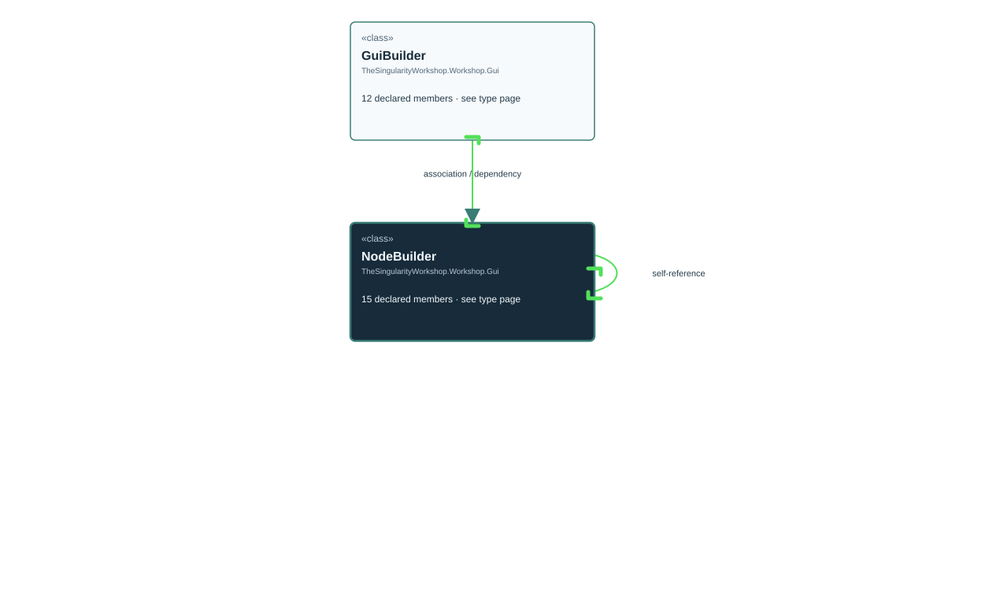

# TheSingularityWorkshop.Workshop.Gui.GuiBuilder.NodeBuilder

> Generated from compiler-backed source analysis. Do not edit by hand.

- Repository: `TrentBest/TheSingularityWorkshop.GUI`
- Revision: [`0644fd4a6c6dc743fb9882f25358651ebbed954b`](https://github.com/TrentBest/TheSingularityWorkshop.GUI/tree/0644fd4a6c6dc743fb9882f25358651ebbed954b)
- Project: `src/Core/TheSingularityWorkshop.GUI.Core.csproj`
- Type ID: `type:TheSingularityWorkshop.GUI.Core, Version=0.1.0.0, Culture=neutral, PublicKeyToken=null:global::TheSingularityWorkshop.Workshop.Gui.GuiBuilder.NodeBuilder`
- Metadata name: `NodeBuilder`
- Kind: `class`
- Generic arity: 0

## UML diagram

## Source declarations

- [`src/Core/GuiBuilder.cs:146-162`](https://github.com/TrentBest/TheSingularityWorkshop.GUI/blob/0644fd4a6c6dc743fb9882f25358651ebbed954b/src/Core/GuiBuilder.cs#L146-162)

## Members

| Kind | Signature | Source |
|---|---|---|
| `Property` | `TheSingularityWorkshop.Workshop.Gui.GuiBuilder.NodeBuilder.Children` | [`src/Core/GuiBuilder.cs:161-161`](https://github.com/TrentBest/TheSingularityWorkshop.GUI/blob/0644fd4a6c6dc743fb9882f25358651ebbed954b/src/Core/GuiBuilder.cs#L161-161) |
| `Method` | `TheSingularityWorkshop.Workshop.Gui.GuiBuilder.NodeBuilder.Children.get` | [`src/Core/GuiBuilder.cs:161-161`](https://github.com/TrentBest/TheSingularityWorkshop.GUI/blob/0644fd4a6c6dc743fb9882f25358651ebbed954b/src/Core/GuiBuilder.cs#L161-161) |
| `Property` | `TheSingularityWorkshop.Workshop.Gui.GuiBuilder.NodeBuilder.Id` | [`src/Core/GuiBuilder.cs:157-157`](https://github.com/TrentBest/TheSingularityWorkshop.GUI/blob/0644fd4a6c6dc743fb9882f25358651ebbed954b/src/Core/GuiBuilder.cs#L157-157) |
| `Method` | `TheSingularityWorkshop.Workshop.Gui.GuiBuilder.NodeBuilder.Id.get` | [`src/Core/GuiBuilder.cs:157-157`](https://github.com/TrentBest/TheSingularityWorkshop.GUI/blob/0644fd4a6c6dc743fb9882f25358651ebbed954b/src/Core/GuiBuilder.cs#L157-157) |
| `Property` | `TheSingularityWorkshop.Workshop.Gui.GuiBuilder.NodeBuilder.Kind` | [`src/Core/GuiBuilder.cs:156-156`](https://github.com/TrentBest/TheSingularityWorkshop.GUI/blob/0644fd4a6c6dc743fb9882f25358651ebbed954b/src/Core/GuiBuilder.cs#L156-156) |
| `Method` | `TheSingularityWorkshop.Workshop.Gui.GuiBuilder.NodeBuilder.Kind.get` | [`src/Core/GuiBuilder.cs:156-156`](https://github.com/TrentBest/TheSingularityWorkshop.GUI/blob/0644fd4a6c6dc743fb9882f25358651ebbed954b/src/Core/GuiBuilder.cs#L156-156) |
| `Method` | `TheSingularityWorkshop.Workshop.Gui.GuiBuilder.NodeBuilder.NodeBuilder(string, string)` | [`src/Core/GuiBuilder.cs:148-154`](https://github.com/TrentBest/TheSingularityWorkshop.GUI/blob/0644fd4a6c6dc743fb9882f25358651ebbed954b/src/Core/GuiBuilder.cs#L148-154) |
| `Property` | `TheSingularityWorkshop.Workshop.Gui.GuiBuilder.NodeBuilder.Properties` | [`src/Core/GuiBuilder.cs:160-160`](https://github.com/TrentBest/TheSingularityWorkshop.GUI/blob/0644fd4a6c6dc743fb9882f25358651ebbed954b/src/Core/GuiBuilder.cs#L160-160) |
| `Method` | `TheSingularityWorkshop.Workshop.Gui.GuiBuilder.NodeBuilder.Properties.get` | [`src/Core/GuiBuilder.cs:160-160`](https://github.com/TrentBest/TheSingularityWorkshop.GUI/blob/0644fd4a6c6dc743fb9882f25358651ebbed954b/src/Core/GuiBuilder.cs#L160-160) |
| `Property` | `TheSingularityWorkshop.Workshop.Gui.GuiBuilder.NodeBuilder.Source` | [`src/Core/GuiBuilder.cs:159-159`](https://github.com/TrentBest/TheSingularityWorkshop.GUI/blob/0644fd4a6c6dc743fb9882f25358651ebbed954b/src/Core/GuiBuilder.cs#L159-159) |
| `Method` | `TheSingularityWorkshop.Workshop.Gui.GuiBuilder.NodeBuilder.Source.get` | [`src/Core/GuiBuilder.cs:159-159`](https://github.com/TrentBest/TheSingularityWorkshop.GUI/blob/0644fd4a6c6dc743fb9882f25358651ebbed954b/src/Core/GuiBuilder.cs#L159-159) |
| `Method` | `TheSingularityWorkshop.Workshop.Gui.GuiBuilder.NodeBuilder.Source.set` | [`src/Core/GuiBuilder.cs:159-159`](https://github.com/TrentBest/TheSingularityWorkshop.GUI/blob/0644fd4a6c6dc743fb9882f25358651ebbed954b/src/Core/GuiBuilder.cs#L159-159) |
| `Property` | `TheSingularityWorkshop.Workshop.Gui.GuiBuilder.NodeBuilder.Text` | [`src/Core/GuiBuilder.cs:158-158`](https://github.com/TrentBest/TheSingularityWorkshop.GUI/blob/0644fd4a6c6dc743fb9882f25358651ebbed954b/src/Core/GuiBuilder.cs#L158-158) |
| `Method` | `TheSingularityWorkshop.Workshop.Gui.GuiBuilder.NodeBuilder.Text.get` | [`src/Core/GuiBuilder.cs:158-158`](https://github.com/TrentBest/TheSingularityWorkshop.GUI/blob/0644fd4a6c6dc743fb9882f25358651ebbed954b/src/Core/GuiBuilder.cs#L158-158) |
| `Method` | `TheSingularityWorkshop.Workshop.Gui.GuiBuilder.NodeBuilder.Text.set` | [`src/Core/GuiBuilder.cs:158-158`](https://github.com/TrentBest/TheSingularityWorkshop.GUI/blob/0644fd4a6c6dc743fb9882f25358651ebbed954b/src/Core/GuiBuilder.cs#L158-158) |

## Relationships

| Direction | Kind | Related type | Resolution | Evidence |
|---|---|---|---|---|
| incoming | `Association` | `TheSingularityWorkshop.Workshop.Gui.GuiBuilder` | `Resolved` | [`src/Core/GuiBuilder.cs:12-12`](https://github.com/TrentBest/TheSingularityWorkshop.GUI/blob/0644fd4a6c6dc743fb9882f25358651ebbed954b/src/Core/GuiBuilder.cs#L12-12) |
| outgoing | `Association` | `TheSingularityWorkshop.Workshop.Gui.GuiBuilder.NodeBuilder` | `Resolved` | [`src/Core/GuiBuilder.cs:161-161`](https://github.com/TrentBest/TheSingularityWorkshop.GUI/blob/0644fd4a6c6dc743fb9882f25358651ebbed954b/src/Core/GuiBuilder.cs#L161-161) |
| incoming | `Dependency` | `TheSingularityWorkshop.Workshop.Gui.GuiBuilder` | `Resolved` | [`src/Core/GuiBuilder.cs:13-13`](https://github.com/TrentBest/TheSingularityWorkshop.GUI/blob/0644fd4a6c6dc743fb9882f25358651ebbed954b/src/Core/GuiBuilder.cs#L13-13) |
| incoming | `Dependency` | `TheSingularityWorkshop.Workshop.Gui.GuiBuilder` | `Resolved` | [`src/Core/GuiBuilder.cs:111-144`](https://github.com/TrentBest/TheSingularityWorkshop.GUI/blob/0644fd4a6c6dc743fb9882f25358651ebbed954b/src/Core/GuiBuilder.cs#L111-144) |

[Back to the generated type index](index.md)

