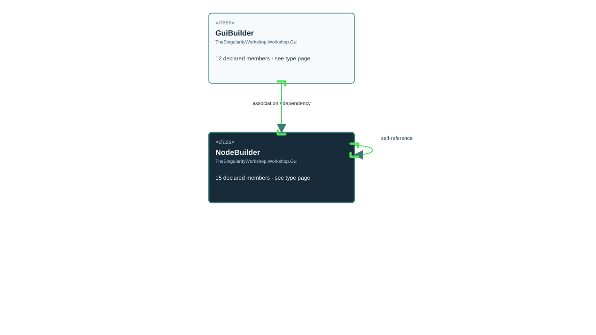

<!-- The Singularity Workshop moniker -->

# TheSingularityWorkshop.Workshop.Gui.GuiBuilder.NodeBuilder

> Generated from compiler-backed source analysis. Do not edit by hand.

- Repository: `TrentBest/TheSingularityWorkshop.GUI`
- Revision: [`29a8ea72d7be2d1496f9ba15ab1fd3f40cd35aba`](https://github.com/TrentBest/TheSingularityWorkshop.GUI/tree/29a8ea72d7be2d1496f9ba15ab1fd3f40cd35aba)
- Project: `src/Core/TheSingularityWorkshop.GUI.Core.csproj`
- Type ID: `type:TheSingularityWorkshop.GUI.Core, Version=0.1.0.0, Culture=neutral, PublicKeyToken=null:global::TheSingularityWorkshop.Workshop.Gui.GuiBuilder.NodeBuilder`
- Metadata name: `NodeBuilder`
- Kind: `class`
- Generic arity: 0

## UML diagram

## Source declarations

- [`src/Core/GuiBuilder.cs:155-172`](https://github.com/TrentBest/TheSingularityWorkshop.GUI/blob/29a8ea72d7be2d1496f9ba15ab1fd3f40cd35aba/src/Core/GuiBuilder.cs#L155-172)

## Members

| Kind | Signature | Source |
|---|---|---|
| `Property` | `TheSingularityWorkshop.Workshop.Gui.GuiBuilder.NodeBuilder.Children` | [`src/Core/GuiBuilder.cs:171-171`](https://github.com/TrentBest/TheSingularityWorkshop.GUI/blob/29a8ea72d7be2d1496f9ba15ab1fd3f40cd35aba/src/Core/GuiBuilder.cs#L171-171) |
| `Method` | `TheSingularityWorkshop.Workshop.Gui.GuiBuilder.NodeBuilder.Children.get` | [`src/Core/GuiBuilder.cs:171-171`](https://github.com/TrentBest/TheSingularityWorkshop.GUI/blob/29a8ea72d7be2d1496f9ba15ab1fd3f40cd35aba/src/Core/GuiBuilder.cs#L171-171) |
| `Property` | `TheSingularityWorkshop.Workshop.Gui.GuiBuilder.NodeBuilder.Control` | [`src/Core/GuiBuilder.cs:169-169`](https://github.com/TrentBest/TheSingularityWorkshop.GUI/blob/29a8ea72d7be2d1496f9ba15ab1fd3f40cd35aba/src/Core/GuiBuilder.cs#L169-169) |
| `Method` | `TheSingularityWorkshop.Workshop.Gui.GuiBuilder.NodeBuilder.Control.get` | [`src/Core/GuiBuilder.cs:169-169`](https://github.com/TrentBest/TheSingularityWorkshop.GUI/blob/29a8ea72d7be2d1496f9ba15ab1fd3f40cd35aba/src/Core/GuiBuilder.cs#L169-169) |
| `Method` | `TheSingularityWorkshop.Workshop.Gui.GuiBuilder.NodeBuilder.Control.set` | [`src/Core/GuiBuilder.cs:169-169`](https://github.com/TrentBest/TheSingularityWorkshop.GUI/blob/29a8ea72d7be2d1496f9ba15ab1fd3f40cd35aba/src/Core/GuiBuilder.cs#L169-169) |
| `Property` | `TheSingularityWorkshop.Workshop.Gui.GuiBuilder.NodeBuilder.Id` | [`src/Core/GuiBuilder.cs:166-166`](https://github.com/TrentBest/TheSingularityWorkshop.GUI/blob/29a8ea72d7be2d1496f9ba15ab1fd3f40cd35aba/src/Core/GuiBuilder.cs#L166-166) |
| `Method` | `TheSingularityWorkshop.Workshop.Gui.GuiBuilder.NodeBuilder.Id.get` | [`src/Core/GuiBuilder.cs:166-166`](https://github.com/TrentBest/TheSingularityWorkshop.GUI/blob/29a8ea72d7be2d1496f9ba15ab1fd3f40cd35aba/src/Core/GuiBuilder.cs#L166-166) |
| `Property` | `TheSingularityWorkshop.Workshop.Gui.GuiBuilder.NodeBuilder.Kind` | [`src/Core/GuiBuilder.cs:165-165`](https://github.com/TrentBest/TheSingularityWorkshop.GUI/blob/29a8ea72d7be2d1496f9ba15ab1fd3f40cd35aba/src/Core/GuiBuilder.cs#L165-165) |
| `Method` | `TheSingularityWorkshop.Workshop.Gui.GuiBuilder.NodeBuilder.Kind.get` | [`src/Core/GuiBuilder.cs:165-165`](https://github.com/TrentBest/TheSingularityWorkshop.GUI/blob/29a8ea72d7be2d1496f9ba15ab1fd3f40cd35aba/src/Core/GuiBuilder.cs#L165-165) |
| `Method` | `TheSingularityWorkshop.Workshop.Gui.GuiBuilder.NodeBuilder.NodeBuilder(string, string)` | [`src/Core/GuiBuilder.cs:157-163`](https://github.com/TrentBest/TheSingularityWorkshop.GUI/blob/29a8ea72d7be2d1496f9ba15ab1fd3f40cd35aba/src/Core/GuiBuilder.cs#L157-163) |
| `Property` | `TheSingularityWorkshop.Workshop.Gui.GuiBuilder.NodeBuilder.Properties` | [`src/Core/GuiBuilder.cs:170-170`](https://github.com/TrentBest/TheSingularityWorkshop.GUI/blob/29a8ea72d7be2d1496f9ba15ab1fd3f40cd35aba/src/Core/GuiBuilder.cs#L170-170) |
| `Method` | `TheSingularityWorkshop.Workshop.Gui.GuiBuilder.NodeBuilder.Properties.get` | [`src/Core/GuiBuilder.cs:170-170`](https://github.com/TrentBest/TheSingularityWorkshop.GUI/blob/29a8ea72d7be2d1496f9ba15ab1fd3f40cd35aba/src/Core/GuiBuilder.cs#L170-170) |
| `Property` | `TheSingularityWorkshop.Workshop.Gui.GuiBuilder.NodeBuilder.Source` | [`src/Core/GuiBuilder.cs:168-168`](https://github.com/TrentBest/TheSingularityWorkshop.GUI/blob/29a8ea72d7be2d1496f9ba15ab1fd3f40cd35aba/src/Core/GuiBuilder.cs#L168-168) |
| `Method` | `TheSingularityWorkshop.Workshop.Gui.GuiBuilder.NodeBuilder.Source.get` | [`src/Core/GuiBuilder.cs:168-168`](https://github.com/TrentBest/TheSingularityWorkshop.GUI/blob/29a8ea72d7be2d1496f9ba15ab1fd3f40cd35aba/src/Core/GuiBuilder.cs#L168-168) |
| `Method` | `TheSingularityWorkshop.Workshop.Gui.GuiBuilder.NodeBuilder.Source.set` | [`src/Core/GuiBuilder.cs:168-168`](https://github.com/TrentBest/TheSingularityWorkshop.GUI/blob/29a8ea72d7be2d1496f9ba15ab1fd3f40cd35aba/src/Core/GuiBuilder.cs#L168-168) |
| `Property` | `TheSingularityWorkshop.Workshop.Gui.GuiBuilder.NodeBuilder.Text` | [`src/Core/GuiBuilder.cs:167-167`](https://github.com/TrentBest/TheSingularityWorkshop.GUI/blob/29a8ea72d7be2d1496f9ba15ab1fd3f40cd35aba/src/Core/GuiBuilder.cs#L167-167) |
| `Method` | `TheSingularityWorkshop.Workshop.Gui.GuiBuilder.NodeBuilder.Text.get` | [`src/Core/GuiBuilder.cs:167-167`](https://github.com/TrentBest/TheSingularityWorkshop.GUI/blob/29a8ea72d7be2d1496f9ba15ab1fd3f40cd35aba/src/Core/GuiBuilder.cs#L167-167) |
| `Method` | `TheSingularityWorkshop.Workshop.Gui.GuiBuilder.NodeBuilder.Text.set` | [`src/Core/GuiBuilder.cs:167-167`](https://github.com/TrentBest/TheSingularityWorkshop.GUI/blob/29a8ea72d7be2d1496f9ba15ab1fd3f40cd35aba/src/Core/GuiBuilder.cs#L167-167) |

## Relationships

| Direction | Kind | Related type | Resolution | Evidence |
|---|---|---|---|---|
| incoming | `Association` | `TheSingularityWorkshop.Workshop.Gui.GuiBuilder` | `Resolved` | [`src/Core/GuiBuilder.cs:12-12`](https://github.com/TrentBest/TheSingularityWorkshop.GUI/blob/29a8ea72d7be2d1496f9ba15ab1fd3f40cd35aba/src/Core/GuiBuilder.cs#L12-12) |
| outgoing | `Association` | `TheSingularityWorkshop.Workshop.Gui.GuiBuilder.NodeBuilder` | `Resolved` | [`src/Core/GuiBuilder.cs:171-171`](https://github.com/TrentBest/TheSingularityWorkshop.GUI/blob/29a8ea72d7be2d1496f9ba15ab1fd3f40cd35aba/src/Core/GuiBuilder.cs#L171-171) |
| outgoing | `Association` | `TheSingularityWorkshop.Workshop.Gui.GuiControlDefinition` | `Resolved` | [`src/Core/GuiBuilder.cs:169-169`](https://github.com/TrentBest/TheSingularityWorkshop.GUI/blob/29a8ea72d7be2d1496f9ba15ab1fd3f40cd35aba/src/Core/GuiBuilder.cs#L169-169) |
| incoming | `Dependency` | `TheSingularityWorkshop.Workshop.Gui.GuiBuilder` | `Resolved` | [`src/Core/GuiBuilder.cs:13-13`](https://github.com/TrentBest/TheSingularityWorkshop.GUI/blob/29a8ea72d7be2d1496f9ba15ab1fd3f40cd35aba/src/Core/GuiBuilder.cs#L13-13) |
| incoming | `Dependency` | `TheSingularityWorkshop.Workshop.Gui.GuiBuilder` | `Resolved` | [`src/Core/GuiBuilder.cs:119-153`](https://github.com/TrentBest/TheSingularityWorkshop.GUI/blob/29a8ea72d7be2d1496f9ba15ab1fd3f40cd35aba/src/Core/GuiBuilder.cs#L119-153) |

[Back to the generated type index](index.md)

---

<!-- THE SINGULARITY WORKSHOP FOOTER -->

