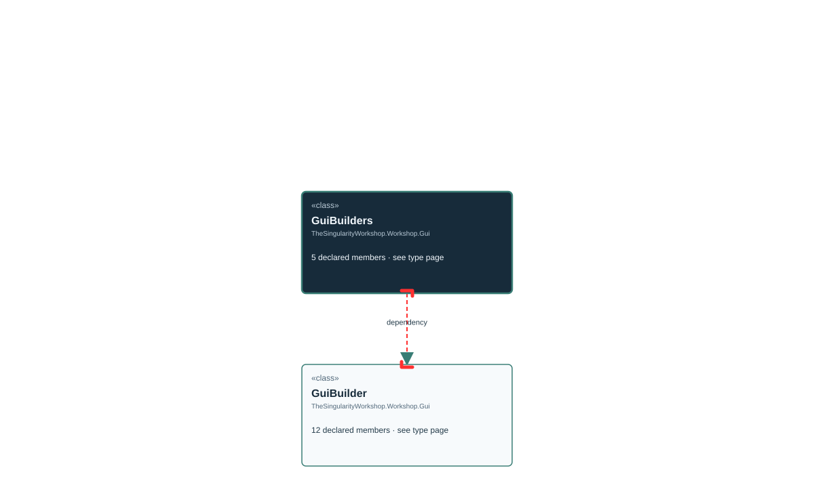

# TheSingularityWorkshop.Workshop.Gui.GuiBuilders

> Generated from compiler-backed source analysis. Do not edit by hand.

- Repository: `TrentBest/TheSingularityWorkshop.GUI`
- Revision: [`3844b48b1a30f678cb8aa80c2a21aaaceed9348b`](https://github.com/TrentBest/TheSingularityWorkshop.GUI/tree/3844b48b1a30f678cb8aa80c2a21aaaceed9348b)
- Project: `src/Core/TheSingularityWorkshop.GUI.Core.csproj`
- Type ID: `type:TheSingularityWorkshop.GUI.Core, Version=0.1.0.0, Culture=neutral, PublicKeyToken=null:global::TheSingularityWorkshop.Workshop.Gui.GuiBuilders`
- Metadata name: `GuiBuilders`
- Kind: `class`
- Generic arity: 0

## UML diagram

## Source declarations

- [`src/Core/GuiBuilders.cs:4-16`](https://github.com/TrentBest/TheSingularityWorkshop.GUI/blob/3844b48b1a30f678cb8aa80c2a21aaaceed9348b/src/Core/GuiBuilders.cs#L4-16)

## Members

| Kind | Signature | Source |
|---|---|---|
| `Method` | `TheSingularityWorkshop.Workshop.Gui.GuiBuilders.Button(string, string)` | [`src/Core/GuiBuilders.cs:13-13`](https://github.com/TrentBest/TheSingularityWorkshop.GUI/blob/3844b48b1a30f678cb8aa80c2a21aaaceed9348b/src/Core/GuiBuilders.cs#L13-13) |
| `Method` | `TheSingularityWorkshop.Workshop.Gui.GuiBuilders.Column(string)` | [`src/Core/GuiBuilders.cs:9-9`](https://github.com/TrentBest/TheSingularityWorkshop.GUI/blob/3844b48b1a30f678cb8aa80c2a21aaaceed9348b/src/Core/GuiBuilders.cs#L9-9) |
| `Method` | `TheSingularityWorkshop.Workshop.Gui.GuiBuilders.Panel(string)` | [`src/Core/GuiBuilders.cs:7-7`](https://github.com/TrentBest/TheSingularityWorkshop.GUI/blob/3844b48b1a30f678cb8aa80c2a21aaaceed9348b/src/Core/GuiBuilders.cs#L7-7) |
| `Method` | `TheSingularityWorkshop.Workshop.Gui.GuiBuilders.Text(string, string)` | [`src/Core/GuiBuilders.cs:11-11`](https://github.com/TrentBest/TheSingularityWorkshop.GUI/blob/3844b48b1a30f678cb8aa80c2a21aaaceed9348b/src/Core/GuiBuilders.cs#L11-11) |
| `Method` | `TheSingularityWorkshop.Workshop.Gui.GuiBuilders.Warning(string, string)` | [`src/Core/GuiBuilders.cs:15-15`](https://github.com/TrentBest/TheSingularityWorkshop.GUI/blob/3844b48b1a30f678cb8aa80c2a21aaaceed9348b/src/Core/GuiBuilders.cs#L15-15) |

## Relationships

| Direction | Kind | Related type | Resolution | Evidence |
|---|---|---|---|---|
| outgoing | `Dependency` | `TheSingularityWorkshop.Workshop.Gui.GuiBuilder` | `Resolved` | [`src/Core/GuiBuilders.cs:13-13`](https://github.com/TrentBest/TheSingularityWorkshop.GUI/blob/3844b48b1a30f678cb8aa80c2a21aaaceed9348b/src/Core/GuiBuilders.cs#L13-13) |
| outgoing | `Dependency` | `TheSingularityWorkshop.Workshop.Gui.GuiBuilder` | `Resolved` | [`src/Core/GuiBuilders.cs:9-9`](https://github.com/TrentBest/TheSingularityWorkshop.GUI/blob/3844b48b1a30f678cb8aa80c2a21aaaceed9348b/src/Core/GuiBuilders.cs#L9-9) |
| outgoing | `Dependency` | `TheSingularityWorkshop.Workshop.Gui.GuiBuilder` | `Resolved` | [`src/Core/GuiBuilders.cs:7-7`](https://github.com/TrentBest/TheSingularityWorkshop.GUI/blob/3844b48b1a30f678cb8aa80c2a21aaaceed9348b/src/Core/GuiBuilders.cs#L7-7) |
| outgoing | `Dependency` | `TheSingularityWorkshop.Workshop.Gui.GuiBuilder` | `Resolved` | [`src/Core/GuiBuilders.cs:11-11`](https://github.com/TrentBest/TheSingularityWorkshop.GUI/blob/3844b48b1a30f678cb8aa80c2a21aaaceed9348b/src/Core/GuiBuilders.cs#L11-11) |
| outgoing | `Dependency` | `TheSingularityWorkshop.Workshop.Gui.GuiBuilder` | `Resolved` | [`src/Core/GuiBuilders.cs:15-15`](https://github.com/TrentBest/TheSingularityWorkshop.GUI/blob/3844b48b1a30f678cb8aa80c2a21aaaceed9348b/src/Core/GuiBuilders.cs#L15-15) |

[Back to the generated type index](index.md)

