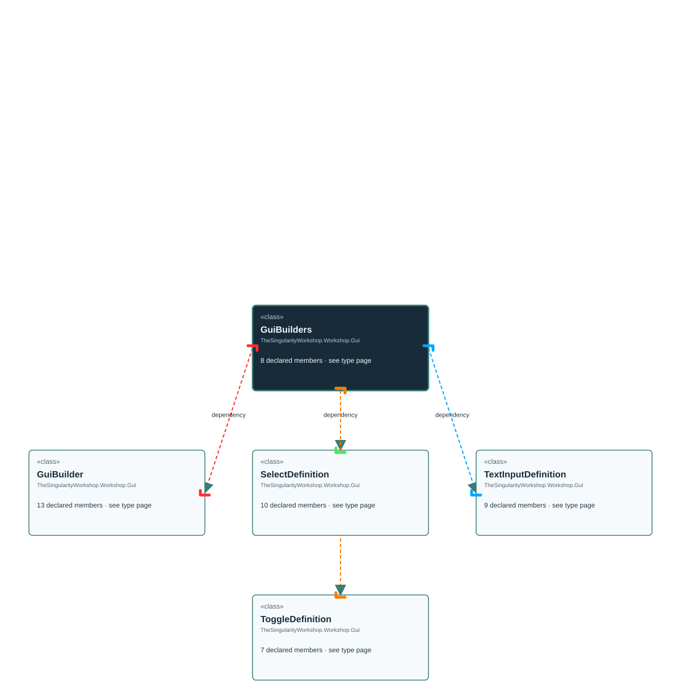

<!-- The Singularity Workshop moniker -->

# TheSingularityWorkshop.Workshop.Gui.GuiBuilders

> Generated from compiler-backed source analysis. Do not edit by hand.

- Repository: `TrentBest/TheSingularityWorkshop.GUI`
- Revision: [`ab72064a71716d2a2240016baaac9257896d425a`](https://github.com/TrentBest/TheSingularityWorkshop.GUI/tree/ab72064a71716d2a2240016baaac9257896d425a)
- Project: `src/Core/TheSingularityWorkshop.GUI.Core.csproj`
- Type ID: `type:TheSingularityWorkshop.GUI.Core, Version=0.1.0.0, Culture=neutral, PublicKeyToken=null:global::TheSingularityWorkshop.Workshop.Gui.GuiBuilders`
- Metadata name: `GuiBuilders`
- Kind: `class`
- Generic arity: 0

## UML diagram

## Source declarations

- [`src/Core/GuiBuilders.cs:6-33`](https://github.com/TrentBest/TheSingularityWorkshop.GUI/blob/ab72064a71716d2a2240016baaac9257896d425a/src/Core/GuiBuilders.cs#L6-33)

## Members

| Kind | Signature | Source |
|---|---|---|
| `Method` | `TheSingularityWorkshop.Workshop.Gui.GuiBuilders.Button(string, string)` | [`src/Core/GuiBuilders.cs:15-15`](https://github.com/TrentBest/TheSingularityWorkshop.GUI/blob/ab72064a71716d2a2240016baaac9257896d425a/src/Core/GuiBuilders.cs#L15-15) |
| `Method` | `TheSingularityWorkshop.Workshop.Gui.GuiBuilders.Column(string)` | [`src/Core/GuiBuilders.cs:11-11`](https://github.com/TrentBest/TheSingularityWorkshop.GUI/blob/ab72064a71716d2a2240016baaac9257896d425a/src/Core/GuiBuilders.cs#L11-11) |
| `Method` | `TheSingularityWorkshop.Workshop.Gui.GuiBuilders.Panel(string)` | [`src/Core/GuiBuilders.cs:9-9`](https://github.com/TrentBest/TheSingularityWorkshop.GUI/blob/ab72064a71716d2a2240016baaac9257896d425a/src/Core/GuiBuilders.cs#L9-9) |
| `Method` | `TheSingularityWorkshop.Workshop.Gui.GuiBuilders.Select(string, TheSingularityWorkshop.Workshop.Gui.SelectDefinition)` | [`src/Core/GuiBuilders.cs:28-29`](https://github.com/TrentBest/TheSingularityWorkshop.GUI/blob/ab72064a71716d2a2240016baaac9257896d425a/src/Core/GuiBuilders.cs#L28-29) |
| `Method` | `TheSingularityWorkshop.Workshop.Gui.GuiBuilders.Text(string, string)` | [`src/Core/GuiBuilders.cs:13-13`](https://github.com/TrentBest/TheSingularityWorkshop.GUI/blob/ab72064a71716d2a2240016baaac9257896d425a/src/Core/GuiBuilders.cs#L13-13) |
| `Method` | `TheSingularityWorkshop.Workshop.Gui.GuiBuilders.TextInput(string, TheSingularityWorkshop.Workshop.Gui.TextInputDefinition)` | [`src/Core/GuiBuilders.cs:25-26`](https://github.com/TrentBest/TheSingularityWorkshop.GUI/blob/ab72064a71716d2a2240016baaac9257896d425a/src/Core/GuiBuilders.cs#L25-26) |
| `Method` | `TheSingularityWorkshop.Workshop.Gui.GuiBuilders.Toggle(string, TheSingularityWorkshop.Workshop.Gui.ToggleDefinition)` | [`src/Core/GuiBuilders.cs:31-32`](https://github.com/TrentBest/TheSingularityWorkshop.GUI/blob/ab72064a71716d2a2240016baaac9257896d425a/src/Core/GuiBuilders.cs#L31-32) |
| `Method` | `TheSingularityWorkshop.Workshop.Gui.GuiBuilders.Viewport(string, string)` | [`src/Core/GuiBuilders.cs:17-21`](https://github.com/TrentBest/TheSingularityWorkshop.GUI/blob/ab72064a71716d2a2240016baaac9257896d425a/src/Core/GuiBuilders.cs#L17-21) |
| `Method` | `TheSingularityWorkshop.Workshop.Gui.GuiBuilders.Warning(string, string)` | [`src/Core/GuiBuilders.cs:23-23`](https://github.com/TrentBest/TheSingularityWorkshop.GUI/blob/ab72064a71716d2a2240016baaac9257896d425a/src/Core/GuiBuilders.cs#L23-23) |

## Relationships

| Direction | Kind | Related type | Resolution | Evidence |
|---|---|---|---|---|
| outgoing | `Dependency` | `TheSingularityWorkshop.Workshop.Gui.GuiBuilder` | `Resolved` | [`src/Core/GuiBuilders.cs:15-15`](https://github.com/TrentBest/TheSingularityWorkshop.GUI/blob/ab72064a71716d2a2240016baaac9257896d425a/src/Core/GuiBuilders.cs#L15-15) |
| outgoing | `Dependency` | `TheSingularityWorkshop.Workshop.Gui.GuiBuilder` | `Resolved` | [`src/Core/GuiBuilders.cs:11-11`](https://github.com/TrentBest/TheSingularityWorkshop.GUI/blob/ab72064a71716d2a2240016baaac9257896d425a/src/Core/GuiBuilders.cs#L11-11) |
| outgoing | `Dependency` | `TheSingularityWorkshop.Workshop.Gui.GuiBuilder` | `Resolved` | [`src/Core/GuiBuilders.cs:9-9`](https://github.com/TrentBest/TheSingularityWorkshop.GUI/blob/ab72064a71716d2a2240016baaac9257896d425a/src/Core/GuiBuilders.cs#L9-9) |
| outgoing | `Dependency` | `TheSingularityWorkshop.Workshop.Gui.GuiBuilder` | `Resolved` | [`src/Core/GuiBuilders.cs:28-29`](https://github.com/TrentBest/TheSingularityWorkshop.GUI/blob/ab72064a71716d2a2240016baaac9257896d425a/src/Core/GuiBuilders.cs#L28-29) |
| outgoing | `Dependency` | `TheSingularityWorkshop.Workshop.Gui.GuiBuilder` | `Resolved` | [`src/Core/GuiBuilders.cs:13-13`](https://github.com/TrentBest/TheSingularityWorkshop.GUI/blob/ab72064a71716d2a2240016baaac9257896d425a/src/Core/GuiBuilders.cs#L13-13) |
| outgoing | `Dependency` | `TheSingularityWorkshop.Workshop.Gui.GuiBuilder` | `Resolved` | [`src/Core/GuiBuilders.cs:25-26`](https://github.com/TrentBest/TheSingularityWorkshop.GUI/blob/ab72064a71716d2a2240016baaac9257896d425a/src/Core/GuiBuilders.cs#L25-26) |
| outgoing | `Dependency` | `TheSingularityWorkshop.Workshop.Gui.GuiBuilder` | `Resolved` | [`src/Core/GuiBuilders.cs:31-32`](https://github.com/TrentBest/TheSingularityWorkshop.GUI/blob/ab72064a71716d2a2240016baaac9257896d425a/src/Core/GuiBuilders.cs#L31-32) |
| outgoing | `Dependency` | `TheSingularityWorkshop.Workshop.Gui.GuiBuilder` | `Resolved` | [`src/Core/GuiBuilders.cs:17-21`](https://github.com/TrentBest/TheSingularityWorkshop.GUI/blob/ab72064a71716d2a2240016baaac9257896d425a/src/Core/GuiBuilders.cs#L17-21) |
| outgoing | `Dependency` | `TheSingularityWorkshop.Workshop.Gui.GuiBuilder` | `Resolved` | [`src/Core/GuiBuilders.cs:23-23`](https://github.com/TrentBest/TheSingularityWorkshop.GUI/blob/ab72064a71716d2a2240016baaac9257896d425a/src/Core/GuiBuilders.cs#L23-23) |
| outgoing | `Dependency` | `TheSingularityWorkshop.Workshop.Gui.SelectDefinition` | `Resolved` | [`src/Core/GuiBuilders.cs:28-29`](https://github.com/TrentBest/TheSingularityWorkshop.GUI/blob/ab72064a71716d2a2240016baaac9257896d425a/src/Core/GuiBuilders.cs#L28-29) |
| outgoing | `Dependency` | `TheSingularityWorkshop.Workshop.Gui.TextInputDefinition` | `Resolved` | [`src/Core/GuiBuilders.cs:25-26`](https://github.com/TrentBest/TheSingularityWorkshop.GUI/blob/ab72064a71716d2a2240016baaac9257896d425a/src/Core/GuiBuilders.cs#L25-26) |
| outgoing | `Dependency` | `TheSingularityWorkshop.Workshop.Gui.ToggleDefinition` | `Resolved` | [`src/Core/GuiBuilders.cs:31-32`](https://github.com/TrentBest/TheSingularityWorkshop.GUI/blob/ab72064a71716d2a2240016baaac9257896d425a/src/Core/GuiBuilders.cs#L31-32) |

[Back to the generated type index](index.md)

---

<!-- THE SINGULARITY WORKSHOP FOOTER -->

