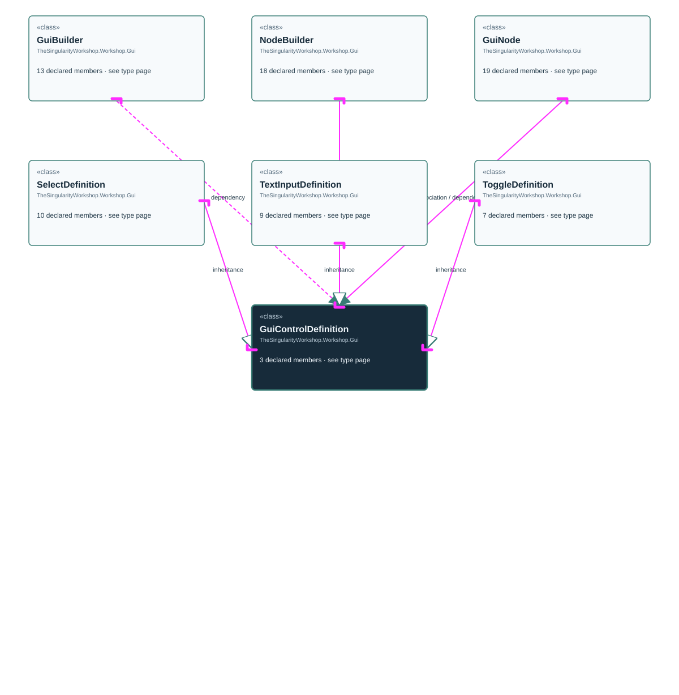

<!-- The Singularity Workshop moniker -->

# TheSingularityWorkshop.Workshop.Gui.GuiControlDefinition

> Generated from compiler-backed source analysis. Do not edit by hand.

- Repository: `TrentBest/TheSingularityWorkshop.GUI`
- Revision: [`792939b14c162608acaac5d2d1fda64a0c209304`](https://github.com/TrentBest/TheSingularityWorkshop.GUI/tree/792939b14c162608acaac5d2d1fda64a0c209304)
- Project: `src/Core/TheSingularityWorkshop.GUI.Core.csproj`
- Type ID: `type:TheSingularityWorkshop.GUI.Core, Version=0.1.0.0, Culture=neutral, PublicKeyToken=null:global::TheSingularityWorkshop.Workshop.Gui.GuiControlDefinition`
- Metadata name: `GuiControlDefinition`
- Kind: `class`
- Generic arity: 0

## UML diagram

## Source declarations

- [`src/Core/GuiControlDefinition.cs:9-19`](https://github.com/TrentBest/TheSingularityWorkshop.GUI/blob/792939b14c162608acaac5d2d1fda64a0c209304/src/Core/GuiControlDefinition.cs#L9-19)

## Members

| Kind | Signature | Source |
|---|---|---|
| `Property` | `TheSingularityWorkshop.Workshop.Gui.GuiControlDefinition.ChangeCommandId` | [`src/Core/GuiControlDefinition.cs:18-18`](https://github.com/TrentBest/TheSingularityWorkshop.GUI/blob/792939b14c162608acaac5d2d1fda64a0c209304/src/Core/GuiControlDefinition.cs#L18-18) |
| `Method` | `TheSingularityWorkshop.Workshop.Gui.GuiControlDefinition.ChangeCommandId.get` | [`src/Core/GuiControlDefinition.cs:18-18`](https://github.com/TrentBest/TheSingularityWorkshop.GUI/blob/792939b14c162608acaac5d2d1fda64a0c209304/src/Core/GuiControlDefinition.cs#L18-18) |
| `Method` | `TheSingularityWorkshop.Workshop.Gui.GuiControlDefinition.GuiControlDefinition(string)` | [`src/Core/GuiControlDefinition.cs:11-15`](https://github.com/TrentBest/TheSingularityWorkshop.GUI/blob/792939b14c162608acaac5d2d1fda64a0c209304/src/Core/GuiControlDefinition.cs#L11-15) |

## Relationships

| Direction | Kind | Related type | Resolution | Evidence |
|---|---|---|---|---|
| incoming | `Inheritance` | `TheSingularityWorkshop.Workshop.Gui.SelectDefinition` | `Resolved` | [`src/Core/GuiControlDefinition.cs:59-93`](https://github.com/TrentBest/TheSingularityWorkshop.GUI/blob/792939b14c162608acaac5d2d1fda64a0c209304/src/Core/GuiControlDefinition.cs#L59-93) |
| incoming | `Inheritance` | `TheSingularityWorkshop.Workshop.Gui.TextInputDefinition` | `Resolved` | [`src/Core/GuiControlDefinition.cs:22-41`](https://github.com/TrentBest/TheSingularityWorkshop.GUI/blob/792939b14c162608acaac5d2d1fda64a0c209304/src/Core/GuiControlDefinition.cs#L22-41) |
| incoming | `Inheritance` | `TheSingularityWorkshop.Workshop.Gui.ToggleDefinition` | `Resolved` | [`src/Core/GuiControlDefinition.cs:96-109`](https://github.com/TrentBest/TheSingularityWorkshop.GUI/blob/792939b14c162608acaac5d2d1fda64a0c209304/src/Core/GuiControlDefinition.cs#L96-109) |
| incoming | `Association` | `TheSingularityWorkshop.Workshop.Gui.GuiBuilder.NodeBuilder` | `Resolved` | [`src/Core/GuiBuilder.cs:169-169`](https://github.com/TrentBest/TheSingularityWorkshop.GUI/blob/792939b14c162608acaac5d2d1fda64a0c209304/src/Core/GuiBuilder.cs#L169-169) |
| incoming | `Association` | `TheSingularityWorkshop.Workshop.Gui.GuiNode` | `Resolved` | [`src/Core/GuiNode.cs:67-67`](https://github.com/TrentBest/TheSingularityWorkshop.GUI/blob/792939b14c162608acaac5d2d1fda64a0c209304/src/Core/GuiNode.cs#L67-67) |
| incoming | `Dependency` | `TheSingularityWorkshop.Workshop.Gui.GuiBuilder` | `Resolved` | [`src/Core/GuiBuilder.cs:25-30`](https://github.com/TrentBest/TheSingularityWorkshop.GUI/blob/792939b14c162608acaac5d2d1fda64a0c209304/src/Core/GuiBuilder.cs#L25-30) |
| incoming | `Dependency` | `TheSingularityWorkshop.Workshop.Gui.GuiNode` | `Resolved` | [`src/Core/GuiNode.cs:14-56`](https://github.com/TrentBest/TheSingularityWorkshop.GUI/blob/792939b14c162608acaac5d2d1fda64a0c209304/src/Core/GuiNode.cs#L14-56) |

[Back to the generated type index](index.md)

---

<!-- THE SINGULARITY WORKSHOP FOOTER -->

