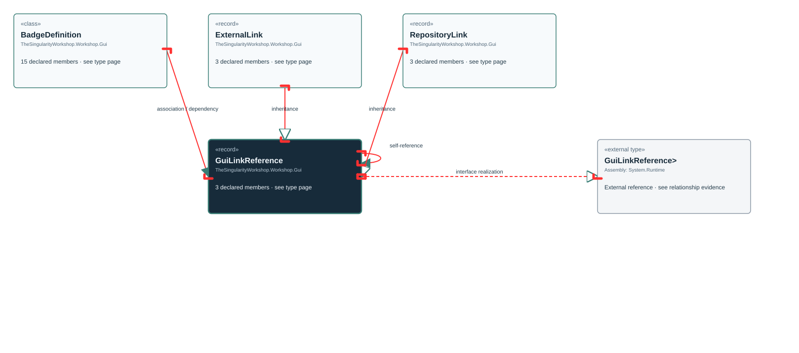

<!-- The Singularity Workshop moniker -->

# TheSingularityWorkshop.Workshop.Gui.GuiLinkReference

> Generated from compiler-backed source analysis. Do not edit by hand.

- Repository: `TrentBest/TheSingularityWorkshop.GUI`
- Revision: [`f43434399731a230d7e2b21db24ebf1e0a58dafd`](https://github.com/TrentBest/TheSingularityWorkshop.GUI/tree/f43434399731a230d7e2b21db24ebf1e0a58dafd)
- Project: `src/Core/TheSingularityWorkshop.GUI.Core.csproj`
- Type ID: `type:TheSingularityWorkshop.GUI.Core, Version=0.1.0.0, Culture=neutral, PublicKeyToken=null:global::TheSingularityWorkshop.Workshop.Gui.GuiLinkReference`
- Metadata name: `GuiLinkReference`
- Kind: `record`
- Generic arity: 0

## UML diagram

## Source declarations

- [`src/Core/BadgeDefinition.cs:55-83`](https://github.com/TrentBest/TheSingularityWorkshop.GUI/blob/f43434399731a230d7e2b21db24ebf1e0a58dafd/src/Core/BadgeDefinition.cs#L55-83)

## Members

| Kind | Signature | Source |
|---|---|---|
| `Method` | `TheSingularityWorkshop.Workshop.Gui.GuiLinkReference.External(System.Uri)` | [`src/Core/BadgeDefinition.cs:82-82`](https://github.com/TrentBest/TheSingularityWorkshop.GUI/blob/f43434399731a230d7e2b21db24ebf1e0a58dafd/src/Core/BadgeDefinition.cs#L82-82) |
| `Method` | `TheSingularityWorkshop.Workshop.Gui.GuiLinkReference.GuiLinkReference()` | [`src/Core/BadgeDefinition.cs:57-57`](https://github.com/TrentBest/TheSingularityWorkshop.GUI/blob/f43434399731a230d7e2b21db24ebf1e0a58dafd/src/Core/BadgeDefinition.cs#L57-57) |
| `Method` | `TheSingularityWorkshop.Workshop.Gui.GuiLinkReference.Repository(string)` | [`src/Core/BadgeDefinition.cs:80-80`](https://github.com/TrentBest/TheSingularityWorkshop.GUI/blob/f43434399731a230d7e2b21db24ebf1e0a58dafd/src/Core/BadgeDefinition.cs#L80-80) |

## Relationships

| Direction | Kind | Related type | Resolution | Evidence |
|---|---|---|---|---|
| incoming | `Inheritance` | `TheSingularityWorkshop.Workshop.Gui.GuiLinkReference.ExternalLink` | `Resolved` | [`src/Core/BadgeDefinition.cs:71-77`](https://github.com/TrentBest/TheSingularityWorkshop.GUI/blob/f43434399731a230d7e2b21db24ebf1e0a58dafd/src/Core/BadgeDefinition.cs#L71-77) |
| incoming | `Inheritance` | `TheSingularityWorkshop.Workshop.Gui.GuiLinkReference.RepositoryLink` | `Resolved` | [`src/Core/BadgeDefinition.cs:61-67`](https://github.com/TrentBest/TheSingularityWorkshop.GUI/blob/f43434399731a230d7e2b21db24ebf1e0a58dafd/src/Core/BadgeDefinition.cs#L61-67) |
| outgoing | `InterfaceRealization` | `global::System.IEquatable<global::TheSingularityWorkshop.Workshop.Gui.GuiLinkReference>` | `External` | [`src/Core/BadgeDefinition.cs:55-83`](https://github.com/TrentBest/TheSingularityWorkshop.GUI/blob/f43434399731a230d7e2b21db24ebf1e0a58dafd/src/Core/BadgeDefinition.cs#L55-83) |
| incoming | `Association` | `TheSingularityWorkshop.Workshop.Gui.BadgeDefinition` | `Resolved` | [`src/Core/BadgeDefinition.cs:128-128`](https://github.com/TrentBest/TheSingularityWorkshop.GUI/blob/f43434399731a230d7e2b21db24ebf1e0a58dafd/src/Core/BadgeDefinition.cs#L128-128) |
| incoming | `Dependency` | `TheSingularityWorkshop.Workshop.Gui.BadgeDefinition` | `Resolved` | [`src/Core/BadgeDefinition.cs:92-113`](https://github.com/TrentBest/TheSingularityWorkshop.GUI/blob/f43434399731a230d7e2b21db24ebf1e0a58dafd/src/Core/BadgeDefinition.cs#L92-113) |
| outgoing | `Dependency` | `TheSingularityWorkshop.Workshop.Gui.GuiLinkReference` | `Resolved` | [`src/Core/BadgeDefinition.cs:82-82`](https://github.com/TrentBest/TheSingularityWorkshop.GUI/blob/f43434399731a230d7e2b21db24ebf1e0a58dafd/src/Core/BadgeDefinition.cs#L82-82) |
| outgoing | `Dependency` | `TheSingularityWorkshop.Workshop.Gui.GuiLinkReference` | `Resolved` | [`src/Core/BadgeDefinition.cs:80-80`](https://github.com/TrentBest/TheSingularityWorkshop.GUI/blob/f43434399731a230d7e2b21db24ebf1e0a58dafd/src/Core/BadgeDefinition.cs#L80-80) |

[Back to the generated type index](index.md)

---

<!-- THE SINGULARITY WORKSHOP FOOTER -->

