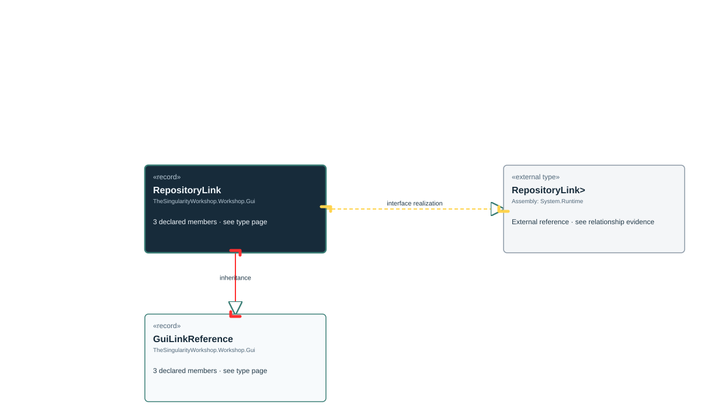

<!-- The Singularity Workshop moniker -->

# TheSingularityWorkshop.Workshop.Gui.GuiLinkReference.RepositoryLink

> Generated from compiler-backed source analysis. Do not edit by hand.

- Repository: `TrentBest/TheSingularityWorkshop.GUI`
- Revision: [`9716d4dd70d9d5eb65bd00df2fcd9632f316828d`](https://github.com/TrentBest/TheSingularityWorkshop.GUI/tree/9716d4dd70d9d5eb65bd00df2fcd9632f316828d)
- Project: `src/Core/TheSingularityWorkshop.GUI.Core.csproj`
- Type ID: `type:TheSingularityWorkshop.GUI.Core, Version=0.1.0.0, Culture=neutral, PublicKeyToken=null:global::TheSingularityWorkshop.Workshop.Gui.GuiLinkReference.RepositoryLink`
- Metadata name: `RepositoryLink`
- Kind: `record`
- Generic arity: 0

## UML diagram

## Source declarations

- [`src/Core/BadgeDefinition.cs:61-67`](https://github.com/TrentBest/TheSingularityWorkshop.GUI/blob/9716d4dd70d9d5eb65bd00df2fcd9632f316828d/src/Core/BadgeDefinition.cs#L61-67)

## Members

| Kind | Signature | Source |
|---|---|---|
| `Property` | `TheSingularityWorkshop.Workshop.Gui.GuiLinkReference.RepositoryLink.Path` | [`src/Core/BadgeDefinition.cs:66-66`](https://github.com/TrentBest/TheSingularityWorkshop.GUI/blob/9716d4dd70d9d5eb65bd00df2fcd9632f316828d/src/Core/BadgeDefinition.cs#L66-66) |
| `Method` | `TheSingularityWorkshop.Workshop.Gui.GuiLinkReference.RepositoryLink.Path.get` | [`src/Core/BadgeDefinition.cs:66-66`](https://github.com/TrentBest/TheSingularityWorkshop.GUI/blob/9716d4dd70d9d5eb65bd00df2fcd9632f316828d/src/Core/BadgeDefinition.cs#L66-66) |
| `Method` | `TheSingularityWorkshop.Workshop.Gui.GuiLinkReference.RepositoryLink.RepositoryLink(string)` | [`src/Core/BadgeDefinition.cs:64-64`](https://github.com/TrentBest/TheSingularityWorkshop.GUI/blob/9716d4dd70d9d5eb65bd00df2fcd9632f316828d/src/Core/BadgeDefinition.cs#L64-64) |

## Relationships

| Direction | Kind | Related type | Resolution | Evidence |
|---|---|---|---|---|
| outgoing | `Inheritance` | `TheSingularityWorkshop.Workshop.Gui.GuiLinkReference` | `Resolved` | [`src/Core/BadgeDefinition.cs:61-67`](https://github.com/TrentBest/TheSingularityWorkshop.GUI/blob/9716d4dd70d9d5eb65bd00df2fcd9632f316828d/src/Core/BadgeDefinition.cs#L61-67) |
| outgoing | `InterfaceRealization` | `global::System.IEquatable<global::TheSingularityWorkshop.Workshop.Gui.GuiLinkReference.RepositoryLink>` | `External` | [`src/Core/BadgeDefinition.cs:61-67`](https://github.com/TrentBest/TheSingularityWorkshop.GUI/blob/9716d4dd70d9d5eb65bd00df2fcd9632f316828d/src/Core/BadgeDefinition.cs#L61-67) |

[Back to the generated type index](index.md)

---

<!-- THE SINGULARITY WORKSHOP FOOTER -->

