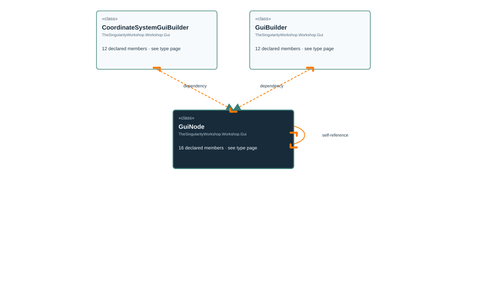

# TheSingularityWorkshop.Workshop.Gui.GuiNode

> Generated from compiler-backed source analysis. Do not edit by hand.

- Repository: `TrentBest/TheSingularityWorkshop.GUI`
- Revision: [`35bb31b337c1340f8713babd0d411f86f0d602cd`](https://github.com/TrentBest/TheSingularityWorkshop.GUI/tree/35bb31b337c1340f8713babd0d411f86f0d602cd)
- Project: `src/Core/TheSingularityWorkshop.GUI.Core.csproj`
- Type ID: `type:TheSingularityWorkshop.GUI.Core, Version=0.1.0.0, Culture=neutral, PublicKeyToken=null:global::TheSingularityWorkshop.Workshop.Gui.GuiNode`
- Metadata name: `GuiNode`
- Kind: `class`
- Generic arity: 0

## UML diagram

## Source declarations

- [`src/Core/GuiNode.cs:9-92`](https://github.com/TrentBest/TheSingularityWorkshop.GUI/blob/35bb31b337c1340f8713babd0d411f86f0d602cd/src/Core/GuiNode.cs#L9-92)

## Members

| Kind | Signature | Source |
|---|---|---|
| `Property` | `TheSingularityWorkshop.Workshop.Gui.GuiNode.Children` | [`src/Core/GuiNode.cs:53-53`](https://github.com/TrentBest/TheSingularityWorkshop.GUI/blob/35bb31b337c1340f8713babd0d411f86f0d602cd/src/Core/GuiNode.cs#L53-53) |
| `Method` | `TheSingularityWorkshop.Workshop.Gui.GuiNode.Children.get` | [`src/Core/GuiNode.cs:53-53`](https://github.com/TrentBest/TheSingularityWorkshop.GUI/blob/35bb31b337c1340f8713babd0d411f86f0d602cd/src/Core/GuiNode.cs#L53-53) |
| `Method` | `TheSingularityWorkshop.Workshop.Gui.GuiNode.Find(string)` | [`src/Core/GuiNode.cs:56-65`](https://github.com/TrentBest/TheSingularityWorkshop.GUI/blob/35bb31b337c1340f8713babd0d411f86f0d602cd/src/Core/GuiNode.cs#L56-65) |
| `Method` | `TheSingularityWorkshop.Workshop.Gui.GuiNode.GuiNode(string, string, string?, string?, System.Collections.Generic.IReadOnlyDictionary<string, string>?, System.Collections.Generic.IEnumerable<TheSingularityWorkshop.Workshop.Gui.GuiNode>?)` | [`src/Core/GuiNode.cs:14-40`](https://github.com/TrentBest/TheSingularityWorkshop.GUI/blob/35bb31b337c1340f8713babd0d411f86f0d602cd/src/Core/GuiNode.cs#L14-40) |
| `Property` | `TheSingularityWorkshop.Workshop.Gui.GuiNode.Id` | [`src/Core/GuiNode.cs:45-45`](https://github.com/TrentBest/TheSingularityWorkshop.GUI/blob/35bb31b337c1340f8713babd0d411f86f0d602cd/src/Core/GuiNode.cs#L45-45) |
| `Method` | `TheSingularityWorkshop.Workshop.Gui.GuiNode.Id.get` | [`src/Core/GuiNode.cs:45-45`](https://github.com/TrentBest/TheSingularityWorkshop.GUI/blob/35bb31b337c1340f8713babd0d411f86f0d602cd/src/Core/GuiNode.cs#L45-45) |
| `Property` | `TheSingularityWorkshop.Workshop.Gui.GuiNode.Kind` | [`src/Core/GuiNode.cs:43-43`](https://github.com/TrentBest/TheSingularityWorkshop.GUI/blob/35bb31b337c1340f8713babd0d411f86f0d602cd/src/Core/GuiNode.cs#L43-43) |
| `Method` | `TheSingularityWorkshop.Workshop.Gui.GuiNode.Kind.get` | [`src/Core/GuiNode.cs:43-43`](https://github.com/TrentBest/TheSingularityWorkshop.GUI/blob/35bb31b337c1340f8713babd0d411f86f0d602cd/src/Core/GuiNode.cs#L43-43) |
| `Property` | `TheSingularityWorkshop.Workshop.Gui.GuiNode.Properties` | [`src/Core/GuiNode.cs:51-51`](https://github.com/TrentBest/TheSingularityWorkshop.GUI/blob/35bb31b337c1340f8713babd0d411f86f0d602cd/src/Core/GuiNode.cs#L51-51) |
| `Method` | `TheSingularityWorkshop.Workshop.Gui.GuiNode.Properties.get` | [`src/Core/GuiNode.cs:51-51`](https://github.com/TrentBest/TheSingularityWorkshop.GUI/blob/35bb31b337c1340f8713babd0d411f86f0d602cd/src/Core/GuiNode.cs#L51-51) |
| `Property` | `TheSingularityWorkshop.Workshop.Gui.GuiNode.Source` | [`src/Core/GuiNode.cs:49-49`](https://github.com/TrentBest/TheSingularityWorkshop.GUI/blob/35bb31b337c1340f8713babd0d411f86f0d602cd/src/Core/GuiNode.cs#L49-49) |
| `Method` | `TheSingularityWorkshop.Workshop.Gui.GuiNode.Source.get` | [`src/Core/GuiNode.cs:49-49`](https://github.com/TrentBest/TheSingularityWorkshop.GUI/blob/35bb31b337c1340f8713babd0d411f86f0d602cd/src/Core/GuiNode.cs#L49-49) |
| `Property` | `TheSingularityWorkshop.Workshop.Gui.GuiNode.Text` | [`src/Core/GuiNode.cs:47-47`](https://github.com/TrentBest/TheSingularityWorkshop.GUI/blob/35bb31b337c1340f8713babd0d411f86f0d602cd/src/Core/GuiNode.cs#L47-47) |
| `Method` | `TheSingularityWorkshop.Workshop.Gui.GuiNode.Text.get` | [`src/Core/GuiNode.cs:47-47`](https://github.com/TrentBest/TheSingularityWorkshop.GUI/blob/35bb31b337c1340f8713babd0d411f86f0d602cd/src/Core/GuiNode.cs#L47-47) |
| `Method` | `TheSingularityWorkshop.Workshop.Gui.GuiNode.TryFind(string, out TheSingularityWorkshop.Workshop.Gui.GuiNode?)` | [`src/Core/GuiNode.cs:68-91`](https://github.com/TrentBest/TheSingularityWorkshop.GUI/blob/35bb31b337c1340f8713babd0d411f86f0d602cd/src/Core/GuiNode.cs#L68-91) |
| `Field` | `TheSingularityWorkshop.Workshop.Gui.GuiNode._children` | [`src/Core/GuiNode.cs:11-11`](https://github.com/TrentBest/TheSingularityWorkshop.GUI/blob/35bb31b337c1340f8713babd0d411f86f0d602cd/src/Core/GuiNode.cs#L11-11) |

## Relationships

| Direction | Kind | Related type | Resolution | Evidence |
|---|---|---|---|---|
| outgoing | `Association` | `TheSingularityWorkshop.Workshop.Gui.GuiNode` | `Resolved` | [`src/Core/GuiNode.cs:11-11`](https://github.com/TrentBest/TheSingularityWorkshop.GUI/blob/35bb31b337c1340f8713babd0d411f86f0d602cd/src/Core/GuiNode.cs#L11-11) |
| outgoing | `Association` | `TheSingularityWorkshop.Workshop.Gui.GuiNode` | `Resolved` | [`src/Core/GuiNode.cs:53-53`](https://github.com/TrentBest/TheSingularityWorkshop.GUI/blob/35bb31b337c1340f8713babd0d411f86f0d602cd/src/Core/GuiNode.cs#L53-53) |
| incoming | `Dependency` | `TheSingularityWorkshop.Workshop.Gui.CoordinateSystemGuiBuilder` | `Resolved` | [`src/Core/CoordinateSystemGuiBuilder.cs:37-37`](https://github.com/TrentBest/TheSingularityWorkshop.GUI/blob/35bb31b337c1340f8713babd0d411f86f0d602cd/src/Core/CoordinateSystemGuiBuilder.cs#L37-37) |
| incoming | `Dependency` | `TheSingularityWorkshop.Workshop.Gui.GuiBuilder` | `Resolved` | [`src/Core/GuiBuilder.cs:62-67`](https://github.com/TrentBest/TheSingularityWorkshop.GUI/blob/35bb31b337c1340f8713babd0d411f86f0d602cd/src/Core/GuiBuilder.cs#L62-67) |
| incoming | `Dependency` | `TheSingularityWorkshop.Workshop.Gui.GuiBuilder` | `Resolved` | [`src/Core/GuiBuilder.cs:111-144`](https://github.com/TrentBest/TheSingularityWorkshop.GUI/blob/35bb31b337c1340f8713babd0d411f86f0d602cd/src/Core/GuiBuilder.cs#L111-144) |
| incoming | `Dependency` | `TheSingularityWorkshop.Workshop.Gui.GuiBuilder` | `Resolved` | [`src/Core/GuiBuilder.cs:73-109`](https://github.com/TrentBest/TheSingularityWorkshop.GUI/blob/35bb31b337c1340f8713babd0d411f86f0d602cd/src/Core/GuiBuilder.cs#L73-109) |
| outgoing | `Dependency` | `TheSingularityWorkshop.Workshop.Gui.GuiNode` | `Resolved` | [`src/Core/GuiNode.cs:14-40`](https://github.com/TrentBest/TheSingularityWorkshop.GUI/blob/35bb31b337c1340f8713babd0d411f86f0d602cd/src/Core/GuiNode.cs#L14-40) |
| outgoing | `Dependency` | `TheSingularityWorkshop.Workshop.Gui.GuiNode` | `Resolved` | [`src/Core/GuiNode.cs:68-91`](https://github.com/TrentBest/TheSingularityWorkshop.GUI/blob/35bb31b337c1340f8713babd0d411f86f0d602cd/src/Core/GuiNode.cs#L68-91) |
| outgoing | `Dependency` | `TheSingularityWorkshop.Workshop.Gui.GuiNode` | `Resolved` | [`src/Core/GuiNode.cs:56-65`](https://github.com/TrentBest/TheSingularityWorkshop.GUI/blob/35bb31b337c1340f8713babd0d411f86f0d602cd/src/Core/GuiNode.cs#L56-65) |

[Back to the generated type index](index.md)

