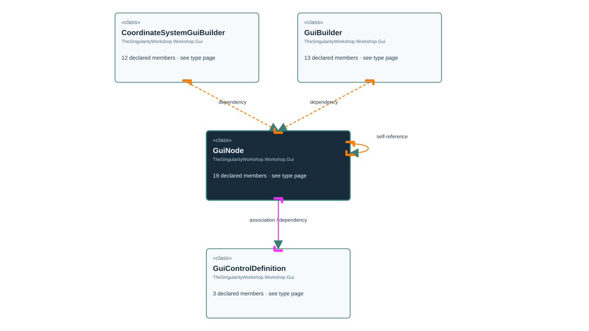

<!-- The Singularity Workshop moniker -->

# TheSingularityWorkshop.Workshop.Gui.GuiNode

> Generated from compiler-backed source analysis. Do not edit by hand.

- Repository: `TrentBest/TheSingularityWorkshop.GUI`
- Revision: [`ab72064a71716d2a2240016baaac9257896d425a`](https://github.com/TrentBest/TheSingularityWorkshop.GUI/tree/ab72064a71716d2a2240016baaac9257896d425a)
- Project: `src/Core/TheSingularityWorkshop.GUI.Core.csproj`
- Type ID: `type:TheSingularityWorkshop.GUI.Core, Version=0.1.0.0, Culture=neutral, PublicKeyToken=null:global::TheSingularityWorkshop.Workshop.Gui.GuiNode`
- Metadata name: `GuiNode`
- Kind: `class`
- Generic arity: 0

## UML diagram

## Source declarations

- [`src/Core/GuiNode.cs:9-113`](https://github.com/TrentBest/TheSingularityWorkshop.GUI/blob/ab72064a71716d2a2240016baaac9257896d425a/src/Core/GuiNode.cs#L9-113)

## Members

| Kind | Signature | Source |
|---|---|---|
| `Property` | `TheSingularityWorkshop.Workshop.Gui.GuiNode.Children` | [`src/Core/GuiNode.cs:71-71`](https://github.com/TrentBest/TheSingularityWorkshop.GUI/blob/ab72064a71716d2a2240016baaac9257896d425a/src/Core/GuiNode.cs#L71-71) |
| `Method` | `TheSingularityWorkshop.Workshop.Gui.GuiNode.Children.get` | [`src/Core/GuiNode.cs:71-71`](https://github.com/TrentBest/TheSingularityWorkshop.GUI/blob/ab72064a71716d2a2240016baaac9257896d425a/src/Core/GuiNode.cs#L71-71) |
| `Property` | `TheSingularityWorkshop.Workshop.Gui.GuiNode.Control` | [`src/Core/GuiNode.cs:67-67`](https://github.com/TrentBest/TheSingularityWorkshop.GUI/blob/ab72064a71716d2a2240016baaac9257896d425a/src/Core/GuiNode.cs#L67-67) |
| `Method` | `TheSingularityWorkshop.Workshop.Gui.GuiNode.Control.get` | [`src/Core/GuiNode.cs:67-67`](https://github.com/TrentBest/TheSingularityWorkshop.GUI/blob/ab72064a71716d2a2240016baaac9257896d425a/src/Core/GuiNode.cs#L67-67) |
| `Method` | `TheSingularityWorkshop.Workshop.Gui.GuiNode.Find(string)` | [`src/Core/GuiNode.cs:77-86`](https://github.com/TrentBest/TheSingularityWorkshop.GUI/blob/ab72064a71716d2a2240016baaac9257896d425a/src/Core/GuiNode.cs#L77-86) |
| `Method` | `TheSingularityWorkshop.Workshop.Gui.GuiNode.GuiNode(string, string, string?, string?, System.Collections.Generic.IReadOnlyDictionary<string, string>?, System.Collections.Generic.IEnumerable<TheSingularityWorkshop.Workshop.Gui.GuiNode>?, TheSingularityWorkshop.Workshop.Gui.GuiControlDefinition?)` | [`src/Core/GuiNode.cs:14-56`](https://github.com/TrentBest/TheSingularityWorkshop.GUI/blob/ab72064a71716d2a2240016baaac9257896d425a/src/Core/GuiNode.cs#L14-56) |
| `Property` | `TheSingularityWorkshop.Workshop.Gui.GuiNode.Id` | [`src/Core/GuiNode.cs:61-61`](https://github.com/TrentBest/TheSingularityWorkshop.GUI/blob/ab72064a71716d2a2240016baaac9257896d425a/src/Core/GuiNode.cs#L61-61) |
| `Method` | `TheSingularityWorkshop.Workshop.Gui.GuiNode.Id.get` | [`src/Core/GuiNode.cs:61-61`](https://github.com/TrentBest/TheSingularityWorkshop.GUI/blob/ab72064a71716d2a2240016baaac9257896d425a/src/Core/GuiNode.cs#L61-61) |
| `Method` | `TheSingularityWorkshop.Workshop.Gui.GuiNode.IsControlKind(string)` | [`src/Core/GuiNode.cs:73-74`](https://github.com/TrentBest/TheSingularityWorkshop.GUI/blob/ab72064a71716d2a2240016baaac9257896d425a/src/Core/GuiNode.cs#L73-74) |
| `Property` | `TheSingularityWorkshop.Workshop.Gui.GuiNode.Kind` | [`src/Core/GuiNode.cs:59-59`](https://github.com/TrentBest/TheSingularityWorkshop.GUI/blob/ab72064a71716d2a2240016baaac9257896d425a/src/Core/GuiNode.cs#L59-59) |
| `Method` | `TheSingularityWorkshop.Workshop.Gui.GuiNode.Kind.get` | [`src/Core/GuiNode.cs:59-59`](https://github.com/TrentBest/TheSingularityWorkshop.GUI/blob/ab72064a71716d2a2240016baaac9257896d425a/src/Core/GuiNode.cs#L59-59) |
| `Property` | `TheSingularityWorkshop.Workshop.Gui.GuiNode.Properties` | [`src/Core/GuiNode.cs:69-69`](https://github.com/TrentBest/TheSingularityWorkshop.GUI/blob/ab72064a71716d2a2240016baaac9257896d425a/src/Core/GuiNode.cs#L69-69) |
| `Method` | `TheSingularityWorkshop.Workshop.Gui.GuiNode.Properties.get` | [`src/Core/GuiNode.cs:69-69`](https://github.com/TrentBest/TheSingularityWorkshop.GUI/blob/ab72064a71716d2a2240016baaac9257896d425a/src/Core/GuiNode.cs#L69-69) |
| `Property` | `TheSingularityWorkshop.Workshop.Gui.GuiNode.Source` | [`src/Core/GuiNode.cs:65-65`](https://github.com/TrentBest/TheSingularityWorkshop.GUI/blob/ab72064a71716d2a2240016baaac9257896d425a/src/Core/GuiNode.cs#L65-65) |
| `Method` | `TheSingularityWorkshop.Workshop.Gui.GuiNode.Source.get` | [`src/Core/GuiNode.cs:65-65`](https://github.com/TrentBest/TheSingularityWorkshop.GUI/blob/ab72064a71716d2a2240016baaac9257896d425a/src/Core/GuiNode.cs#L65-65) |
| `Property` | `TheSingularityWorkshop.Workshop.Gui.GuiNode.Text` | [`src/Core/GuiNode.cs:63-63`](https://github.com/TrentBest/TheSingularityWorkshop.GUI/blob/ab72064a71716d2a2240016baaac9257896d425a/src/Core/GuiNode.cs#L63-63) |
| `Method` | `TheSingularityWorkshop.Workshop.Gui.GuiNode.Text.get` | [`src/Core/GuiNode.cs:63-63`](https://github.com/TrentBest/TheSingularityWorkshop.GUI/blob/ab72064a71716d2a2240016baaac9257896d425a/src/Core/GuiNode.cs#L63-63) |
| `Method` | `TheSingularityWorkshop.Workshop.Gui.GuiNode.TryFind(string, out TheSingularityWorkshop.Workshop.Gui.GuiNode?)` | [`src/Core/GuiNode.cs:89-112`](https://github.com/TrentBest/TheSingularityWorkshop.GUI/blob/ab72064a71716d2a2240016baaac9257896d425a/src/Core/GuiNode.cs#L89-112) |
| `Field` | `TheSingularityWorkshop.Workshop.Gui.GuiNode._children` | [`src/Core/GuiNode.cs:11-11`](https://github.com/TrentBest/TheSingularityWorkshop.GUI/blob/ab72064a71716d2a2240016baaac9257896d425a/src/Core/GuiNode.cs#L11-11) |

## Relationships

| Direction | Kind | Related type | Resolution | Evidence |
|---|---|---|---|---|
| outgoing | `Association` | `TheSingularityWorkshop.Workshop.Gui.GuiControlDefinition` | `Resolved` | [`src/Core/GuiNode.cs:67-67`](https://github.com/TrentBest/TheSingularityWorkshop.GUI/blob/ab72064a71716d2a2240016baaac9257896d425a/src/Core/GuiNode.cs#L67-67) |
| outgoing | `Association` | `TheSingularityWorkshop.Workshop.Gui.GuiNode` | `Resolved` | [`src/Core/GuiNode.cs:11-11`](https://github.com/TrentBest/TheSingularityWorkshop.GUI/blob/ab72064a71716d2a2240016baaac9257896d425a/src/Core/GuiNode.cs#L11-11) |
| outgoing | `Association` | `TheSingularityWorkshop.Workshop.Gui.GuiNode` | `Resolved` | [`src/Core/GuiNode.cs:71-71`](https://github.com/TrentBest/TheSingularityWorkshop.GUI/blob/ab72064a71716d2a2240016baaac9257896d425a/src/Core/GuiNode.cs#L71-71) |
| incoming | `Dependency` | `TheSingularityWorkshop.Workshop.Gui.CoordinateSystemGuiBuilder` | `Resolved` | [`src/Core/CoordinateSystemGuiBuilder.cs:37-37`](https://github.com/TrentBest/TheSingularityWorkshop.GUI/blob/ab72064a71716d2a2240016baaac9257896d425a/src/Core/CoordinateSystemGuiBuilder.cs#L37-37) |
| incoming | `Dependency` | `TheSingularityWorkshop.Workshop.Gui.GuiBuilder` | `Resolved` | [`src/Core/GuiBuilder.cs:70-75`](https://github.com/TrentBest/TheSingularityWorkshop.GUI/blob/ab72064a71716d2a2240016baaac9257896d425a/src/Core/GuiBuilder.cs#L70-75) |
| incoming | `Dependency` | `TheSingularityWorkshop.Workshop.Gui.GuiBuilder` | `Resolved` | [`src/Core/GuiBuilder.cs:119-153`](https://github.com/TrentBest/TheSingularityWorkshop.GUI/blob/ab72064a71716d2a2240016baaac9257896d425a/src/Core/GuiBuilder.cs#L119-153) |
| incoming | `Dependency` | `TheSingularityWorkshop.Workshop.Gui.GuiBuilder` | `Resolved` | [`src/Core/GuiBuilder.cs:81-117`](https://github.com/TrentBest/TheSingularityWorkshop.GUI/blob/ab72064a71716d2a2240016baaac9257896d425a/src/Core/GuiBuilder.cs#L81-117) |
| outgoing | `Dependency` | `TheSingularityWorkshop.Workshop.Gui.GuiControlDefinition` | `Resolved` | [`src/Core/GuiNode.cs:14-56`](https://github.com/TrentBest/TheSingularityWorkshop.GUI/blob/ab72064a71716d2a2240016baaac9257896d425a/src/Core/GuiNode.cs#L14-56) |
| outgoing | `Dependency` | `TheSingularityWorkshop.Workshop.Gui.GuiNode` | `Resolved` | [`src/Core/GuiNode.cs:14-56`](https://github.com/TrentBest/TheSingularityWorkshop.GUI/blob/ab72064a71716d2a2240016baaac9257896d425a/src/Core/GuiNode.cs#L14-56) |
| outgoing | `Dependency` | `TheSingularityWorkshop.Workshop.Gui.GuiNode` | `Resolved` | [`src/Core/GuiNode.cs:89-112`](https://github.com/TrentBest/TheSingularityWorkshop.GUI/blob/ab72064a71716d2a2240016baaac9257896d425a/src/Core/GuiNode.cs#L89-112) |
| outgoing | `Dependency` | `TheSingularityWorkshop.Workshop.Gui.GuiNode` | `Resolved` | [`src/Core/GuiNode.cs:77-86`](https://github.com/TrentBest/TheSingularityWorkshop.GUI/blob/ab72064a71716d2a2240016baaac9257896d425a/src/Core/GuiNode.cs#L77-86) |

[Back to the generated type index](index.md)

---

<!-- THE SINGULARITY WORKSHOP FOOTER -->

