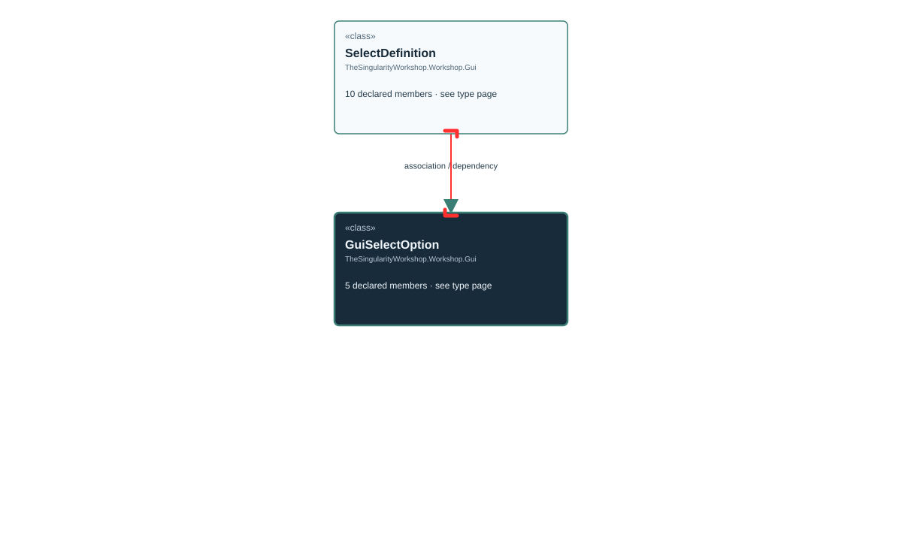

<!-- The Singularity Workshop moniker -->

# TheSingularityWorkshop.Workshop.Gui.GuiSelectOption

> Generated from compiler-backed source analysis. Do not edit by hand.

- Repository: `TrentBest/TheSingularityWorkshop.GUI`
- Revision: [`c1f4fdd938163ed0a26f4b2c5dd4d88194d5f8d9`](https://github.com/TrentBest/TheSingularityWorkshop.GUI/tree/c1f4fdd938163ed0a26f4b2c5dd4d88194d5f8d9)
- Project: `src/Core/TheSingularityWorkshop.GUI.Core.csproj`
- Type ID: `type:TheSingularityWorkshop.GUI.Core, Version=0.1.0.0, Culture=neutral, PublicKeyToken=null:global::TheSingularityWorkshop.Workshop.Gui.GuiSelectOption`
- Metadata name: `GuiSelectOption`
- Kind: `class`
- Generic arity: 0

## UML diagram

## Source declarations

- [`src/Core/GuiControlDefinition.cs:44-56`](https://github.com/TrentBest/TheSingularityWorkshop.GUI/blob/c1f4fdd938163ed0a26f4b2c5dd4d88194d5f8d9/src/Core/GuiControlDefinition.cs#L44-56)

## Members

| Kind | Signature | Source |
|---|---|---|
| `Method` | `TheSingularityWorkshop.Workshop.Gui.GuiSelectOption.GuiSelectOption(string, string)` | [`src/Core/GuiControlDefinition.cs:46-52`](https://github.com/TrentBest/TheSingularityWorkshop.GUI/blob/c1f4fdd938163ed0a26f4b2c5dd4d88194d5f8d9/src/Core/GuiControlDefinition.cs#L46-52) |
| `Property` | `TheSingularityWorkshop.Workshop.Gui.GuiSelectOption.Id` | [`src/Core/GuiControlDefinition.cs:54-54`](https://github.com/TrentBest/TheSingularityWorkshop.GUI/blob/c1f4fdd938163ed0a26f4b2c5dd4d88194d5f8d9/src/Core/GuiControlDefinition.cs#L54-54) |
| `Method` | `TheSingularityWorkshop.Workshop.Gui.GuiSelectOption.Id.get` | [`src/Core/GuiControlDefinition.cs:54-54`](https://github.com/TrentBest/TheSingularityWorkshop.GUI/blob/c1f4fdd938163ed0a26f4b2c5dd4d88194d5f8d9/src/Core/GuiControlDefinition.cs#L54-54) |
| `Property` | `TheSingularityWorkshop.Workshop.Gui.GuiSelectOption.Label` | [`src/Core/GuiControlDefinition.cs:55-55`](https://github.com/TrentBest/TheSingularityWorkshop.GUI/blob/c1f4fdd938163ed0a26f4b2c5dd4d88194d5f8d9/src/Core/GuiControlDefinition.cs#L55-55) |
| `Method` | `TheSingularityWorkshop.Workshop.Gui.GuiSelectOption.Label.get` | [`src/Core/GuiControlDefinition.cs:55-55`](https://github.com/TrentBest/TheSingularityWorkshop.GUI/blob/c1f4fdd938163ed0a26f4b2c5dd4d88194d5f8d9/src/Core/GuiControlDefinition.cs#L55-55) |

## Relationships

| Direction | Kind | Related type | Resolution | Evidence |
|---|---|---|---|---|
| incoming | `Association` | `TheSingularityWorkshop.Workshop.Gui.SelectDefinition` | `Resolved` | [`src/Core/GuiControlDefinition.cs:61-61`](https://github.com/TrentBest/TheSingularityWorkshop.GUI/blob/c1f4fdd938163ed0a26f4b2c5dd4d88194d5f8d9/src/Core/GuiControlDefinition.cs#L61-61) |
| incoming | `Association` | `TheSingularityWorkshop.Workshop.Gui.SelectDefinition` | `Resolved` | [`src/Core/GuiControlDefinition.cs:89-89`](https://github.com/TrentBest/TheSingularityWorkshop.GUI/blob/c1f4fdd938163ed0a26f4b2c5dd4d88194d5f8d9/src/Core/GuiControlDefinition.cs#L89-89) |
| incoming | `Dependency` | `TheSingularityWorkshop.Workshop.Gui.SelectDefinition` | `Resolved` | [`src/Core/GuiControlDefinition.cs:63-87`](https://github.com/TrentBest/TheSingularityWorkshop.GUI/blob/c1f4fdd938163ed0a26f4b2c5dd4d88194d5f8d9/src/Core/GuiControlDefinition.cs#L63-87) |

[Back to the generated type index](index.md)

---

<!-- THE SINGULARITY WORKSHOP FOOTER -->

