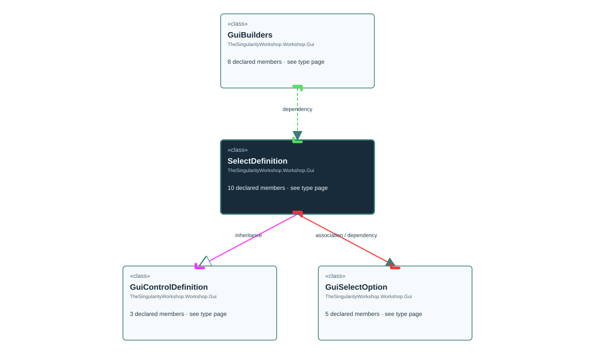

<!-- The Singularity Workshop moniker -->

# TheSingularityWorkshop.Workshop.Gui.SelectDefinition

> Generated from compiler-backed source analysis. Do not edit by hand.

- Repository: `TrentBest/TheSingularityWorkshop.GUI`
- Revision: [`4fa33208ca046ee81f02d3dc3f244ffe960bcec8`](https://github.com/TrentBest/TheSingularityWorkshop.GUI/tree/4fa33208ca046ee81f02d3dc3f244ffe960bcec8)
- Project: `src/Core/TheSingularityWorkshop.GUI.Core.csproj`
- Type ID: `type:TheSingularityWorkshop.GUI.Core, Version=0.1.0.0, Culture=neutral, PublicKeyToken=null:global::TheSingularityWorkshop.Workshop.Gui.SelectDefinition`
- Metadata name: `SelectDefinition`
- Kind: `class`
- Generic arity: 0

## UML diagram

## Source declarations

- [`src/Core/GuiControlDefinition.cs:59-93`](https://github.com/TrentBest/TheSingularityWorkshop.GUI/blob/4fa33208ca046ee81f02d3dc3f244ffe960bcec8/src/Core/GuiControlDefinition.cs#L59-93)

## Members

| Kind | Signature | Source |
|---|---|---|
| `Property` | `TheSingularityWorkshop.Workshop.Gui.SelectDefinition.IsReadOnly` | [`src/Core/GuiControlDefinition.cs:92-92`](https://github.com/TrentBest/TheSingularityWorkshop.GUI/blob/4fa33208ca046ee81f02d3dc3f244ffe960bcec8/src/Core/GuiControlDefinition.cs#L92-92) |
| `Method` | `TheSingularityWorkshop.Workshop.Gui.SelectDefinition.IsReadOnly.get` | [`src/Core/GuiControlDefinition.cs:92-92`](https://github.com/TrentBest/TheSingularityWorkshop.GUI/blob/4fa33208ca046ee81f02d3dc3f244ffe960bcec8/src/Core/GuiControlDefinition.cs#L92-92) |
| `Property` | `TheSingularityWorkshop.Workshop.Gui.SelectDefinition.Options` | [`src/Core/GuiControlDefinition.cs:89-89`](https://github.com/TrentBest/TheSingularityWorkshop.GUI/blob/4fa33208ca046ee81f02d3dc3f244ffe960bcec8/src/Core/GuiControlDefinition.cs#L89-89) |
| `Method` | `TheSingularityWorkshop.Workshop.Gui.SelectDefinition.Options.get` | [`src/Core/GuiControlDefinition.cs:89-89`](https://github.com/TrentBest/TheSingularityWorkshop.GUI/blob/4fa33208ca046ee81f02d3dc3f244ffe960bcec8/src/Core/GuiControlDefinition.cs#L89-89) |
| `Method` | `TheSingularityWorkshop.Workshop.Gui.SelectDefinition.SelectDefinition(System.Collections.Generic.IEnumerable<TheSingularityWorkshop.Workshop.Gui.GuiSelectOption>, string, string, string?, bool)` | [`src/Core/GuiControlDefinition.cs:63-87`](https://github.com/TrentBest/TheSingularityWorkshop.GUI/blob/4fa33208ca046ee81f02d3dc3f244ffe960bcec8/src/Core/GuiControlDefinition.cs#L63-87) |
| `Property` | `TheSingularityWorkshop.Workshop.Gui.SelectDefinition.SelectedOptionId` | [`src/Core/GuiControlDefinition.cs:90-90`](https://github.com/TrentBest/TheSingularityWorkshop.GUI/blob/4fa33208ca046ee81f02d3dc3f244ffe960bcec8/src/Core/GuiControlDefinition.cs#L90-90) |
| `Method` | `TheSingularityWorkshop.Workshop.Gui.SelectDefinition.SelectedOptionId.get` | [`src/Core/GuiControlDefinition.cs:90-90`](https://github.com/TrentBest/TheSingularityWorkshop.GUI/blob/4fa33208ca046ee81f02d3dc3f244ffe960bcec8/src/Core/GuiControlDefinition.cs#L90-90) |
| `Property` | `TheSingularityWorkshop.Workshop.Gui.SelectDefinition.ValidationMessage` | [`src/Core/GuiControlDefinition.cs:91-91`](https://github.com/TrentBest/TheSingularityWorkshop.GUI/blob/4fa33208ca046ee81f02d3dc3f244ffe960bcec8/src/Core/GuiControlDefinition.cs#L91-91) |
| `Method` | `TheSingularityWorkshop.Workshop.Gui.SelectDefinition.ValidationMessage.get` | [`src/Core/GuiControlDefinition.cs:91-91`](https://github.com/TrentBest/TheSingularityWorkshop.GUI/blob/4fa33208ca046ee81f02d3dc3f244ffe960bcec8/src/Core/GuiControlDefinition.cs#L91-91) |
| `Field` | `TheSingularityWorkshop.Workshop.Gui.SelectDefinition._options` | [`src/Core/GuiControlDefinition.cs:61-61`](https://github.com/TrentBest/TheSingularityWorkshop.GUI/blob/4fa33208ca046ee81f02d3dc3f244ffe960bcec8/src/Core/GuiControlDefinition.cs#L61-61) |

## Relationships

| Direction | Kind | Related type | Resolution | Evidence |
|---|---|---|---|---|
| outgoing | `Inheritance` | `TheSingularityWorkshop.Workshop.Gui.GuiControlDefinition` | `Resolved` | [`src/Core/GuiControlDefinition.cs:59-93`](https://github.com/TrentBest/TheSingularityWorkshop.GUI/blob/4fa33208ca046ee81f02d3dc3f244ffe960bcec8/src/Core/GuiControlDefinition.cs#L59-93) |
| outgoing | `Association` | `TheSingularityWorkshop.Workshop.Gui.GuiSelectOption` | `Resolved` | [`src/Core/GuiControlDefinition.cs:61-61`](https://github.com/TrentBest/TheSingularityWorkshop.GUI/blob/4fa33208ca046ee81f02d3dc3f244ffe960bcec8/src/Core/GuiControlDefinition.cs#L61-61) |
| outgoing | `Association` | `TheSingularityWorkshop.Workshop.Gui.GuiSelectOption` | `Resolved` | [`src/Core/GuiControlDefinition.cs:89-89`](https://github.com/TrentBest/TheSingularityWorkshop.GUI/blob/4fa33208ca046ee81f02d3dc3f244ffe960bcec8/src/Core/GuiControlDefinition.cs#L89-89) |
| incoming | `Dependency` | `TheSingularityWorkshop.Workshop.Gui.GuiBuilders` | `Resolved` | [`src/Core/GuiBuilders.cs:28-29`](https://github.com/TrentBest/TheSingularityWorkshop.GUI/blob/4fa33208ca046ee81f02d3dc3f244ffe960bcec8/src/Core/GuiBuilders.cs#L28-29) |
| outgoing | `Dependency` | `TheSingularityWorkshop.Workshop.Gui.GuiSelectOption` | `Resolved` | [`src/Core/GuiControlDefinition.cs:63-87`](https://github.com/TrentBest/TheSingularityWorkshop.GUI/blob/4fa33208ca046ee81f02d3dc3f244ffe960bcec8/src/Core/GuiControlDefinition.cs#L63-87) |

[Back to the generated type index](index.md)

---

<!-- THE SINGULARITY WORKSHOP FOOTER -->

