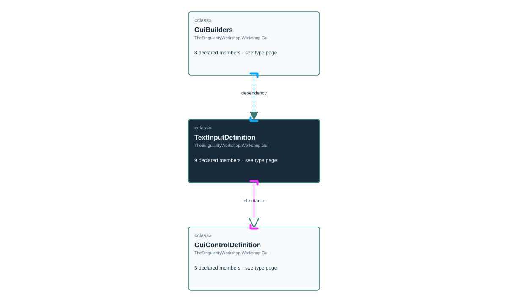

<!-- The Singularity Workshop moniker -->

# TheSingularityWorkshop.Workshop.Gui.TextInputDefinition

> Generated from compiler-backed source analysis. Do not edit by hand.

- Repository: `TrentBest/TheSingularityWorkshop.GUI`
- Revision: [`440eb79e15bf4b14ffe94389c39f0fe067f4b709`](https://github.com/TrentBest/TheSingularityWorkshop.GUI/tree/440eb79e15bf4b14ffe94389c39f0fe067f4b709)
- Project: `src/Core/TheSingularityWorkshop.GUI.Core.csproj`
- Type ID: `type:TheSingularityWorkshop.GUI.Core, Version=0.1.0.0, Culture=neutral, PublicKeyToken=null:global::TheSingularityWorkshop.Workshop.Gui.TextInputDefinition`
- Metadata name: `TextInputDefinition`
- Kind: `class`
- Generic arity: 0

## UML diagram

## Source declarations

- [`src/Core/GuiControlDefinition.cs:22-41`](https://github.com/TrentBest/TheSingularityWorkshop.GUI/blob/440eb79e15bf4b14ffe94389c39f0fe067f4b709/src/Core/GuiControlDefinition.cs#L22-41)

## Members

| Kind | Signature | Source |
|---|---|---|
| `Property` | `TheSingularityWorkshop.Workshop.Gui.TextInputDefinition.IsReadOnly` | [`src/Core/GuiControlDefinition.cs:40-40`](https://github.com/TrentBest/TheSingularityWorkshop.GUI/blob/440eb79e15bf4b14ffe94389c39f0fe067f4b709/src/Core/GuiControlDefinition.cs#L40-40) |
| `Method` | `TheSingularityWorkshop.Workshop.Gui.TextInputDefinition.IsReadOnly.get` | [`src/Core/GuiControlDefinition.cs:40-40`](https://github.com/TrentBest/TheSingularityWorkshop.GUI/blob/440eb79e15bf4b14ffe94389c39f0fe067f4b709/src/Core/GuiControlDefinition.cs#L40-40) |
| `Property` | `TheSingularityWorkshop.Workshop.Gui.TextInputDefinition.Placeholder` | [`src/Core/GuiControlDefinition.cs:38-38`](https://github.com/TrentBest/TheSingularityWorkshop.GUI/blob/440eb79e15bf4b14ffe94389c39f0fe067f4b709/src/Core/GuiControlDefinition.cs#L38-38) |
| `Method` | `TheSingularityWorkshop.Workshop.Gui.TextInputDefinition.Placeholder.get` | [`src/Core/GuiControlDefinition.cs:38-38`](https://github.com/TrentBest/TheSingularityWorkshop.GUI/blob/440eb79e15bf4b14ffe94389c39f0fe067f4b709/src/Core/GuiControlDefinition.cs#L38-38) |
| `Method` | `TheSingularityWorkshop.Workshop.Gui.TextInputDefinition.TextInputDefinition(string, string, string?, string?, bool)` | [`src/Core/GuiControlDefinition.cs:24-35`](https://github.com/TrentBest/TheSingularityWorkshop.GUI/blob/440eb79e15bf4b14ffe94389c39f0fe067f4b709/src/Core/GuiControlDefinition.cs#L24-35) |
| `Property` | `TheSingularityWorkshop.Workshop.Gui.TextInputDefinition.ValidationMessage` | [`src/Core/GuiControlDefinition.cs:39-39`](https://github.com/TrentBest/TheSingularityWorkshop.GUI/blob/440eb79e15bf4b14ffe94389c39f0fe067f4b709/src/Core/GuiControlDefinition.cs#L39-39) |
| `Method` | `TheSingularityWorkshop.Workshop.Gui.TextInputDefinition.ValidationMessage.get` | [`src/Core/GuiControlDefinition.cs:39-39`](https://github.com/TrentBest/TheSingularityWorkshop.GUI/blob/440eb79e15bf4b14ffe94389c39f0fe067f4b709/src/Core/GuiControlDefinition.cs#L39-39) |
| `Property` | `TheSingularityWorkshop.Workshop.Gui.TextInputDefinition.Value` | [`src/Core/GuiControlDefinition.cs:37-37`](https://github.com/TrentBest/TheSingularityWorkshop.GUI/blob/440eb79e15bf4b14ffe94389c39f0fe067f4b709/src/Core/GuiControlDefinition.cs#L37-37) |
| `Method` | `TheSingularityWorkshop.Workshop.Gui.TextInputDefinition.Value.get` | [`src/Core/GuiControlDefinition.cs:37-37`](https://github.com/TrentBest/TheSingularityWorkshop.GUI/blob/440eb79e15bf4b14ffe94389c39f0fe067f4b709/src/Core/GuiControlDefinition.cs#L37-37) |

## Relationships

| Direction | Kind | Related type | Resolution | Evidence |
|---|---|---|---|---|
| outgoing | `Inheritance` | `TheSingularityWorkshop.Workshop.Gui.GuiControlDefinition` | `Resolved` | [`src/Core/GuiControlDefinition.cs:22-41`](https://github.com/TrentBest/TheSingularityWorkshop.GUI/blob/440eb79e15bf4b14ffe94389c39f0fe067f4b709/src/Core/GuiControlDefinition.cs#L22-41) |
| incoming | `Dependency` | `TheSingularityWorkshop.Workshop.Gui.GuiBuilders` | `Resolved` | [`src/Core/GuiBuilders.cs:17-18`](https://github.com/TrentBest/TheSingularityWorkshop.GUI/blob/440eb79e15bf4b14ffe94389c39f0fe067f4b709/src/Core/GuiBuilders.cs#L17-18) |

[Back to the generated type index](index.md)

---

<!-- THE SINGULARITY WORKSHOP FOOTER -->

