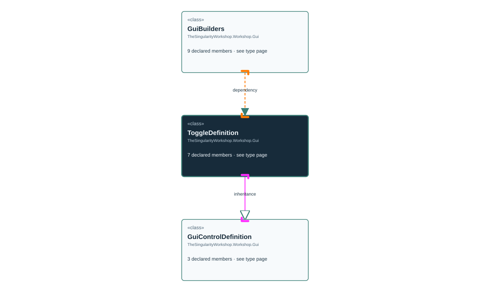

<!-- The Singularity Workshop moniker -->

# TheSingularityWorkshop.Workshop.Gui.ToggleDefinition

> Generated from compiler-backed source analysis. Do not edit by hand.

- Repository: `TrentBest/TheSingularityWorkshop.GUI`
- Revision: [`644c7a0c58665f16199da7181b392162475c99f8`](https://github.com/TrentBest/TheSingularityWorkshop.GUI/tree/644c7a0c58665f16199da7181b392162475c99f8)
- Project: `src/Core/TheSingularityWorkshop.GUI.Core.csproj`
- Type ID: `type:TheSingularityWorkshop.GUI.Core, Version=0.1.0.0, Culture=neutral, PublicKeyToken=null:global::TheSingularityWorkshop.Workshop.Gui.ToggleDefinition`
- Metadata name: `ToggleDefinition`
- Kind: `class`
- Generic arity: 0

## UML diagram

## Source declarations

- [`src/Core/GuiControlDefinition.cs:96-109`](https://github.com/TrentBest/TheSingularityWorkshop.GUI/blob/644c7a0c58665f16199da7181b392162475c99f8/src/Core/GuiControlDefinition.cs#L96-109)

## Members

| Kind | Signature | Source |
|---|---|---|
| `Property` | `TheSingularityWorkshop.Workshop.Gui.ToggleDefinition.IsChecked` | [`src/Core/GuiControlDefinition.cs:106-106`](https://github.com/TrentBest/TheSingularityWorkshop.GUI/blob/644c7a0c58665f16199da7181b392162475c99f8/src/Core/GuiControlDefinition.cs#L106-106) |
| `Method` | `TheSingularityWorkshop.Workshop.Gui.ToggleDefinition.IsChecked.get` | [`src/Core/GuiControlDefinition.cs:106-106`](https://github.com/TrentBest/TheSingularityWorkshop.GUI/blob/644c7a0c58665f16199da7181b392162475c99f8/src/Core/GuiControlDefinition.cs#L106-106) |
| `Property` | `TheSingularityWorkshop.Workshop.Gui.ToggleDefinition.IsReadOnly` | [`src/Core/GuiControlDefinition.cs:108-108`](https://github.com/TrentBest/TheSingularityWorkshop.GUI/blob/644c7a0c58665f16199da7181b392162475c99f8/src/Core/GuiControlDefinition.cs#L108-108) |
| `Method` | `TheSingularityWorkshop.Workshop.Gui.ToggleDefinition.IsReadOnly.get` | [`src/Core/GuiControlDefinition.cs:108-108`](https://github.com/TrentBest/TheSingularityWorkshop.GUI/blob/644c7a0c58665f16199da7181b392162475c99f8/src/Core/GuiControlDefinition.cs#L108-108) |
| `Method` | `TheSingularityWorkshop.Workshop.Gui.ToggleDefinition.ToggleDefinition(bool, string, string?, bool)` | [`src/Core/GuiControlDefinition.cs:98-104`](https://github.com/TrentBest/TheSingularityWorkshop.GUI/blob/644c7a0c58665f16199da7181b392162475c99f8/src/Core/GuiControlDefinition.cs#L98-104) |
| `Property` | `TheSingularityWorkshop.Workshop.Gui.ToggleDefinition.ValidationMessage` | [`src/Core/GuiControlDefinition.cs:107-107`](https://github.com/TrentBest/TheSingularityWorkshop.GUI/blob/644c7a0c58665f16199da7181b392162475c99f8/src/Core/GuiControlDefinition.cs#L107-107) |
| `Method` | `TheSingularityWorkshop.Workshop.Gui.ToggleDefinition.ValidationMessage.get` | [`src/Core/GuiControlDefinition.cs:107-107`](https://github.com/TrentBest/TheSingularityWorkshop.GUI/blob/644c7a0c58665f16199da7181b392162475c99f8/src/Core/GuiControlDefinition.cs#L107-107) |

## Relationships

| Direction | Kind | Related type | Resolution | Evidence |
|---|---|---|---|---|
| outgoing | `Inheritance` | `TheSingularityWorkshop.Workshop.Gui.GuiControlDefinition` | `Resolved` | [`src/Core/GuiControlDefinition.cs:96-109`](https://github.com/TrentBest/TheSingularityWorkshop.GUI/blob/644c7a0c58665f16199da7181b392162475c99f8/src/Core/GuiControlDefinition.cs#L96-109) |
| incoming | `Dependency` | `TheSingularityWorkshop.Workshop.Gui.GuiBuilders` | `Resolved` | [`src/Core/GuiBuilders.cs:23-24`](https://github.com/TrentBest/TheSingularityWorkshop.GUI/blob/644c7a0c58665f16199da7181b392162475c99f8/src/Core/GuiBuilders.cs#L23-24) |

[Back to the generated type index](index.md)

---

<!-- THE SINGULARITY WORKSHOP FOOTER -->

