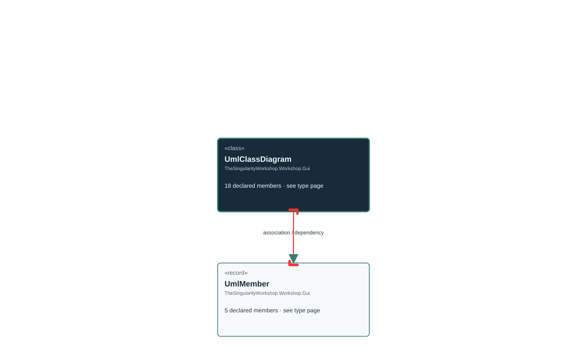

<!-- The Singularity Workshop moniker -->

# TheSingularityWorkshop.Workshop.Gui.UmlClassDiagram

> Generated from compiler-backed source analysis. Do not edit by hand.

- Repository: `TrentBest/TheSingularityWorkshop.GUI`
- Revision: [`f48dd15256521c88fad88371742c89d5fd1d326f`](https://github.com/TrentBest/TheSingularityWorkshop.GUI/tree/f48dd15256521c88fad88371742c89d5fd1d326f)
- Project: `src/Core/TheSingularityWorkshop.GUI.Core.csproj`
- Type ID: `type:TheSingularityWorkshop.GUI.Core, Version=0.1.0.0, Culture=neutral, PublicKeyToken=null:global::TheSingularityWorkshop.Workshop.Gui.UmlClassDiagram`
- Metadata name: `UmlClassDiagram`
- Kind: `class`
- Generic arity: 0

## UML diagram

## Source declarations

- [`src/Core/UmlClassDiagram.cs:9-54`](https://github.com/TrentBest/TheSingularityWorkshop.GUI/blob/f48dd15256521c88fad88371742c89d5fd1d326f/src/Core/UmlClassDiagram.cs#L9-54)

## Members

| Kind | Signature | Source |
|---|---|---|
| `Property` | `TheSingularityWorkshop.Workshop.Gui.UmlClassDiagram.DeclaredRelationships` | [`src/Core/UmlClassDiagram.cs:49-49`](https://github.com/TrentBest/TheSingularityWorkshop.GUI/blob/f48dd15256521c88fad88371742c89d5fd1d326f/src/Core/UmlClassDiagram.cs#L49-49) |
| `Method` | `TheSingularityWorkshop.Workshop.Gui.UmlClassDiagram.DeclaredRelationships.get` | [`src/Core/UmlClassDiagram.cs:49-49`](https://github.com/TrentBest/TheSingularityWorkshop.GUI/blob/f48dd15256521c88fad88371742c89d5fd1d326f/src/Core/UmlClassDiagram.cs#L49-49) |
| `Property` | `TheSingularityWorkshop.Workshop.Gui.UmlClassDiagram.Description` | [`src/Core/UmlClassDiagram.cs:50-50`](https://github.com/TrentBest/TheSingularityWorkshop.GUI/blob/f48dd15256521c88fad88371742c89d5fd1d326f/src/Core/UmlClassDiagram.cs#L50-50) |
| `Method` | `TheSingularityWorkshop.Workshop.Gui.UmlClassDiagram.Description.get` | [`src/Core/UmlClassDiagram.cs:50-50`](https://github.com/TrentBest/TheSingularityWorkshop.GUI/blob/f48dd15256521c88fad88371742c89d5fd1d326f/src/Core/UmlClassDiagram.cs#L50-50) |
| `Property` | `TheSingularityWorkshop.Workshop.Gui.UmlClassDiagram.Fields` | [`src/Core/UmlClassDiagram.cs:45-45`](https://github.com/TrentBest/TheSingularityWorkshop.GUI/blob/f48dd15256521c88fad88371742c89d5fd1d326f/src/Core/UmlClassDiagram.cs#L45-45) |
| `Method` | `TheSingularityWorkshop.Workshop.Gui.UmlClassDiagram.Fields.get` | [`src/Core/UmlClassDiagram.cs:45-45`](https://github.com/TrentBest/TheSingularityWorkshop.GUI/blob/f48dd15256521c88fad88371742c89d5fd1d326f/src/Core/UmlClassDiagram.cs#L45-45) |
| `Property` | `TheSingularityWorkshop.Workshop.Gui.UmlClassDiagram.Kind` | [`src/Core/UmlClassDiagram.cs:43-43`](https://github.com/TrentBest/TheSingularityWorkshop.GUI/blob/f48dd15256521c88fad88371742c89d5fd1d326f/src/Core/UmlClassDiagram.cs#L43-43) |
| `Method` | `TheSingularityWorkshop.Workshop.Gui.UmlClassDiagram.Kind.get` | [`src/Core/UmlClassDiagram.cs:43-43`](https://github.com/TrentBest/TheSingularityWorkshop.GUI/blob/f48dd15256521c88fad88371742c89d5fd1d326f/src/Core/UmlClassDiagram.cs#L43-43) |
| `Property` | `TheSingularityWorkshop.Workshop.Gui.UmlClassDiagram.Name` | [`src/Core/UmlClassDiagram.cs:42-42`](https://github.com/TrentBest/TheSingularityWorkshop.GUI/blob/f48dd15256521c88fad88371742c89d5fd1d326f/src/Core/UmlClassDiagram.cs#L42-42) |
| `Method` | `TheSingularityWorkshop.Workshop.Gui.UmlClassDiagram.Name.get` | [`src/Core/UmlClassDiagram.cs:42-42`](https://github.com/TrentBest/TheSingularityWorkshop.GUI/blob/f48dd15256521c88fad88371742c89d5fd1d326f/src/Core/UmlClassDiagram.cs#L42-42) |
| `Property` | `TheSingularityWorkshop.Workshop.Gui.UmlClassDiagram.Namespace` | [`src/Core/UmlClassDiagram.cs:44-44`](https://github.com/TrentBest/TheSingularityWorkshop.GUI/blob/f48dd15256521c88fad88371742c89d5fd1d326f/src/Core/UmlClassDiagram.cs#L44-44) |
| `Method` | `TheSingularityWorkshop.Workshop.Gui.UmlClassDiagram.Namespace.get` | [`src/Core/UmlClassDiagram.cs:44-44`](https://github.com/TrentBest/TheSingularityWorkshop.GUI/blob/f48dd15256521c88fad88371742c89d5fd1d326f/src/Core/UmlClassDiagram.cs#L44-44) |
| `Property` | `TheSingularityWorkshop.Workshop.Gui.UmlClassDiagram.Operations` | [`src/Core/UmlClassDiagram.cs:47-47`](https://github.com/TrentBest/TheSingularityWorkshop.GUI/blob/f48dd15256521c88fad88371742c89d5fd1d326f/src/Core/UmlClassDiagram.cs#L47-47) |
| `Method` | `TheSingularityWorkshop.Workshop.Gui.UmlClassDiagram.Operations.get` | [`src/Core/UmlClassDiagram.cs:47-47`](https://github.com/TrentBest/TheSingularityWorkshop.GUI/blob/f48dd15256521c88fad88371742c89d5fd1d326f/src/Core/UmlClassDiagram.cs#L47-47) |
| `Property` | `TheSingularityWorkshop.Workshop.Gui.UmlClassDiagram.Properties` | [`src/Core/UmlClassDiagram.cs:46-46`](https://github.com/TrentBest/TheSingularityWorkshop.GUI/blob/f48dd15256521c88fad88371742c89d5fd1d326f/src/Core/UmlClassDiagram.cs#L46-46) |
| `Method` | `TheSingularityWorkshop.Workshop.Gui.UmlClassDiagram.Properties.get` | [`src/Core/UmlClassDiagram.cs:46-46`](https://github.com/TrentBest/TheSingularityWorkshop.GUI/blob/f48dd15256521c88fad88371742c89d5fd1d326f/src/Core/UmlClassDiagram.cs#L46-46) |
| `Method` | `TheSingularityWorkshop.Workshop.Gui.UmlClassDiagram.Snapshot(System.Collections.Generic.IEnumerable<TheSingularityWorkshop.Workshop.Gui.UmlMember>?)` | [`src/Core/UmlClassDiagram.cs:52-53`](https://github.com/TrentBest/TheSingularityWorkshop.GUI/blob/f48dd15256521c88fad88371742c89d5fd1d326f/src/Core/UmlClassDiagram.cs#L52-53) |
| `Method` | `TheSingularityWorkshop.Workshop.Gui.UmlClassDiagram.UmlClassDiagram(string, string, string?, System.Collections.Generic.IEnumerable<TheSingularityWorkshop.Workshop.Gui.UmlMember>?, System.Collections.Generic.IEnumerable<TheSingularityWorkshop.Workshop.Gui.UmlMember>?, System.Collections.Generic.IEnumerable<TheSingularityWorkshop.Workshop.Gui.UmlMember>?, System.Collections.Generic.IEnumerable<string>?, string?)` | [`src/Core/UmlClassDiagram.cs:11-40`](https://github.com/TrentBest/TheSingularityWorkshop.GUI/blob/f48dd15256521c88fad88371742c89d5fd1d326f/src/Core/UmlClassDiagram.cs#L11-40) |

## Relationships

| Direction | Kind | Related type | Resolution | Evidence |
|---|---|---|---|---|
| outgoing | `Association` | `TheSingularityWorkshop.Workshop.Gui.UmlMember` | `Resolved` | [`src/Core/UmlClassDiagram.cs:45-45`](https://github.com/TrentBest/TheSingularityWorkshop.GUI/blob/f48dd15256521c88fad88371742c89d5fd1d326f/src/Core/UmlClassDiagram.cs#L45-45) |
| outgoing | `Association` | `TheSingularityWorkshop.Workshop.Gui.UmlMember` | `Resolved` | [`src/Core/UmlClassDiagram.cs:47-47`](https://github.com/TrentBest/TheSingularityWorkshop.GUI/blob/f48dd15256521c88fad88371742c89d5fd1d326f/src/Core/UmlClassDiagram.cs#L47-47) |
| outgoing | `Association` | `TheSingularityWorkshop.Workshop.Gui.UmlMember` | `Resolved` | [`src/Core/UmlClassDiagram.cs:46-46`](https://github.com/TrentBest/TheSingularityWorkshop.GUI/blob/f48dd15256521c88fad88371742c89d5fd1d326f/src/Core/UmlClassDiagram.cs#L46-46) |
| outgoing | `Dependency` | `TheSingularityWorkshop.Workshop.Gui.UmlMember` | `Resolved` | [`src/Core/UmlClassDiagram.cs:11-40`](https://github.com/TrentBest/TheSingularityWorkshop.GUI/blob/f48dd15256521c88fad88371742c89d5fd1d326f/src/Core/UmlClassDiagram.cs#L11-40) |
| outgoing | `Dependency` | `TheSingularityWorkshop.Workshop.Gui.UmlMember` | `Resolved` | [`src/Core/UmlClassDiagram.cs:52-53`](https://github.com/TrentBest/TheSingularityWorkshop.GUI/blob/f48dd15256521c88fad88371742c89d5fd1d326f/src/Core/UmlClassDiagram.cs#L52-53) |
| outgoing | `Dependency` | `TheSingularityWorkshop.Workshop.Gui.UmlMember` | `Resolved` | [`src/Core/UmlClassDiagram.cs:11-40`](https://github.com/TrentBest/TheSingularityWorkshop.GUI/blob/f48dd15256521c88fad88371742c89d5fd1d326f/src/Core/UmlClassDiagram.cs#L11-40) |
| outgoing | `Dependency` | `TheSingularityWorkshop.Workshop.Gui.UmlMember` | `Resolved` | [`src/Core/UmlClassDiagram.cs:11-40`](https://github.com/TrentBest/TheSingularityWorkshop.GUI/blob/f48dd15256521c88fad88371742c89d5fd1d326f/src/Core/UmlClassDiagram.cs#L11-40) |
| outgoing | `Dependency` | `TheSingularityWorkshop.Workshop.Gui.UmlMember` | `Resolved` | [`src/Core/UmlClassDiagram.cs:52-53`](https://github.com/TrentBest/TheSingularityWorkshop.GUI/blob/f48dd15256521c88fad88371742c89d5fd1d326f/src/Core/UmlClassDiagram.cs#L52-53) |

[Back to the generated type index](index.md)

---

<!-- THE SINGULARITY WORKSHOP FOOTER -->

